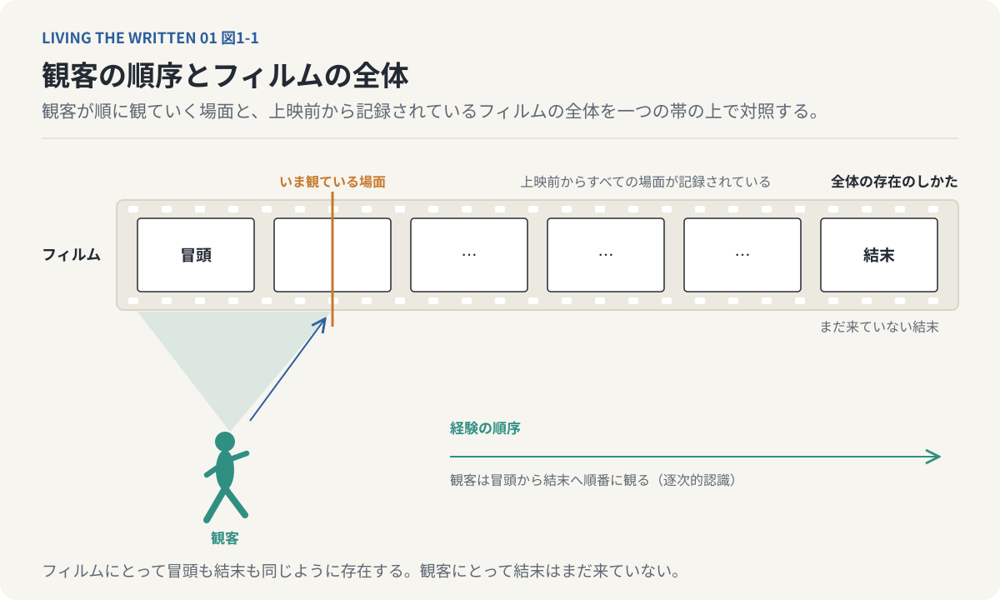
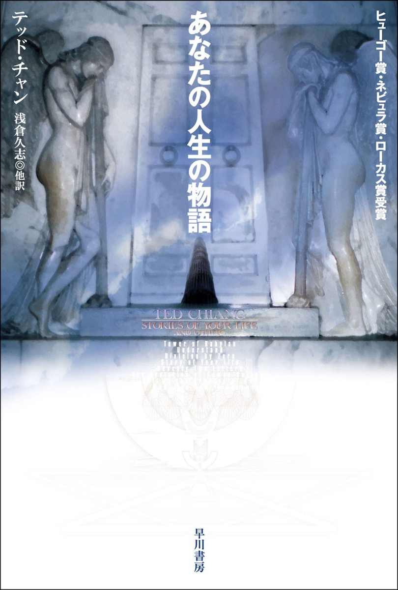
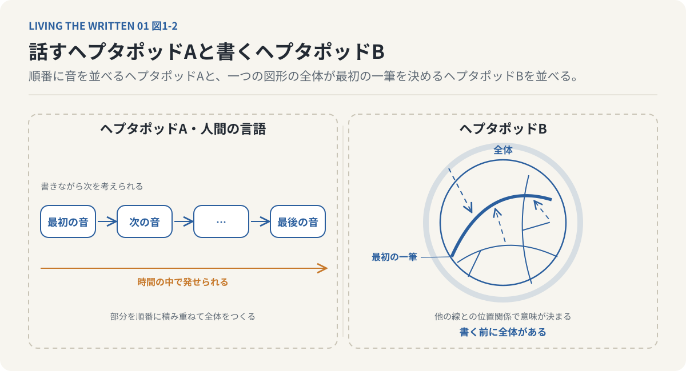
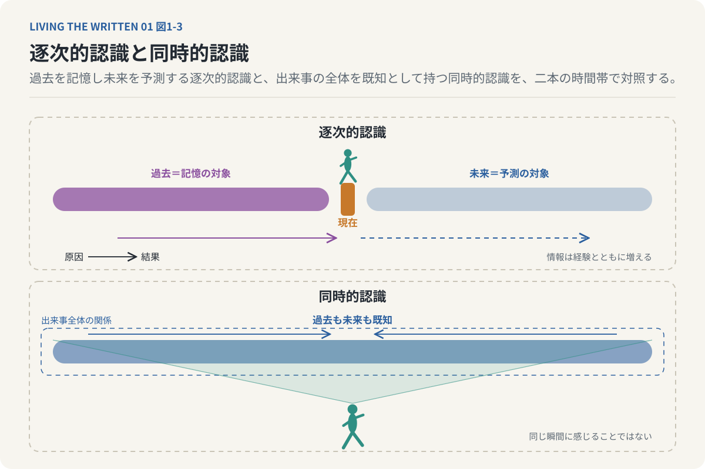
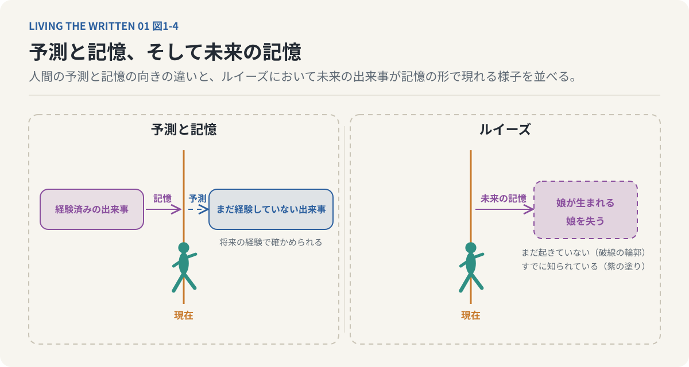
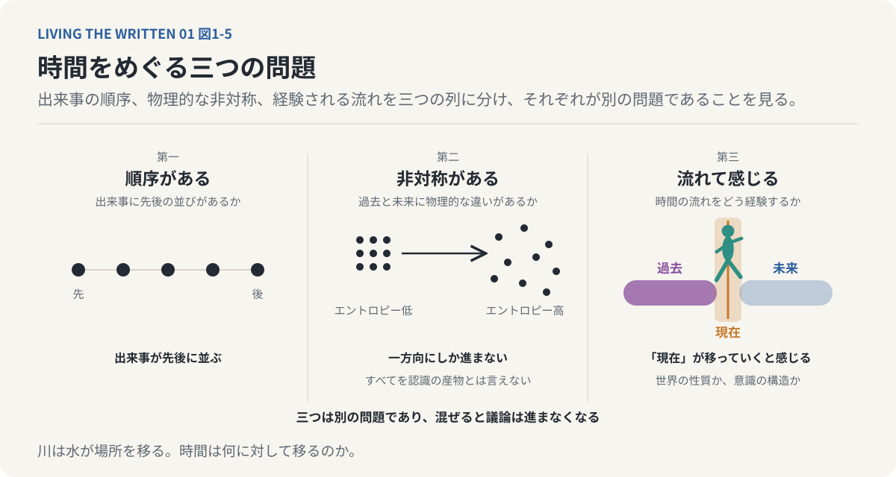
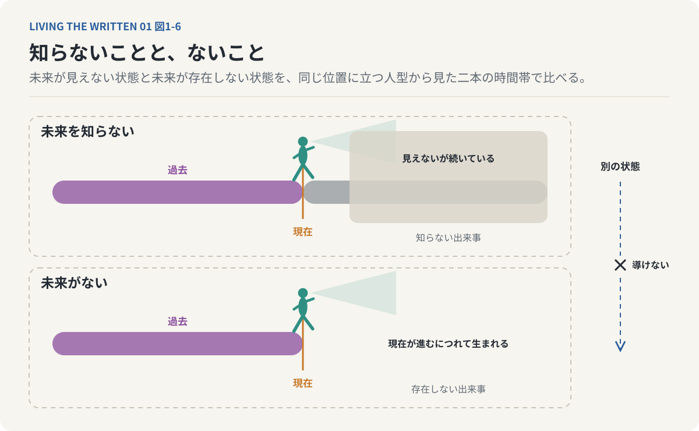

# 第1回　時間は流れているのか、それとも私たちが流しているのか

## 『あなたの人生の物語』と言語がつくる時間

<!-- NAV:TOP -->
[連載目次](../README.md) | [第2回 →](02-causality-and-teleology.md)
<!-- /NAV -->

一画目を引く前に文の終わりまで決まっていなければ書けない文字がある。その文字を学んだ言語学者はまだ生まれていない娘の一生を記憶として持つようになる。娘が生まれる日も、娘を失う日も。

**時間が過去から未来へ流れているのか、それとも私たちが出来事を過去から未来へと順番に認識しているだけなのか。**

前者は世界そのものの性質についての主張で、後者は世界を認識する側の性質についての主張である。言語と時間と認識の関係からこの区別を考える。

### 順番にしか知ることができない

私たちは昨日食べたものを思い出せる。かつて交わした会話や子どもの頃に訪れた場所も同じである。一方で明日何を食べるか、十年後に何を後悔するかは思い出せない。未来は予測するしかない。何かを決めるとき私たちは過去の経験を参照して未来の結果を予測し、現在において行為する。

出来事は一つずつ順に経験される。ある出来事を経験した後に別の出来事を経験し、ある情報を得た後に次の情報を得て、ある判断を下した後にようやくその結果を知る。出来事を順番に知っていく認識の形を、この連載では逐次的認識と呼ぶ。私たちにとってこの順序は世界の構造そのものに見える。

だが経験の順序と世界の構造は、論理的には別のものとして扱える。映画館を思い浮かべるとよい。観客は冒頭から結末へと順番に観る。結末はまだ来ていない。ところが完成した映画のすべての場面は、上映が始まる前から記録されている。フィルムにとって冒頭も結末も同じように存在する。

*図1-1：観客は冒頭から結末へ順番に観るが、フィルムにはすべての場面が上映前から記録されている。経験の順序と出来事全体の存在のしかたは別のものとして扱える。現実の世界が完成した映画だという主張ではない。*

もちろん現実の世界が映画のようにあらかじめ完成していると言えるわけではない。この比喩が示すのは出来事を経験する順序と、出来事全体の存在のしかたを分けて考えられることまでである。テッド・チャンの『あなたの人生の物語』[^chiang-story]はこの区別を異星人の言語を通じて描く。

*書影：『あなたの人生の物語』（早川書房、ハヤカワ文庫SF）[^chiang-story]*

### 言葉が先か、考えが先か

言葉は考えを他人へ伝える道具だと私たちは思っている。まず考えがあってそれを言葉にする。けれど私たちは言葉を使って物事を分類し整理し、経験を記憶してもいる。何かに名前を与えるとそれまで区別していなかったものが区別できるようになる。文法は出来事の主体と行為と対象と時間の関係を一定の形で表す。

ここから言語が思考や認識のあり方に影響するという考えが生まれる。言語学でサピア＝ウォーフ仮説あるいは言語相対性と呼ばれる問題である。この仮説は二つに分かれる。一つは言語が思考を完全に決定するという強い主張で、もう一つは言語の構造が注意や分類や記憶や判断に影響するという弱い主張である。言語学や認知科学で確立しているのは強い主張ではない。言語の違いが認知活動の一部に影響するという研究が、弱い主張を支えている。

テッド・チャンはこの問題を極端な思考実験へ広げる。私たちとは根本的に異なる構造の言語があり、それを習得した者の世界の認識そのものが変わるという設定である。それがヘプタポッドの言語である。

### 書き始める前に、全体がある

ヘプタポッドには二つの言語がある。声に出すヘプタポッドAと、書くヘプタポッドBである。ヘプタポッドAは人間の言語と同じように時間の中で発せられる。最初の音があって次の音があり、最後の音がある。聞き手はその順序に従って受け取る。

ヘプタポッドBは違う。単語を順番に並べる代わりに、一つの複雑な図形の中で複数の意味の要素が同時に関係づけられている。ある線の形は他の線との位置関係と全体の構造によって意味を持つ。だから書き手は表現する内容の全体を、文字を書き始める前に把握していなければならない。

人間なら文章を書きながら次の言葉を考えられるし、最初の一文を書いた後に結論を変えることもできる。ヘプタポッドBでは後に何を書くかによって最初の一筆の形が決まる。全体が先に要る。

*図1-2：ヘプタポッドAと人間の言語は時間の中で順に発せられ、書き手は書きながら次を考えられる。ヘプタポッドBでは後に何を書くかで最初の一筆の形が決まる。全体が先に要る。*

これは文字の形が珍しいという話ではない。部分を順番に積み重ねて全体をつくるのではない。全体が先に成立し、その構造によって部分が決まる。人間の言語は時間に沿って意味を展開し、ヘプタポッドBは全体の関係から個々の要素の意味を定める。

もちろん人間の言語にも全体の構造はある。文章を構想してから書くこともできるし、一つの文の意味が後の部分で確定することもある。違いは全体を考えられるかどうかではない。ヘプタポッドBでは全体の把握が文字を生み出すための構造上の前提になっている。

時間の認識へ話を進める。人間は出来事を時間の順序に沿って知り、原因を知ってから結果を推論する。ヘプタポッドは物語の中で過去と現在と未来を順番に発見するのではなく一つの全体として把握する。この認識の形を逐次的認識と対にして同時的認識と呼ぶ。ただし同時的認識とは、無数の出来事を文字どおり同じ瞬間に感じることではない。過去から未来へと情報を得ていく認識との差は、出来事の全体がすでに知られている点にある。

逐次的認識にとって過去は記憶の対象で未来は予測の対象である。因果は原因から結果へたどられ、行為は未知の結果に向かって行われ、情報は経験とともに増えていく。同時的認識にとっては過去も未来も既知の出来事である。因果は出来事全体の関係として把握され、行為は既知の歴史として遂行され、情報は全体の構造として最初から保持される。

*図1-3：逐次的認識では過去は記憶の対象で未来は予測の対象であり、情報は経験とともに増える。同時的認識では過去も未来も既知で、因果は出来事全体の関係として把握される。同時的認識は無数の出来事を同じ瞬間に感じることではない。*

この対比は私たちが当然視している時間経験の特殊さを浮かび上がらせる。人間にとって未来はまだ知られていない。けれど未来が未知であることと、未来が存在しないことは同じではない。同時的認識が可能だとしても現実の世界で未来が確定していることの証明にはならない。『あなたの人生の物語』は未来を知る存在を描いた小説であり、その設定によって私たちの時間認識が唯一の形ではないと考えさせる。

### 未来を予測することと、記憶すること

言語学者のルイーズ・バンクスはヘプタポッドBを習得していく。その過程で彼女は未来の出来事を経験するようになる。これを予知能力の獲得として読むと、起きていることを取り違える。予測と記憶のあいだには決定的な違いがあるからである。予測はまだ経験していない出来事についての推論で、正しいかどうかは将来の経験によって確かめられる。記憶はすでに経験した出来事についての認識で、誤りを含むことはあっても、本人はその出来事を経験済みのものとして捉えている。

ルイーズが得るのは未来についての情報だけではない。未来を、すでに知っている人生の一部として経験する認識の形である。彼女は「ときおり〈ヘプタポッドＢ〉が真の優位を占めるとき、わたしはひらめきを得て、過去と未来を一挙に経験する」[^chiang-story]と語る。過去と未来が一つの経験として現れるのであって、未来だけが推論の対象として切り離されてはいない。娘が生まれることも娘を失うことも未来の記憶として現れる。彼女にとってそれらは、まだ起きていない出来事であると同時に、すでに知られている出来事でもある。

*図1-4：予測はまだ経験していない出来事の推論で、記憶は経験済みの出来事の認識である。ルイーズにとって娘の誕生も喪失も未来の記憶として現れる。それは予知ではなく、未来を人生の一部として経験する認識の形である。*

二つの時間がここで重なる。一つは日常の中で出来事を順番に経験する時間で、もう一つは人生の全体を既知の構造として把握する時間である。未来の記憶を持っていてもルイーズは日常の行為を省略できない。

娘との会話を知っていてもその会話を実際に交わす。未来の出来事を知っていることと、その出来事を現在において経験することは異なる。この区別は自由意志の問題へつながる。その前に時間の認識についてもう一つ考えておくことがある。

### 時間は何に対して流れるのか

ここまでの話から時間について少なくとも三つの問題を分けられる。第一は出来事に時間的な順序があるか、第二は過去と未来の間に物理的な非対称性があるか、第三は私たちが時間の流れをどう経験するかという問題である。三つを混ぜると議論は進まなくなる。

物理的な非対称性は実在する。熱力学ではエントロピーの増大が時間の方向と深く関わり、記憶が過去にだけ向けられるという非対称性にも物理的な条件が働いている。したがって時間の非対称性のすべてを認識の産物として説明できるわけではない。一方で「現在が移動していく」という感覚については、それが世界の客観的な性質なのか、意識の構造から生じるものなのかという哲学の問題が残る。相対性理論はすべての観測者に共通する絶対的な現在を前提としない。ただし絶対的な現在がないことから時間の流れが錯覚だとは直ちに言えない。

時間的な順序があることと時間そのものが流れていることは同じ主張ではない。川が流れると言うとき、私たちは水がある場所から別の場所へ移ることを意味している。では時間が流れると言うとき、時間は何に対して移っているのか。時間の流れる速さを測ろうとしてもその速さは時間を基準に表される。

*図1-5：時間については出来事の順序、過去と未来の物理的な非対称、流れとして経験されることの三つを分けられる。順序があることと時間が流れていることは同じ主張ではない。三つを混ぜると議論は進まなくなる。*

これは時間の流れを否定する証明ではない。時間が流れるという日常の言い方が、物理的な移動とは別の概念を含んでいることを示している。私たちが直接経験しているのは時間そのものの運動というより、感覚と記憶と期待と行為が絶えず変わっていくことである。時間の流れとはこの変化をひとつにまとめる意識の形なのかもしれない。

### 知らないことと、ないことは違う

最初の問いに戻る。私たちは未来を記憶できない。そのため未来はまだ存在せず、現在が進むにつれて次第に生まれるものだと感じる。この推論には飛躍がある。未来を知らないことは、未来が存在しないことの証明にはならない。自分が知らない出来事と、存在しない出来事は別のものである。

*図1-6：私たちは未来を記憶できないため、未来はまだ存在しないと感じる。だが自分が知らない出来事と存在しない出来事は別のものである。前者から後者は導けない。*

この区別を未来に当てはめると一つの逆説が現れる。未来が見えないから時間が流れていると考えるのではなく、私たちが出来事を順番に認識するから未来が見えないのではないか。未来があらかじめ確定していると断定する主張ではない。時間の流れを説明するときに認識の形を無視できないという主張である。

『あなたの人生の物語』の独創性は異星人に特殊な能力を与えたことだけにあるのではない。私たち自身の認識が持つ制約を、異なる認識の形との比較によって見えるようにしたことにある。人間は過去から未来へ進む存在である。それでも世界の全体が人間の経験する順序と同じように構成されているとは限らない。

時間の認識にはもう一つの含みがある。同じ出来事でもどの順序で知るかによって意味が変わる。ある人が長い年月をかけて成し遂げた仕事を、私たちは「まず困難に直面し試行錯誤を重ねて最後にようやく成功した」という順序で理解する。ところが最初に結末を知っていた場合は途中の困難が別の意味を持つ。失敗に見えた出来事が成功へ至る過程として読まれ、偶然の出会いが後から振り返ると転機になる。結末を知ったことで過去の事実が変わったわけではなく、変わったのはそれぞれの出来事が全体の中で占める意味である。

時間の認識と物語の構造はここでつながる。物語は時間的な順序を持つ。けれど物語の意味は、その順序に沿って一方向に決まるわけではない。結末を知ることで冒頭の意味が変わり、後の出来事によって先の出来事が新しい意味を持つ。

私たちは時間を順番に生きながら、人生全体の意味を絶えず組み替えている。同じことがヘプタポッドBの文字にも言える。部分の意味は部分だけからは決まらず全体との関係によって定まる。時間を生きることは逐次的であっても、時間を理解することは全体的でありうる。

### 意識の中にも時間がある

『あなたの人生の物語』は未来を知ることができたら何が起こるのかという物語として読める。それ以上に私たちが当然視する時間経験そのものを問い直す物語でもある。私たちは過去を記憶し、未来を予測し、出来事を順番に経験して原因から結果へと考える。この認識の形によって世界は過去から未来へ流れているように現れる。ヘプタポッドBはそれとは別の可能性を示す。部分を積み重ねて全体へ至るのではなく全体から部分を理解し、未来を未知の結果として待つのではなく人生の全体を既知の構造として把握する。

それは人間の時間経験が誤っているという意味ではない。逐次的認識もまた世界を経験する一つの形であり、この形の中で私たちは記憶し判断し行為する。ここから導かれるのは時間の流れが存在しないという結論ではない。**時間がどのように存在するかという問題と、私たちが時間をどのように経験するかという問題は、分けて考えなければならない。**時間の中に意識があるだけではない。意識の中にも時間がある。

この区別を認めたとき次の問題が生まれる。私たちが出来事を順番に経験していることは、出来事そのものが原因から結果へ一方向に決まることを意味するのだろうか。出来事を全体として記述できるなら結果を含む全体の条件から原因を説明する道もありうる。

ルイーズは娘に向かって語り続ける。その娘は、まだ生まれていない。

---

次回：第2回「原因は本当に結果より先にあるのか」

## 参考文献・注記

本文で触れた言語相対性（サピア＝ウォーフ仮説）、熱力学における時間の方向、相対性理論における絶対的な現在の不在は、いずれも概説の範囲で述べており、特定の文献からの引用はない。「逐次的認識」「同時的認識」はこの連載の用語である。本文末尾の自由意志の問題は第3回で扱う。

[^chiang-story]: テッド・チャン（Ted Chiang）（1998）. [あなたの人生の物語（Story of Your Life）](https://ja.wikipedia.org/wiki/%E3%81%82%E3%81%AA%E3%81%9F%E3%81%AE%E4%BA%BA%E7%94%9F%E3%81%AE%E7%89%A9%E8%AA%9E)。1998年発表の中編。邦訳はハヤカワ文庫SF『あなたの人生の物語』（早川書房）所収の表題作。言語学者ルイーズがヘプタポッドの文字言語を習得し、未来を記憶として経験するようになる。リンク先は日本語版Wikipediaの項目。表題作の訳は公手成幸。本回の引用：表題作の語り手ルイーズの一文（娘に向けた語り）。文言は https://eiga.com/movie/85583/review/01928920/ と https://web.archive.org/web/20191019211306/https://in-movies.com/blog/2017/5/20/arrival（いずれも2026-10-29取得、非公式の映画レビュー2件で一致。後者は「〈ヘプタポッドＢ〉」を「ヘプタポッドB（ヘプタポッド言語）」と記す）で確認。原文未照合。書影は早川書房の書誌ページ https://www.hayakawa-online.co.jp/shop/g/g0000611155/ から取得（2026-10-29）。

<!-- NAV:BOTTOM -->
---

[連載目次](../README.md) | [第2回 →](02-causality-and-teleology.md)
<!-- /NAV -->
