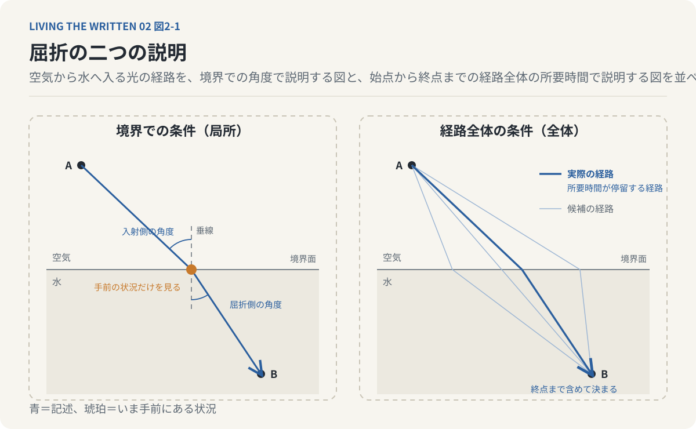
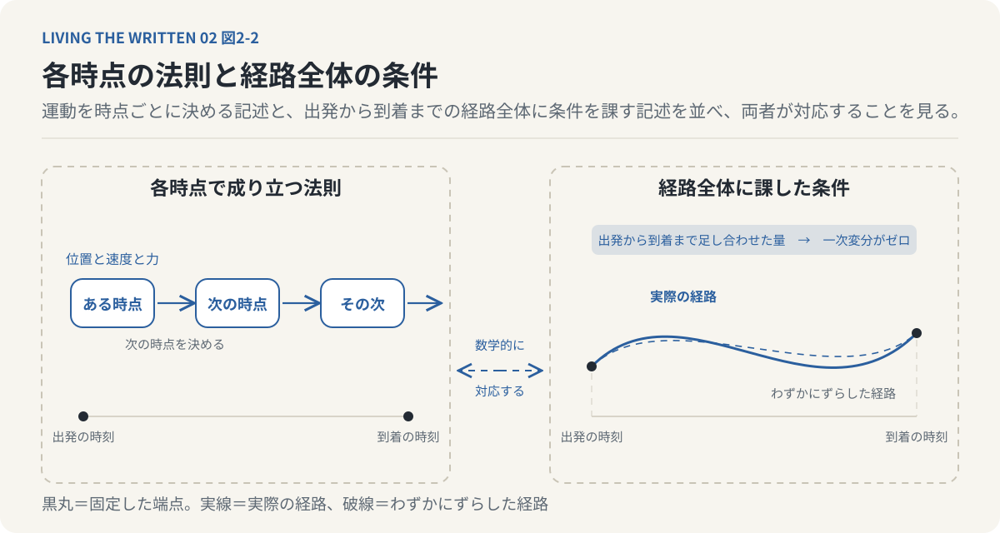
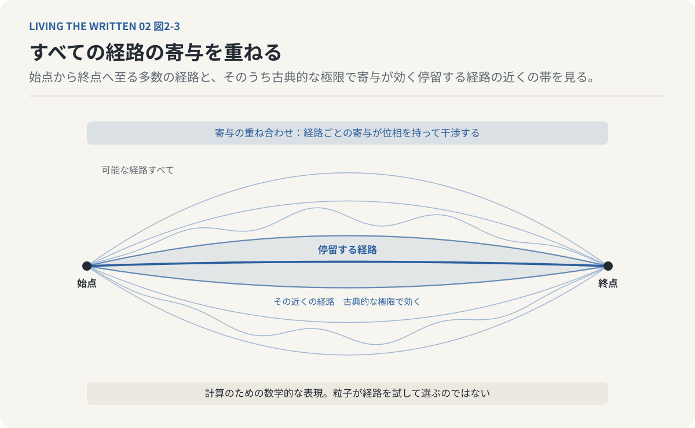
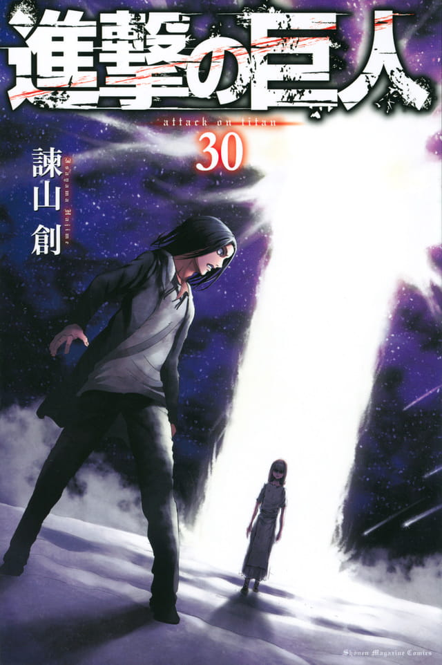
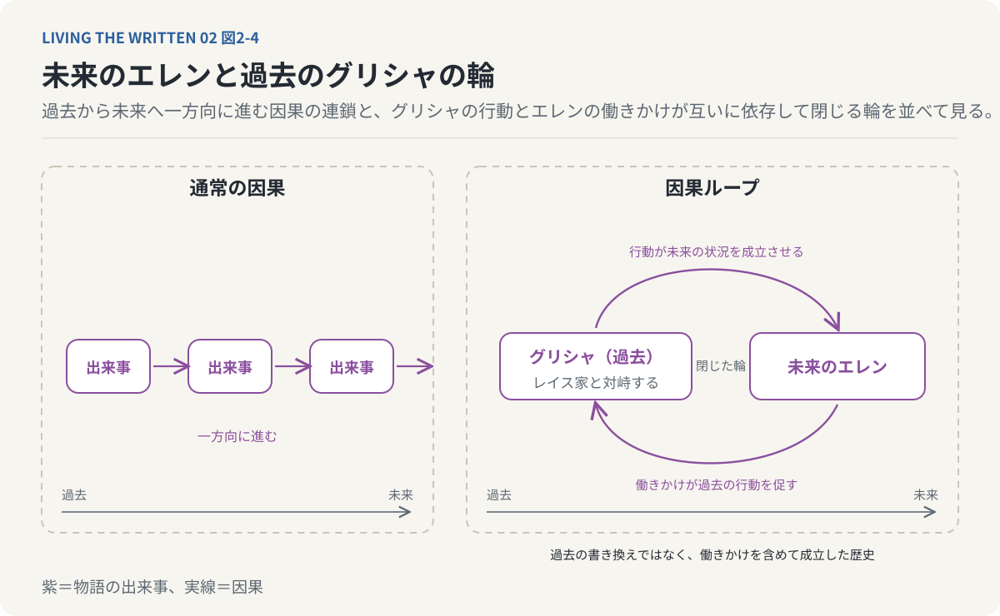
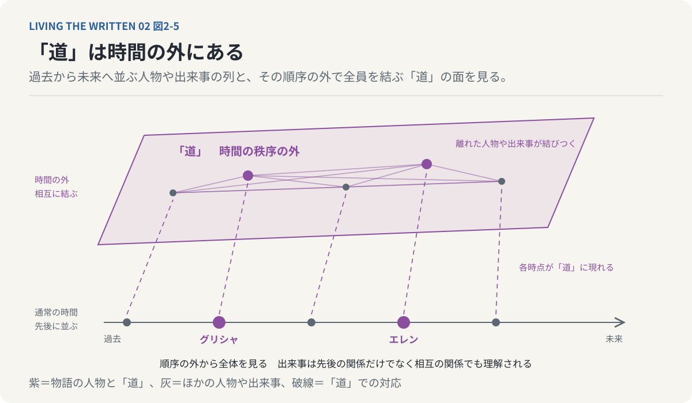
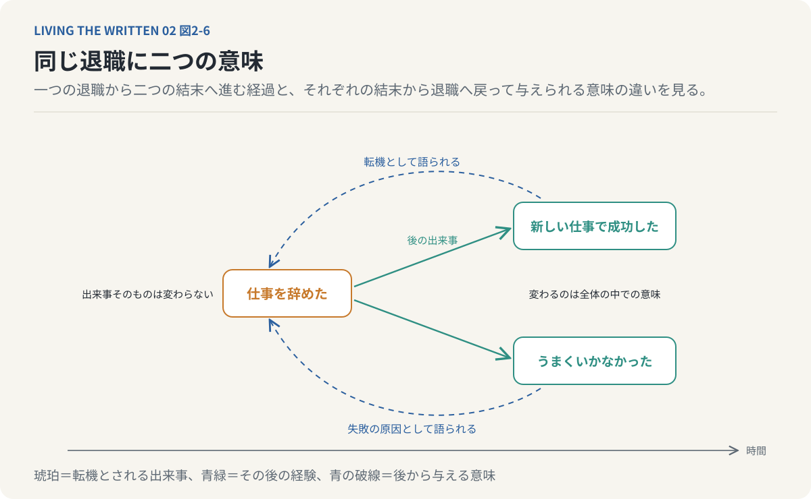
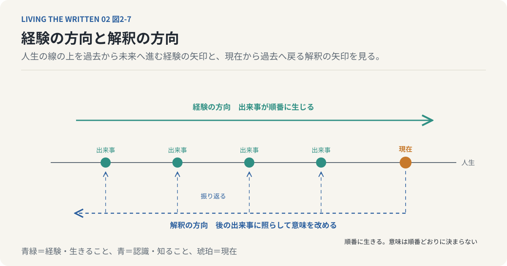

# 第2回　原因は本当に結果より先にあるのか

## 変分原理と『進撃の巨人』の因果ループ

<!-- NAV:TOP -->
[← 第1回](01-perception-of-time.md) | [連載目次](../README.md) | [第3回 →](03-free-will-and-fate.md)
<!-- /NAV -->

駅へ向かう芝生に角を省いて改札へまっすぐ延びる土の道がある。一人が歩き次の人がその跡を踏んだとも言えるし、二点を結ぶいちばん短い線がそこにあったとも言える。今朝も私はその道を通った。

原因が先にあって結果が後から生じると私たちは考えている。ボールを投げたから窓が割れる。この順序は日常でほとんど疑われないが、そこには出来事が過去から未来へと順番に決定されるという前提がある。

**原因から結果へと順番にたどる方法とは別に、結果を含む全体から出来事を説明する方法はあるのか。**

この連載では、出来事を順番に知っていく認識を逐次的認識、全体を一つの構造として把握する認識を同時的認識と呼んでいる。前者にとって原因は結果より先に知られる。後者にとっては両方がすでに知られている。全体を把握する側から見たときに因果がどんな形をとるかを、物理学の記述と一つの漫画の因果ループを手がかりに考える。

ただし最初に一つの線を引いておく。未来の条件を使って現象を記述できることと、未来が過去に物理的な影響を与えることは同じではない。この違いが今回の中心にある。

### 光はどの道を通るのか

投げたボールがどこへ落ちるかを知りたければ、いまの位置と速度と働いている力が分かればよい。ニュートンの運動方程式は、物体の加速度が働く力と質量で決まることを述べている。初期位置と初期速度を与えれば適切な条件の下でその後の運動を計算できる。ある時点の情報が次の時点の情報を決める。現在から未来を導くこの形は私たちの日常の因果理解とよく合う。

物理学には別の記述の仕方もある。経路の各時点だけから考えるのではなく、始点と終点を含む経路全体が満たすべき条件から道筋を求める方法である。原因から結果へ順番に計算する代わりに、経路全体に条件を課す。光の屈折がその入口になる。

光が空気中から水中へ入ると進む向きが変わる。これが屈折で、媒質によって光の伝わる速さが違うために起こる。境界面に立てた垂線に対する入射側と屈折側の角度は、それぞれの媒質の屈折率によって結ばれている。その関係を使えば曲がる角度を求められる。

同じ現象を別の方法で説明することもできる。光がある地点Aから別の地点Bへ進むとき、二点を結ぶ経路は幾何学的には無数に考えられる。その中で光が実際にたどるのは、かかる時間が停留値になる経路、つまりわずかにずらしても所要時間がほぼ変わらない経路である。これをフェルマーの原理と呼ぶ。所要時間は経路ごとに真空中の光速と途中の各点の屈折率と道のりの長さから定まり、実際の経路ではその時間の一次変分がゼロになる。この条件から先ほどの角度の関係が導かれる。

この記述は経路を決めるのに終点まで使っている。境界面に着いた光がそこでの条件に従って曲がるという説明では、光は手前の状況しか見ていない。フェルマーの原理では始点から終点までの経路全体に目を向ける。局所的な説明と全体的な説明が同じ屈折を記述している。

*図2-1：光が空気から水へ入って曲がる。境界での角度の関係からも、始点から終点までの所要時間が停留する経路としても同じ道筋が導かれる。終点は経路を特徴づけるための条件であり、光が未来を知っているわけではない。*

だからといって光が未来を知っているわけではない。光が目的地を選ぶわけでもない。終点は経路を数学的に特徴づけるために置かれた条件である。物理現象を全体から記述できることは、その現象が未来を予知していることを意味しない。それでもこの記述は直感を揺さぶる。出来事の説明が必ずしも過去から未来へ順番に展開される必要はないと示しているからである。

### 全体の条件が部分を決める

光の経路で見たことはより一般的な原理の一例である。物体がたどる道筋は、各時点の力の関係からではなく道筋全体に課した条件から求められる場合がある。古典力学には、運動の各瞬間の状態から定まる量を出発の時刻から到着の時刻まで足し合わせた量がある。物体が実際にたどる経路では、適切な端点条件の下でその量の一次変分がゼロになる。この条件から各時点で成り立つ運動方程式が導かれる。全体に課した条件で運動を表すこうした考え方を変分原理と呼ぶ。

同じ運動を二つの形式で表せる。一つは各時点で成立する微分方程式で、もう一つは経路全体について成立する変分条件である。局所的な法則と全体的な条件は競合する説明ではない。両者は適切な条件の下で数学的に対応する。部分の振る舞いを積み重ねて全体を求めることと、全体の条件から部分の振る舞いを定めることは必ずしも対立しない。

*図2-2：同じ運動は各時点の微分方程式でも経路全体の変分条件でも表せる。実際の経路では出発から到着まで足し合わせた量の一次変分がゼロになり、その条件から各時点の運動方程式が導かれる。部分の積み重ねと全体からの決定は対立しない。*

人間の文章は単語や文を順番に並べて組み立てられる。テッド・チャンの『あなたの人生の物語』[^chiang-story]に登場する異星人ヘプタポッドの文字は、個々の線を描く前に全体の構成を把握しておくことを前提にしている。この対比は、運動方程式が各時点の関係を記述し、変分原理が経路全体の条件を記述するのと同じ形をしている。テッド・チャンがこの二つの認識の形を物理学と言語学に重ねたことには構造上の意味がある。ただし物理学の二つの記述が等価であることは、ヘプタポッドの同時的認識が現実に存在することの証明にはならない。ここにあるのは数学的な構造と物語上の認識の形との対応である。

変分原理の発想は量子力学にもつながる。リチャード・ファインマンの経路積分は、粒子の運動を一つの古典的な経路だけで記述するのではなく、始点から終点へ至る可能な経路すべての寄与を重ね合わせる形式で表す。経路ごとの寄与は位相を持って互いに干渉する。古典的な極限では、先ほど足し合わせた量が停留する経路の近くからの寄与が効いてくる。ここでも始点から終点までの経路全体が数学の対象になっている。

ただし粒子が人間のようにあらゆる経路を実際に試してから一つを選ぶという意味に経路積分を受け取ってはならない。経路積分は量子現象を計算するための数学的な表現であり、その存在論的な解釈には慎重さが要る。日常の理解では物体は現在の位置から次の位置へ、さらにその次へと進むが、経路積分では始点と終点の関係を含む経路全体について振幅を組み立てる。現象を説明する数学の形式は私たちが現象を経験する時間の順序に縛られていない。世界を理解するために使う記述の順序と世界で出来事が起こる順序は必ずしも一致しない。

*図2-3：経路積分では一つの経路ではなく可能な経路すべての寄与を重ね合わせる。古典的な極限では足し合わせた量が停留する経路の近くからの寄与が効く。現象を記述する数学の順序は、私たちが現象を経験する時間の順序に縛られない。*

### 未来のエレンが父を動かす

ここまでの物理学の話では未来の条件を使った記述と未来から過去への因果作用を区別してきた。この区別を手にしたうえで『進撃の巨人』[^isayama-aot]に入る。巨人の力を受け継ぐ者たちの物語で、進撃の巨人と呼ばれる力を継いだ者は、自分より後にその力を継ぐ者の記憶を見る。さらに始祖の巨人と「道」に関わる場面には、通常の時間の先後では説明しにくい出来事が描かれる。その代表がエレンと父グリシャの関係である。

*書影：『進撃の巨人』（講談社、第30巻）[^isayama-aot]*

グリシャは過去においてレイス家と対峙する。その行動には未来のエレンからの働きかけが関与している。レイス家を前にしたグリシャに未来のエレンは「これは お前が始めた物語だろ」と言う[^isayama-aot]。

通常ならグリシャの行動がエレンの未来を形づくったと説明できるところを、物語では未来のエレンがグリシャの行動を促している。過去のグリシャの行動が未来のエレンの状況を成立させ、未来のエレンの働きかけが過去のグリシャの行動を成立させる。原因と結果が時間の順序を越えて互いに依存する。この構造を因果ループと呼ぶ。

ある出来事の原因を過去へたどっていくと、因果ループでは最後にその出来事自身の未来へ戻ってくる。通常の因果の連鎖は過去から未来へ一方向に進む。因果ループではその連鎖が閉じた輪になる。エレンは過去を変えたのか。

一度成立した過去を別の過去へ書き換えたと読む必要は、少なくともこの場面にはない。未来からの働きかけが最初から過去の出来事の一部だったという自己整合的な歴史として読める。エレンが介入したから歴史が変わったのではない。介入することを含めて歴史が成立していた。未来は過去を変更するのではなく、過去がそのように成立した理由の一部をなす。

*図2-4：グリシャがレイス家と対峙する行動には未来のエレンの働きかけが関与し、その行動が未来のエレンの状況を成立させる。連鎖は一方向に抜けず閉じた輪になる。この場面は過去の書き換えではなく、働きかけを含めて成立した歴史として読める。*

これはフェルマーの原理とは違う。光の経路を決める終点が過去へ物理的な情報を送るわけではない。『進撃の巨人』では未来の記憶や働きかけが物語の内部の因果関係に組み込まれている。両者は同じ現象ではない。それでも、過去から未来への一方向の説明だけでは全体の構造を捉えきれないという点で並べて見ることができる。

### 最初の原因はどこにもない

因果ループが直感に反するのは、原因をたどっても出発点が見つからないからである。通常の説明では、ある出来事が起きた理由をそれ以前の出来事に求め、その出来事の理由をさらに前の出来事に求める。原因の連鎖にはどこかに始点があると私たちは考えたくなる。因果ループではこの発想が通用しない。

未来の人物が過去の人物にある情報を伝え、その情報が未来まで保存され、再び過去へ伝えられる状況を考えてみる。情報は因果的に循環している。受け渡しの経路は説明できても、最初に誰がその情報を生み出したのかという問いには答えられない場合がある。この問題はブートストラップ・パラドックスと呼ばれる。

『進撃の巨人』の因果ループも同じ問いを生む。グリシャが行動したのはエレンの働きかけによる。エレンがそのように働きかけられるのは、グリシャが過去に行動した歴史があるからである。どちらか一方を、他方に先立つ独立した原因として取り出すことができない。

原因という概念そのものがここで問い直される。私たちは原因をある出来事に先立つ別の出来事として捉えがちである。相互に依存する構造では出来事同士の関係を全体として捉えるほかないが、これはすべての因果関係が循環しているという意味ではない。因果ループは時間をめぐる特定の物語設定の中で成立する構造であり、論理的に記述できることと現実の物理世界で実現できることは別の問題である。ここから得られる見方はもっと限定的である。出来事を説明するのに最初の原因を見つけることが常に必要なのではなく、出来事全体の関係を明らかにすることも一つの説明として成り立つ。

### 「道」は時間の外にあるのか

『進撃の巨人』に登場する「道」は通常の時間の秩序とは異なる領域として描かれる。過去と現在と未来の区別が日常の世界と同じようには当てはまらず、通常の時間の中では離れている人物や出来事がそこで結びつく。

この設定は『あなたの人生の物語』の同時的認識と比べられる。言語学者のルイーズ・バンクスはヘプタポッドBを習得することで、未来を含む人生全体を経験するようになる。エレンは「道」と巨人の記憶を通じて異なる時点の出来事に関わる。二人の違いもはっきりしている。ルイーズの認識の変化は言語を媒介にし、エレンの経験は巨人の能力と「道」という物語上の構造を媒介にする。未来を認識することと、過去へ因果的に関与することも同じではない。

それでも両作品には共通の問いがある。過去と未来を一つの構造として把握する存在にとって、出来事を先に起こるものと後に起こるものに分けることはどれほどの意味を持つのか。通常の人間にとって未来はまだ到来していない。だから未来の出来事が過去の出来事に影響するという構造は直感に反する。時間全体を一つの構造として捉えるなら、個々の出来事は先後の関係だけでなく相互の関係によっても理解される。

*図2-5：「道」では通常の時間の中で離れている人物や出来事が結びつく。時間の順序に並ぶ各時点を順序の外から見れば、出来事は先後の関係だけでなく相互の関係によっても理解される。時間を全体として捉えることは、未来から過去への因果作用とは別の事柄である。*

物語の構造と認識の構造がここで重なる。ただし時間の全体性と因果の循環性は別のものである。時間を全体として捉えることは、未来から過去への因果作用を必ずしも必要としない。同時的認識と因果ループはそれぞれ独立に考えられる概念であり、二つの作品はそれらを異なる形で組み合わせたときに私たちの時間理解にどんな問題が生まれるかを示している。

### 退職は転機だったのか

ここまでの話から一つの逆説が浮かぶ。原因が結果を生むと私たちは考えている。ところが、ある出来事が何の原因だったかは、その後に何が起きたかを知らなければ判断できない場合がある。ある人が仕事を辞めたとする。その時点では仕事を辞めたという出来事があるだけである。

その後に新しい仕事で成功したならその退職は人生の転機として語られ、うまくいかなかったなら同じ退職が失敗の原因として語られる。後の出来事によって過去の退職という事実が変わるわけではない。後から与えられた意味が過去の物理的な原因を変えるわけでもない。変わるのは、出来事全体の中でその退職がどんな意味を持つかという理解である。

*図2-6：ある人が仕事を辞める。その後に成功すれば退職は転機として語られ、うまくいかなければ失敗の原因として語られる。後の出来事が過去の事実を変えるのではなく、出来事全体の中でその退職が持つ意味が定まる。*

物理的な因果と物語的な説明はここで分かれる。物理的な因果関係では出来事がどんな仕組みによって生じたかを問い、物語的な説明では出来事が全体の中でどんな役割を持つかを問う。両者は区別すべきである。だがどちらの場合にも局所的な出来事だけを取り出していては十分に理解できないことがある。原因が結果を生むことと、結果を知ることで原因の意味が定まることは両立する。

経路全体の条件が運動を特徴づける。未来のエレンと過去のグリシャは『進撃の巨人』の中で因果ループを作る。日常の物語では後の出来事が過去の出来事の意味を変える。これらは同じ現象ではない。共通しているのは、出来事の意味や構造を理解するのに時間の順序だけでは足りないという点である。

### 始まりを理解するには終わりが要る

この問題は人間の人生へつながる。私たちは人生を時間の順序に沿って経験する。出来事が起こって何かを選び、その結果を知る。けれど自分の人生を理解するとき、経験した順序をそのまま再現しているわけではない。現在の自分から過去を振り返って出来事同士を結びつける。あの経験があったから現在の自分がある、あの出会いが後の人生を変えた、という説明は現在の視点から過去の出来事に意味を与えることで成り立つ。

人生を過去から未来へ生きる私たちはその意味を未来の側から過去へ向かって理解している。経験の方向では出来事が順番に生じてから行為の結果が経験される。解釈の方向では現在から過去を振り返り、後の出来事に照らして先の出来事の意味を改め、人生全体の中で個々の経験を位置づけ直す。人生を物語として理解するにはどちらも要るのだから二つは対立しない。出来事を順番に経験するだけでは人生の全体像は成立せず、後から振り返って関係を見いだすことで個々の出来事が一つの物語に結びつく。

*図2-7：出来事は過去から未来へ順番に生じ、その結果が経験される。意味は現在から過去を振り返り、後の出来事に照らして改められる。人生を物語として理解するには二つの方向がどちらも要る。*

人間の経験は逐次的である。それでも人生を理解するとき私たちは出来事全体の関係を考える。人生は順番に生きられるが、その意味は順番どおりに決まるわけではない。二つの作品から日常の時間経験について導かれるのはこの見方である。

原因があり結果が生じるという理解は、日常の現象も物理現象も多くを説明する。ただ原因から結果へという一方向の説明が現象を記述する唯一の方法ではない。フェルマーの原理は光の経路を全体の条件から特徴づけ、変分原理は経路全体の性質と局所的な運動法則を結びつけ、経路積分は量子現象を経路の寄与の重ね合わせとして表す。『進撃の巨人』は未来と過去が互いに因果的な関係を持つ物語構造を描く。これらを同じ現象として扱うことはできない。物理学の数学的な記述とフィクションにおける時間への介入ははっきり異なる。

それでも共通する発想がある。**出来事の全体を理解するためには、過去から未来への順序だけでなく、全体を構成する関係に注目する必要がある。**原因は結果より先にある。ただ結果を知らなければ、原因と考えた出来事の役割を十分に理解できない場合がある。始まりを知ることと始まりの意味を理解することは違う。結末を知ったとき、初めて始まりが何だったのかが分かることもある。

もし始まりから結末までが一つの構造としてあらかじめ決まっているなら、人間の選択はどこにあるのか。未来を知っていることと未来を生きることは同じではない。その違いに自由意志の問題を考える手がかりがある。

駅前の芝生の道を、夕方また通った。踏み固められた土の線は最初の一歩をたどれないまま今日も足を受け止めている。グリシャがレイス家と対峙する。それを促す息子は、まだ未来にいる。

---

次回：第3回「未来を知っていても、人は自由でいられるのか」

## 参考文献・注記

本文で触れたニュートンの運動方程式、屈折の法則（スネルの法則）、フェルマーの原理、変分原理（作用の停留原理とオイラー＝ラグランジュ方程式）、ファインマンの経路積分、ブートストラップ・パラドックスは、いずれも概説の範囲で述べており、特定の文献からの引用はない。「逐次的認識」「同時的認識」はこの連載の用語で、ヘプタポッドBの文字の構造とあわせて第1回で扱った。本文末尾の自由意志の問題は第3回で扱う。

[^chiang-story]: テッド・チャン（Ted Chiang）（1998）. [あなたの人生の物語（Story of Your Life）](https://ja.wikipedia.org/wiki/%E3%81%82%E3%81%AA%E3%81%9F%E3%81%AE%E4%BA%BA%E7%94%9F%E3%81%AE%E7%89%A9%E8%AA%9E)。1998年発表の中編。邦訳はハヤカワ文庫SF『あなたの人生の物語』（早川書房）所収の表題作。言語学者ルイーズがヘプタポッドの文字言語を習得し、未来を記憶として経験するようになる。リンク先は日本語版Wikipediaの項目。
[^isayama-aot]: 諫山創（2009）. [進撃の巨人](https://shingeki.net/)。『別冊少年マガジン』（講談社）2009〜2021年連載。進撃の巨人の継承者が未来の継承者の記憶を見るという設定によって、未来と過去が互いに関与する因果の循環が描かれる。リンク先は公式サイト。本回の引用：第121話「未来の記憶」（第30巻）でエレンがグリシャに向ける台詞。文言は出版社許諾のコマ投稿サービス「アル」の該当コマの題（https://alu.jp/series/進撃の巨人/crop/Yk1BhdXaiAq8ZNiBDqST）、ピクシブ百科事典、ニコニコ大百科の項目名（いずれも2026-10-29取得）で一致を確認。マイナビニュースの名言記事は「父さんが始めた」と表記しており採らなかった。原文未照合。書影は公式サイト shingeki.net のコミックス一覧の画像（https://shingeki.net/upload/shingeki.net/files/assets/images/comics/9784065175439_w.jpg 、2026-10-29取得）。

<!-- NAV:BOTTOM -->
---

[← 第1回](01-perception-of-time.md) | [連載目次](../README.md) | [第3回 →](03-free-will-and-fate.md)
<!-- /NAV -->
