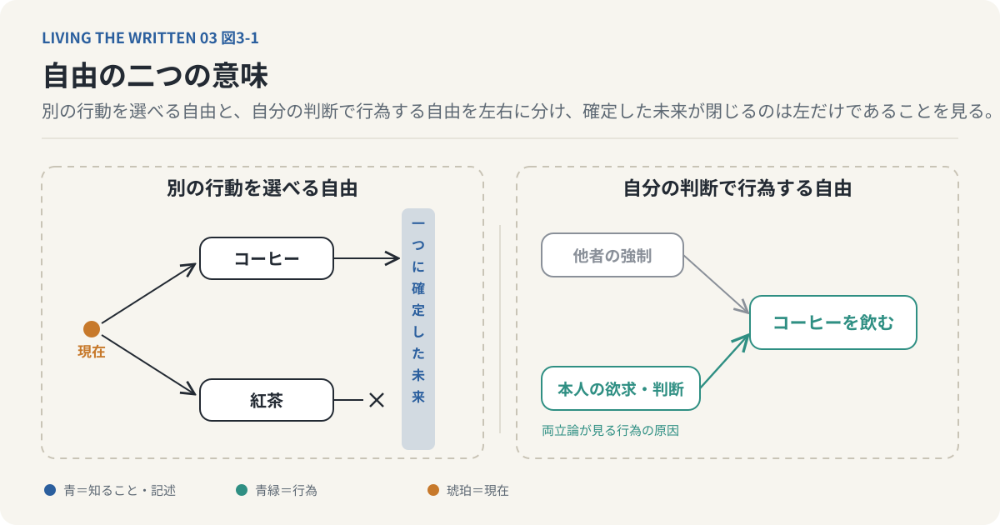
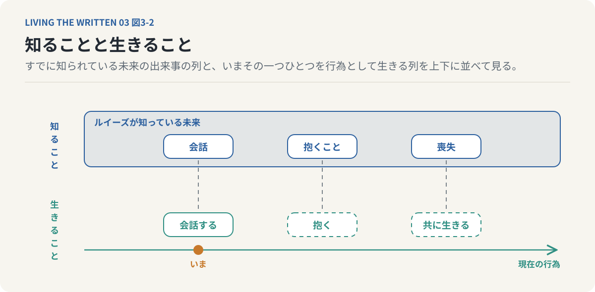
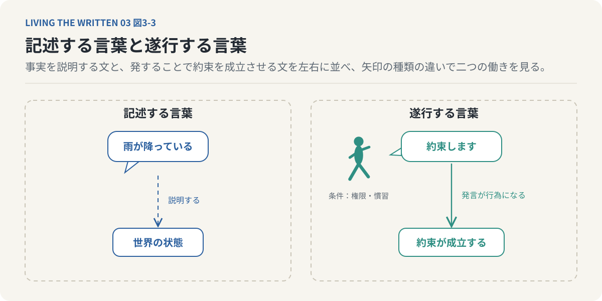
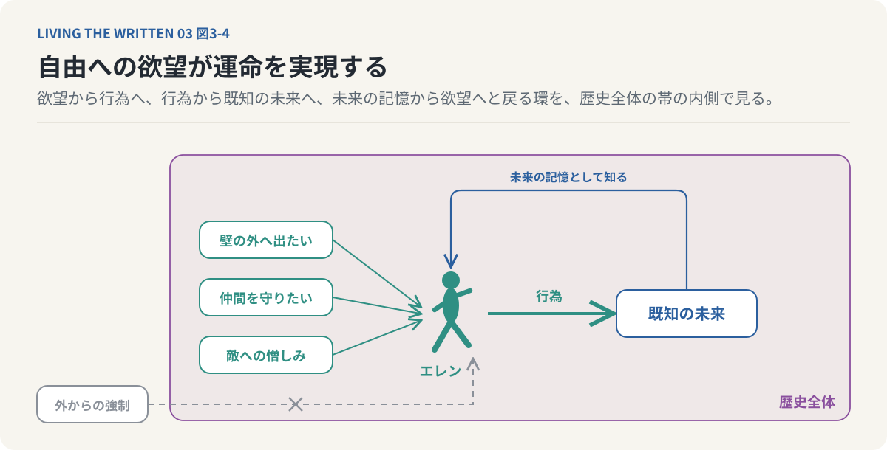
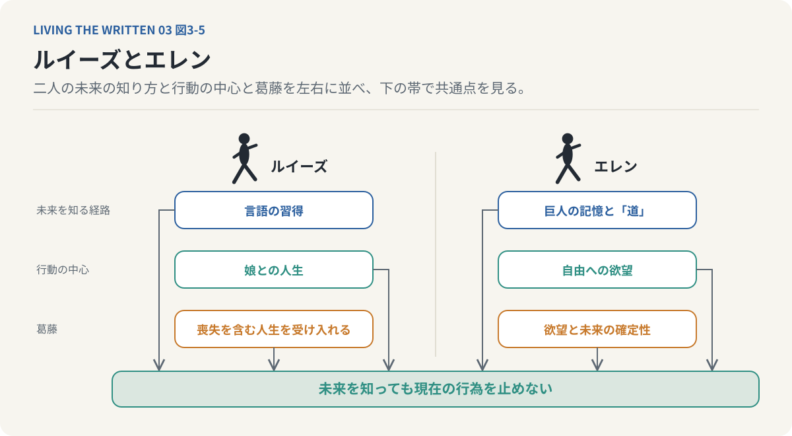
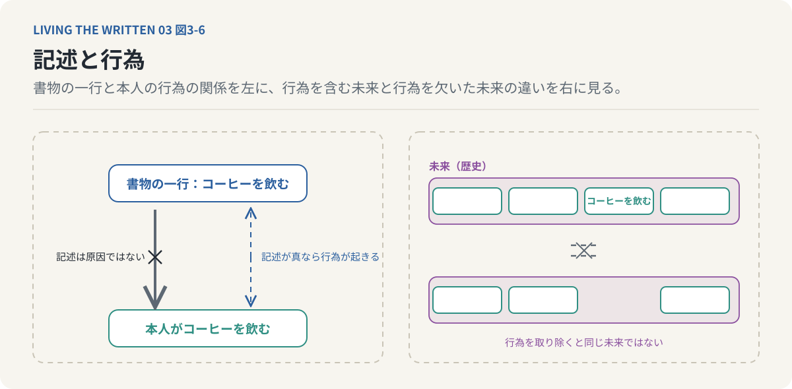

# 第3回　未来を知っていても、人は自由でいられるのか

## ルイーズとエレン、運命を遂行する自由意志

<!-- NAV:TOP -->
[← 第2回](02-causality-and-teleology.md) | [連載目次](../README.md) | [第4回 →](04-memory-and-relationships.md)
<!-- /NAV -->

友人の結婚式で皿の脇の式次第を読んだ。入場から乾杯まで、これから二時間に起きることが時刻つきで一枚の紙に書かれている。それでも紙は二人を夫婦にしない。定刻に二人が立ち上がり自分の声で誓ったとき、書かれていた一行が初めて本当になる。

私たちは未来が決まっていないからこそ自由に選べると考えている。だからもし未来がすべて決まっているとしたら自由意志は存在しないように思える。式次第を読み終えた私にはそうは思えない。

**未来が決まっていることと、自分の意志によって行動することは、必ずしも矛盾しないのではないか。**

出来事は原因から結果へ順番に説明することもできる。結果を含む全体の条件から理解することもできる。全体の側から見て未来がすでに一つの歴史として成立しているなら、現在の私たちが何かを決断することにどんな意味があるのかが問題になる。未来を知りながら娘を産む母親の物語と、未来を知りながら自由を求め続ける少年の物語がこの問いに異なる形で近づく。二人の姿から見えてくるのは自由意志と運命の単純な対立ではない。未来を知ることとその未来を自分の行為で実現することの違いである。

### 未来を完全に記した書物

目の前に自分の人生を完全に記した書物があるとする。明日の朝食から十年後の仕事やこれから出会う人物、最後に迎える死まですべてが正確に書かれていて誤りは一つもない。ページを開くと次の一行がある。「明日の午前七時にコーヒーを飲む」

そこで明日は絶対にコーヒーを飲まないことにしようと考える。紅茶を飲めば予言は外れる。ところが書物が本当に未来を正確に記しているなら紅茶を飲むことはできないし、紅茶を飲めたなら書物は未来を正確に記していなかったことになる。書物の内容は絶対に正しいという前提と、書物を読んだ人間はその内容に反する行動を選べるという前提は、同時には成り立たない。

ただしここから直ちに自由意志が存在しないとも言えない。問題は自由という言葉をどう定義するかで変わる。同じ条件の下で別の行動を選べることを自由と呼ぶなら、完全に確定した未来は自由と緊張関係にある。外から強制されずに自分の欲求や判断に基づいて行動することを自由と呼ぶなら、未来が確定していても自由が成立する余地は残る。

自分の意志でコーヒーを飲んだとする。その行為が書物に記されていたとしても、書物に命令されたから飲んだとは限らない。飲みたいと思って自分でカップを手に取ったのである。未来が確定していることと、行為が本人の意志から生じることは論理的に区別できる。この区別が自由意志をめぐる議論の出発点になる。

### 自由には二つの意味がある

誰かに脅されてコーヒーを飲む場合と、自分が飲みたいから飲む場合を比べてみる。どちらの行動も物理的な因果関係の中で生じている。それでも自由な行為として評価される程度は違う。行為の原因が本人の欲求や理由や判断にあるのか、それとも他者の強制にあるのかが評価を分けている。

昨日の夕方の気圧の配置がわかれば今朝の天気は一つに決まると考える人がいる。この考えを世界のすべてに広げ、ある時点の世界の状態と自然法則が与えられればその後の状態が一つに定まるとする立場を決定論と呼ぶ。哲学では決定論と自由意志が両立するかどうかが長く論じられてきた。決定論が正しいなら人間に別の行動を選ぶ自由はないとする立場が非両立論で、その中には自由意志を守るために決定論を退ける立場も含まれる。決定論が正しくても自由意志は成立しうるとするのが両立論である。両立論が目を向けるのは行為の原因が何かという点であり、脅されて飲むコーヒーと飲みたくて飲むコーヒーの違いがそこに現れる。

自由と呼ばれるものには少なくとも二つの側面がある。一つは別の行動を選べること、つまり未来に複数の可能性が開かれていることである。もう一つは外からの強制ではなく自分の欲求や判断に基づいて行為することである。二つは重なる場合もあるが同一ではない。未来が一つに確定しているとき、別の行動を選べる自由は問題になるけれど、自分の判断で行為する自由まで必ず消えるとは限らない。

*図3-1：自由には二つの側面がある。未来が一つに確定しているとき問題になるのは別の行動を選べる自由であり、自分の欲求や判断から行為する自由まで必ず消えるわけではない。両立論が目を向けるのは行為の原因が何かという点である。*

区別はもう一つある。未来が知られていることと、未来が因果的に決定されていることも同じではない。書物のような完全な知識があると仮定してもその知識が未来を決めたとは限らない。未来が確定している理由と未来を知っている理由は別の問題であり、『あなたの人生の物語』[^chiang-story]が描くのはこの絡み合った関係である。

### ルイーズは未来を変えようとしない

言語学者のルイーズ・バンクスは異星人ヘプタポッドの文字言語ヘプタポッドBを習得していく。その過程で彼女の時間認識は変わる。通常の人間は過去を記憶し未来を予測するが、ルイーズは未来の出来事を記憶のように経験するようになる。その未来には娘の誕生と成長と娘を失う出来事が含まれている。

ルイーズは娘の人生を知っている。それでも娘を産む。この行為を運命への諦めとして読めるだろうか。未来を知っているのにその未来を避けようとしない姿は、一見すると自分の人生を変える意志を失ったようにも見える。作品はそれほど単純な構造を持っていない。

ルイーズにとって未来は単なる予測ではない。まだ起こっていない出来事でありながらすでに知られている人生の一部でもある。彼女は娘の死だけを知っているのではなく、これから娘が生まれることや成長することや交わす会話や積み重ねる日常も知っている。娘を失う結末だけでなく、そこへ至るすべての経験が彼女の未来である。

私たちは未来の悪い結果を予測すると、それを避ける方法を考える。ルイーズにとって未来は、避けるべき可能性の一つとして差し出されているのではない。人生全体を構成する既知の出来事である。この認識では未来を変えるという発想そのものが通常とは別の意味を持つ。

彼女は未来を知りながらなお現在の行為を続ける。娘との会話を知っていても実際に会話する。娘を抱くことを知っていても実際に抱く。娘を失うことを知っていても共に生きる時間を経験する。未来を知っていることは、その未来を生きたことにはならない。ルイーズの行為はこの区別を示している。

*図3-2：ルイーズは娘の誕生から喪失までを知っている。それでも娘と会話し娘を抱く行為は省略されない。知っている出来事の列と生きる行為の列は対応するが同じものではない。*

明日経験することをすべて知っていたら明日を生きる意味はなくなる、と私たちは考えがちである。何が起こるかわからないから明日が楽しみになり、結末を知らないから物語を読み進め、新しい発見があるから旅に出る。未知であることは経験の価値を生む大きな要素に違いない。それでも経験の価値が未知かどうかだけで決まるわけではない。

何度も読んだ小説をまた手に取ることがある。結末も登場人物の行動も誰が死ぬかも分かっているのに、読み返すたびに新しい感情や理解が生まれる。何度も聴いた曲を再び聴く価値も失われない。好きな人との会話も未知の情報を得るためだけに行われるわけではなく、すでに知っている話を繰り返すこと自体が関係を保つ行為になる。

知識と経験の違いがここにある。知識はある出来事についての情報を持つことで、経験はその出来事を実際に生きることである。両者は重なるが同一ではない。ルイーズが未来を記憶していることは娘との現在の経験を不要にしない。娘との人生は情報の集合ではなく、出会って会話し触れ合い共に時間を過ごす行為の連続だからである。

行為の意味は未知の結果を手に入れることだけにあるのではない。結末が分かっていても行為すること自体に固有の価値が存在しうる。この考えを進めるために、言葉の働きに目を向けてみる。

### 言葉は説明するだけではない

「雨が降っている」「明日は会議がある」という文は、世界がどんな状態にあるかを説明している。言葉はこうして事実を記述する手段だと私たちは思いがちである。一方で「約束します」や「ここに開会を宣言します」という発言は、すでにある事実を説明しているのではない。適切な条件の下では発言すること自体が行為になる。

約束は「約束します」と言うことによって成立しうる。開会の宣言は会議の状態を変える行為である。言語のこの働きをJ・L・オースティン[^austin-words]は言語行為論の中で遂行的な発話として論じた。もちろん言葉を発すれば常にその行為が成立するわけではなく、発言する人物の権限や社会的な慣習といった条件が要る。それでも言葉は情報の伝達であるだけでなく、世界の中で何かを実行する行為にもなる。

*図3-3：「雨が降っている」は世界の状態を説明する。「約束します」は適切な条件の下で発言そのものが約束を成立させる。オースティンはこの後者の働きを遂行的な発話と呼んだ。*

テッド・チャンはこの遂行性を時間認識の問題へつなぐ。未来を知る者にとって言葉や行動は、未知の結果を生み出すためだけのものではなく既知の歴史を現実として成立させる行為でもある。未来の会話をすでに知っているからといって、実際の会話を省略できるわけではない。会話が歴史の中で成立するためにはそこで言葉が発せられなければならない。未来について知っていることとその未来を遂行することは別である。

未来の記憶と遂行的な行為はここで結びつく。未来は知識として保持されるだけではなく行為として実現されなければならない。ルイーズは未来を知っている。その未来を成立させるのは彼女自身が娘と共に生きる行為である。

### エレンは自由を求め続ける

『進撃の巨人』[^isayama-aot]のエレン・イェーガーは自由を強く求める少年である。壁の外へ出ることや巨人の支配から逃れること、自分の生き方を自分で決めること。この欲望が物語の初めから彼の行動を支えている。物語が進むにつれてエレンは未来の記憶に近づきこれから起こる出来事の一部を知る。さらに「道」に関わる経験を通じて、過去と未来が通常の時間の秩序では捉えられない形で結びついていることを知る。

自由を求めるエレンは、未来が一つの歴史として成立していることを経験する。自由になりたいのに自分が何をすることになるのかを知っている。それならばエレンは自由を失ったのだろうか。答えるには未来についての知識と彼の欲望を分けなければならない。未来を知っていてもエレン自身の欲望は消えない。壁の外へ出たいという欲望も仲間を守りたいという思いも敵への憎しみも彼の中に残り、未来の出来事を知っていてもその行為に至る理由を彼は経験し続ける。

未来が知られていることは行為の動機が知られていることと同じではない。何をすることになるかを知っていてもなぜ自分がそれをするのかを完全に理解しているとは限らない。エレンの行動を外部の運命に一方的に強いられたものとして理解するだけでは足りず、彼が実現する未来には彼自身の欲望や判断が深く関わっている。

一般に自由と運命は対立する概念として理解されている。自分で選ぶことが自由で、自分の選択とは無関係に決まっていることが運命である。エレンはこの対立を揺さぶる。彼は自由を求め、その欲望によって行動する。その行動がすでに知られている未来を成立させる。エレンにとって自由への欲望は運命から抜け出すための力であるだけでなく、運命を実現する力でもある。

エレンは自由を求めたにもかかわらず運命に従ったのではなく、自由を求める自身の欲望によってその運命を実現する。自由を求める意志そのものが逃れられない運命の構成要素になっている。これはエレンが何の責任も負わないという意味ではなくその逆である。未来が確定していることを理由に彼の欲望や判断を行為から切り離すことはできず、何を望み何を選び何を実行したかはその歴史の一部である。運命を外からの強制とだけ捉えるならエレンの主体性は見えなくなる。自分自身の行為も含む歴史全体として捉えるなら主体性は消えない。

*図3-4：エレンは未来を知っていても壁の外へ出たいという欲望を失わない。その欲望に基づく行為がすでに知られている未来を成立させる。運命を外からの強制とだけ捉えると、この環の内側にある主体性は見えなくなる。*

ただし主体性が残ることと別の行動を選べたことは同じではなく、主体的な行為であることはその行為が倫理的に正しいことも意味しない。自由意志の有無と行為の責任と行為の善悪はそれぞれ別の問題として残る。自分の欲望に従って行動することが結果として必然の歴史を成立させる場合があり、行為する本人にとっては選択であっても歴史全体から見れば確定した出来事になる。この二つの記述は互いに排他的ではない。

### 二人は何が違うのか

ルイーズとエレンはどちらも未来の出来事を知った上で行動する。それでも二人の姿は対照的である。娘を失う未来を知りながら、ルイーズは娘との人生を生きる。エレンは破滅的な未来を知りながら自分の求める自由に向かって行動する。この違いは単純な善悪の対比では説明できない。二人が知っている未来の性質も、その未来に関わる方法も違うからである。

ルイーズの未来認識は言語の習得によって生じる。彼女は人生全体を一つの構造として把握する認識の形を得て既知の人生を生きる。エレンの未来認識は巨人の記憶と「道」を媒介にしている。彼はその記憶を通じて未来の出来事についての知識を得るが、その知識は彼の欲望や葛藤を消さず、彼は既知の出来事を自ら実現していく。

ルイーズの行動の中心には娘との人生があり、エレンの行動の中心には自由への欲望がある。ルイーズの葛藤は喪失を含む人生を受け入れることにある。エレンの葛藤は自由への欲望と未来の確定性のあいだにある。一方の作品が問うのは既知の人生を生きる意味で、もう一方が問うのは自由を求める主体と運命の関係である。

両者に共通する構造もある。二人とも未来を知っているからといって現在の行為を止めない。未来の情報は現在の経験を代替せず、未来を知ることが行為の意味を消し去るわけでもない。この共通点から自由を別の角度で考えられる。自由とは未来を変更できる能力だけを意味するのだろうか。未来がどのようなものであっても自分自身の行為として人生を生きることに自由の一つの形があるのかもしれない。

*図3-5：ルイーズは言語を通じて人生全体を知り娘との人生を生きる。エレンは巨人の記憶を通じて未来を知り自由への欲望に従って行動する。違いは多いが、二人とも未来を知っているからといって現在の行為を止めない。*

### 知ることと生きることのあいだ

私たちは人生の可能性を選択肢の多さで測りがちである。多くの仕事から選べることや多くの場所へ行けること、多くの人と出会えること。選択肢があることには確かに意味があり、自分の意志に反する生活を強いられないことや別の人生を選ぶ機会があることの価値は大きい。それでも選択肢が多いことと実際に生きる人生が豊かであることは同じではない。

一冊の小説には一つの結末しかない。読者が何度読み返しても登場人物の運命は変わらない。それでもその物語の価値が失われるわけではなく、結末が固定されていても登場人物の行為や関係や経験には意味がある。人生を小説と同一視はできないけれど、人生の価値も実現しなかった無数の可能性だけで決まるのではなく、実際に選び経験し関係を結び行為したことにも存在する。

ルイーズの人生には娘を失わない未来が選択肢として差し出されていない。それでも娘と生きる時間の意味は消えない。エレンの場合も未来の確定性によって行為の重大さが消えるわけではなく、その行為を実際に遂行することが物語の悲劇を成立させている。人生の意味は選ばなかった未来の数だけではなく実際に生きた時間の中にも存在する。これは自由な選択の重要性を否定するものではなく、選択可能性だけでは説明できない経験の価値があるという話である。

私たちは何かを達成するために行為するけれどすべての行為が結果を得るためだけに行われるわけではない。人を愛すること、誰かと時間を過ごすこと、作品を制作することには最終的な結果だけには還元できない価値がある。行為は結果へ至る手段であると同時にそれ自体が経験でもある。

最初の思考実験に戻る。自分の人生がすべて記された書物を最後まで読めば、これから起こる出来事を知ることはできる。書物を読んだことによってその人生を生き終えたことになるだろうか。ならない。誰と出会うかを知っていても出会ったことにはならず、何を語るかを知っていてもその言葉を発したことにはならず、誰を失うかを知っていてもその喪失を経験したことにはならない。知識は経験を完全には代替しない。

この違いは感情の問題ではなく、出来事についての記述と出来事を現実に成立させる行為の違いである。書物に「コーヒーを飲む」と書かれていたとしても、実際にコーヒーを飲むという出来事は本人がその行為をすることによって成立する。記述が原因となって必ず飲まなければならないのではない。記述が真であるならその行為が実際に起きるのである。この区別を誤ると未来の既知性が現在の行為を不要にするという結論に陥る。未来が確定しているとしても行為は歴史の中から取り除けず、行為を取り除けばそれはもう同じ未来ではない。

*図3-6：書物に書かれていたから飲むのではない。記述が真であるなら本人が飲む行為が実際に起きる。行為は歴史から取り除けず、取り除けばそれはもう同じ未来ではない。*

未来が決まっているとしてもその未来は現在の行為を通じて成立する。ルイーズは娘との人生を知っていてそれでも娘を産み育て共に生きる。エレンは未来の出来事を知っていてそれでも自分の欲望に従って選び行動する。両者の行為は未来の知識によって省略されない。

ただし決定論とあらゆる意味での自由意志が両立することがこれで証明されたのではなく、別の行動を選べたのかという問いは残る。それでも未来が確定しているなら行為は無意味になるという推論は成り立たない。未来は行為を含んだ歴史であり出来事を知っていてもその出来事は実際に生きられなければならない。**すべてが決まっていたとしても、すべてはまだ生きられていない。**

私たちは人生を一人で生きるのではなく、他者と出会い記憶を共有し互いの人生に影響を与えながら生きる。共に生きるためには同じ時間を共有していなければならないのかという問いがここから生まれる。

式次第はまだ皿の脇にある。やがて定刻が来て二人は立ち上がり、書かれていたとおりの言葉を自分の声で言う。ルイーズは娘と交わす会話を知っていて、その会話を交わす。エレンは自分が何をすることになるかを知っている。それでもまだ壁の外へ出たがっている。

---

次回：第4回「同じ時間を生きなければ、共に生きられないのか」

## 参考文献・注記

本文で触れた決定論、両立論と非両立論は概説の範囲で述べており、特定の文献からの引用はない。ルイーズが人生全体を一つの構造として把握する認識の形は、第1回で「同時的認識」と呼んだものである。出来事を結果を含む全体の条件から理解する見方は第2回で扱った。他者と時間を共有する問題は第4回で扱う。

[^chiang-story]: テッド・チャン（Ted Chiang）（1998）. [あなたの人生の物語（Story of Your Life）](https://ja.wikipedia.org/wiki/%E3%81%82%E3%81%AA%E3%81%9F%E3%81%AE%E4%BA%BA%E7%94%9F%E3%81%AE%E7%89%A9%E8%AA%9E)。1998年発表の中編。邦訳はハヤカワ文庫SF『あなたの人生の物語』（早川書房）所収の表題作。言語学者ルイーズがヘプタポッドの文字言語を習得し、未来を記憶として経験するようになる。リンク先は日本語版Wikipediaの項目。
[^isayama-aot]: 諫山創（2009）. [進撃の巨人](https://shingeki.net/)。『別冊少年マガジン』（講談社）2009〜2021年連載。進撃の巨人の継承者が未来の継承者の記憶を見るという設定によって、未来と過去が互いに関与する因果の循環が描かれる。リンク先は公式サイト。
[^austin-words]: J・L・オースティン（J. L. Austin）（1962）. [How to Do Things with Words（『言語と行為』）](https://plato.stanford.edu/entries/austin-jl/)。「約束する」と言うことがそれ自体で行為になるという遂行的な発話を論じた言語行為論。本連載では、未来の会話を知っていてもその発話を省略できないという議論に用いる。リンク先はスタンフォード哲学百科事典の項目。

<!-- NAV:BOTTOM -->
---

[← 第2回](02-causality-and-teleology.md) | [連載目次](../README.md) | [第4回 →](04-memory-and-relationships.md)
<!-- /NAV -->
