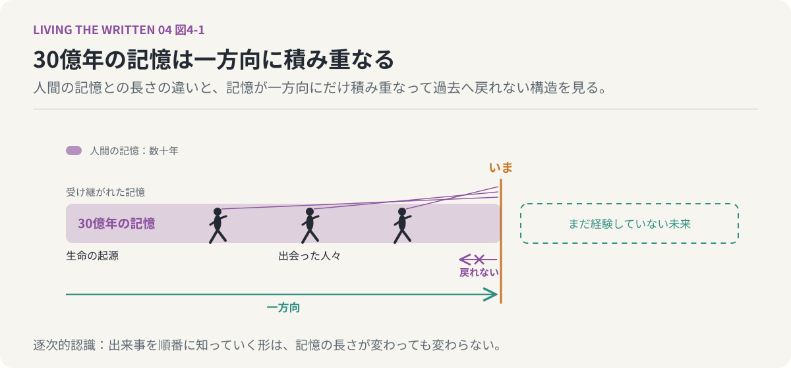
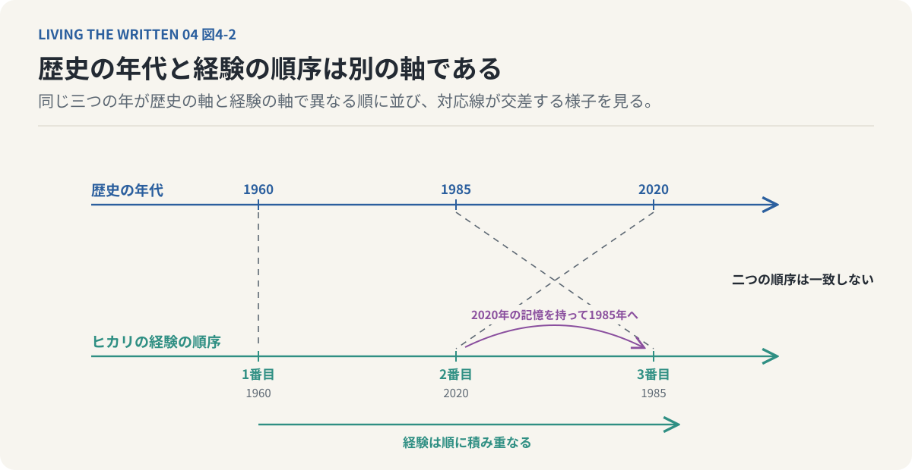
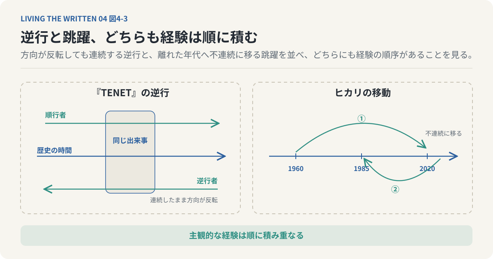
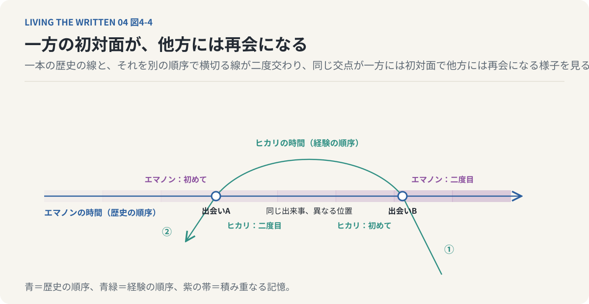
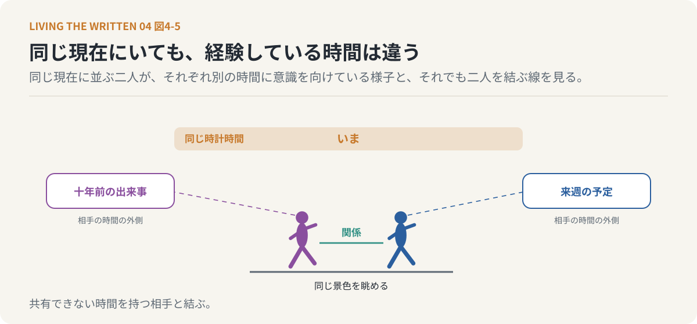
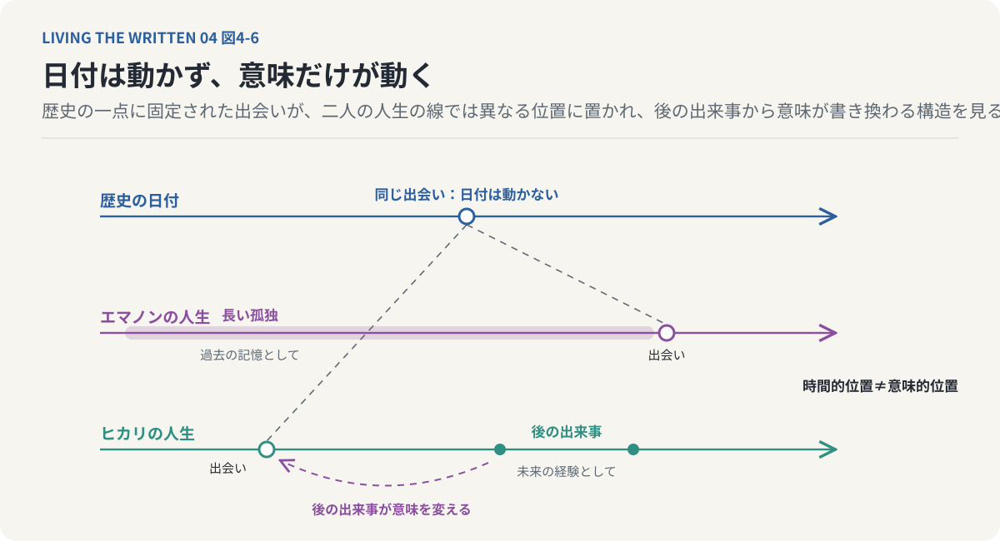

# 第4回　同じ時間を生きなければ、共に生きられないのか

## 『たゆたいエマノン』と、すれ違う記憶の哲学

<!-- NAV:TOP -->
[← 第3回](03-free-will-and-fate.md) | [連載目次](../README.md) | [第5回 →](05-narrative-and-the-past.md)
<!-- /NAV -->

駅の改札で名前を呼ばれた。十年前の雨の日に私が貸したビニール傘を彼女はまだ持っているという。私にはその雨の日の記憶がない。彼女にとっては再会で、私にとっては初対面に近い。同じ十年を挟んで立っているのに、二人が抱えている過去は一致しない。

誰かと共に生きるとは同じ時間を共有することだと私たちは考えている。同じ出来事を経験し共通の記憶を積み重ね、長く一緒にいた相手ほど深い関係があると感じる。この見方の下には二人の人間は同じ時間を同じ順序で生きているという前提がある。

**同じ時間を同じ順序で生きていない二人は、それでも共に生きていると言えるのか。**

自分にとって初めての出会いが相手には何度目かの再会であり、まだ経験していない出来事を相手が懐かしい思い出として語り、何十年も待った再会が相手には昨日の出来事だったとしたら。改札の前の傘の話はその入口にすぎない。未来を知ることとその未来を実際に生きることは別の事柄である。この区別を他者との関係へ広げると、同じ時間を経験することと同じ物語を生きることも必ずしも同じではなくなる。

### 30億年を覚えていても、戻れない

梶尾真治の『たゆたいエマノン』[^kajio-emanon]は異なる時間経験を持つ二人の人物を通じてこの問いを描く。一人は生命の歴史に連なる記憶を受け継ぐエマノンで、もう一人は歴史の順序どおりに進まず時間の中を移動するヒカリである。共に生きるとは何かがこの二人の出会いで問われる。

エマノンは生命の進化に沿って受け継がれてきた、およそ30億年に及ぶ記憶を保持している。現在の彼女が30億年ずっと同じ身体で生きてきたわけではない。生命の世代を越えて継承された記憶が現在の彼女に集積している。人間の記憶は生まれてから経験した出来事におおむね限られるが、エマノンの記憶は個人の生涯を大きく越え、生命の歴史そのものがその一部を成す。

エマノンの記憶もまた過去から未来へ一方向に積み重なる。彼女は未来を記憶する存在ではない。過去を保持しながらまだ経験していない未来へ進んでいく。昨日の夕食を思い出せても明日の夕食を思い出せないという、出来事を順番に知っていく認識の形をこの連載では逐次的認識と呼ぶ。エマノンもこの形の中にいる。異なるのは記憶の規模で、人間の記憶が数十年の生涯に結びつくのに対し、彼女の記憶は生命の進化史にまで広がる。

過去も未来も既に知られた出来事として一望する認識をこの連載では同時的認識と呼んできた。エマノンはその側にはいない。出来事を順番に知っていく形を、生命の歴史の長さにまで引き延ばした存在である。

彼女の時間は決して巻き戻らない。過去の人々を覚えていてもその人々のもとへ戻ることはできず、一度別れた相手が老いて死んでいくと知っていても時間の進行を止められない。別れた人々の記憶だけが彼女の中に残り続ける。これがエマノンの孤独である。

*図4-1：エマノンの記憶は生命の歴史に沿って受け継がれ、人間の数十年をはるかに越える。それでも過去から未来へ順に知っていく逐次的認識の形は変わらない。覚えていても戻れず、別れた人々の記憶だけが残る。*

私たちは記憶を失わないことに価値を見いだす。大切な人との思い出を忘れたくないし生きてきた時間を失いたくない。けれど記憶が残り続けることは、失ったものが失われたまま残り続けることでもある。エマノンはかつて出会った人々を覚えているが、覚えているからといって再会できるわけではない。相手が死んだ後もその人物の記憶は残る。記憶が消えないことと関係が同じ形で続くことは一致しない。

忘れないことは失わないことではない。むしろ忘れないからこそ失われたことを繰り返し認識する場合がある。通常の人間でも、亡くなった人の声やかつて交わした会話や一緒に歩いた道を覚えていて、その記憶が鮮明であるほど相手が今ここにいないことを強く感じる。エマノンはこの構造を極限まで拡張した存在で、30億年の記憶は30億年の豊かさだけを意味せず、数えきれない喪失も含んでいる。生命の歴史を保持していても、その歴史を構成した個々の生命と再び同じ時間を生きられるわけではない。記憶の永続と関係の永続は一致しない。

### 順番はあるが、年代とは一致しない

エマノンに対してヒカリは別の時間経験を持つ。彼女はある時代から別の時代へ移りさらに過去や未来の別の時点へ現れる。通常のタイムトラベルと似ているが、時間軸の上を自在に行き来する操縦者として描かれているわけではない。移動は必ずしも彼女の意志で制御されず、次にどの時代へ移るのかを本人が確実に知っているわけでもない。

世界の歴史的時間とヒカリ自身が経験する主観的時間は別のものとして扱える。たとえばヒカリが1960年にいて、次に2020年へ移り、その後に1985年へ移ったとする。歴史の年代は1960年から1985年を経て2020年へ続くが、ヒカリが経験した順序は1960年から2020年を経て1985年へ進む。二つの異なる順序がここに並ぶ。

ヒカリ自身の経験には順序がある。彼女は1960年の後に2020年を、その後に1985年を経験する。2020年で得た記憶を持って1985年に現れることができる。歴史的時間の移動順序が非線形でも主観的な経験は逐次的である。過去と未来のすべてを同時に把握する存在ではなく、彼女にも経験する前の出来事と経験した後の出来事があり、ただその区分が歴史上の年代と一致しない。ヒカリの時間経験には、時間の流れる方向とは別に、時間の中を移動する順序という軸が要る。

*図4-2：世界の歴史的時間とヒカリの主観的時間は別の軸に置ける。歴史は1960年から1985年を経て2020年へ続くが、彼女は1960年の後に2020年を経験し、その記憶を持って1985年に現れる。移動が非線形でも彼女の経験には順序がある。*

時間の非線形性を考える上ではクリストファー・ノーランの映画『TENET』[^nolan-tenet]が比較の相手になる。『TENET』の逆行者は通常とは逆方向に時間を経験する。外から見ると逆向きに進んでいるように見えるが、本人の経験は連続していて、一秒の後には次の一秒が訪れる。時間の進行方向が反転していても主観的な経験が順番に積み重なる点は変わらない。これに対してヒカリは歴史上の離れた時点へ不連続に移り、移動先の年代が歴史の順序に従う必要もない。

順行する人物と逆行する人物が異なる方向から同じ出来事に関与する、いわゆる時間的挟撃作戦は、双方から得られる情報を組み合わせることで成立する。それぞれの人物にとって行為は逐次的に経験されている。ヒカリの場合も主観的な時間は失われていない。異なるのは歴史的時間に対する移動の仕方である。

*図4-3：『TENET』の逆行者は外から見ると逆向きに進むが本人の経験は連続している。ヒカリは歴史上の離れた時点へ不連続に移り、移動先の年代は歴史の順序に従わない。どちらも経験は順番に積み重なる。*

時間を逆行することと時間を全体として認識することは異なり、時間を非線形に移動することと時間の順序そのものを持たないことも異なる。ヒカリにはヒカリ自身の人生の順序がある。それはエマノンの人生の順序と一致しない。この違いが二人の関係に特異な構造を生む。

### 初対面が、相手には再会だったら

エマノンとヒカリの時間経験は一枚の布にたとえられる。エマノンの記憶は歴史の順序に従って伸びる縦糸で、過去から未来へ進みながら経験を積み重ねる。ヒカリの移動はその縦糸を横断する横糸のようなもので、異なる時代に現れてはエマノンの人生の異なる地点と交差する。この二つの時間が交わる場所に二人の出会いが成立する。

布の比喩には限界がある。二人の時間が文字どおり二次元の空間として存在するという意味ではなく、異なる順序で経験を積み重ねながら共通する出来事を持つという構造を示すにとどまる。エマノンにとってヒカリとの出会いは歴史の順序で蓄積される。ヒカリにとってその出会いは別の順序で経験される。

私たちは共通の出来事についておおむね同じ先後関係を持っている。十年前に出会い五年前に旅行し昨日再会したなら、その順序は二人に共通している。エマノンとヒカリの場合は同じ出来事について経験順序が一致しないことがある。エマノンにとって最初の出会いがヒカリにとっては二度目の出会いかもしれず、ヒカリが覚えている会話をエマノンはまだ経験していないかもしれない。逆にエマノンが大切にしている思い出をヒカリはまだ知らないかもしれない。同じ出来事を共有していても、その出来事が二人の人生の中で占める位置は異なる。

通常は初対面という出来事が二人に共通している。互いに会ったことがなければ二人とも初めての出会いとして経験する。時間経験の順序が異なれば初対面は対称的な出来事ではなくなり、一方にとって初めての出会いがもう一方にとっては再会になる。

*図4-4：エマノンの記憶は歴史の順序に従って伸び、ヒカリの移動はそれを別の順序で横切る。二つの交点は二人に共通する出来事だが、それぞれの人生の中で占める位置は一致しない。初対面は対称な出来事ではなくなる。*

この状況は人間関係における記憶の役割を照らす。誰かと親しいと感じるとき私たちは共通の過去を参照している。以前に交わした会話や一緒に経験した出来事や相手に助けられたことや相手を傷つけたことが、現在の相手に対する感情や態度を形づくっている。ところが一方だけがその記憶を持っていたらどうなるか。記憶を持つ側にとって相手は大切な存在であり、記憶を持たない側にとって相手はまだ見知らぬ人物かもしれない。二人の間に同じ出来事が存在していても、それを経験済みのものとして保持しているかどうかが異なる。

関係が二人の間に成立していることと、その関係を二人が同じように認識していることは異なる。これは時間跳躍という特殊な設定に限られた問題ではない。一方にとって忘れられない言葉が他方にとっては何気ない一言だったことがあり、ある人にとって人生を変えた出会いが相手にとっては数ある出会いの一つだったこともある。同じ出来事を経験しても記憶の強さや意味づけは一致しない。ヒカリとエマノンの時間構造はこの日常的な非対称性を極端な形で見せている。私たちは同じ時間を生きていると思っていても、実際にはそれぞれ異なる記憶の中を生きている。

### 再会は、誰にとっての再会なのか

再会という言葉には以前に出会ったことがあるという前提がある。通常は再会する二人がその過去を共有している。エマノンとヒカリの場合は再会の意味が一つに定まらない。エマノンにとっては再会でもヒカリにとっては初対面かもしれず、ヒカリにとって懐かしい再会がエマノンにとっては初めての出会いかもしれない。双方にとって再会であってもその前に経験した出来事が異なる可能性もある。関係の時間的な起点が一つに定まらないのは、二人が初めて出会った歴史上の日付と、二人が初めて出会ったと感じる主観的な時点が一致しないからである。

この構造は関係の成立条件についての問いを生む。人間関係は共通の過去を持つことによって成立するのか、それとも相手との出会いが自分の人生に意味を持つことによって成立するのか。現実の関係では相互性が重い。一方だけの親しみで対等な親密関係が成立するとは限らない。それでも関係を形成する記憶が完全に対称である必要はなく、同じ出来事を異なる意味で記憶していても二人は関係を築くことができる。

エマノンとヒカリはこの問題を時間的な順序そのものの違いとして生きている。共に生きることは同じ過去を同じ順序で記憶することと同義ではない。二人の間に成立するのは完全に一致した記憶ではなく、異なる経験の中で互いが重要な存在となる関係である。

私たちは共に生きるためには同じ時間を共有する必要があると考えている。エマノンとヒカリの関係はその前提を揺さぶる。二人は歴史的時間を同じ順序で経験せず、出会いの順序も記憶の蓄積も一致しない。それでも二人は互いの人生に現れる。それぞれの時間の中で相手との出会いが意味を持つ。共に生きることは単純な時間の同期としては理解できず、二人の人生が互いに影響を与えて記憶に痕跡を残すことに重みが移る。

ある人物と短い時間しか過ごしていなくても、その出会いが人生全体に影響を与えることがある。反対に長い時間を同じ場所で過ごしていても互いの人生に深く関わらないこともある。時間の長さは関係の形成にとって軽い条件ではなく、長く共に過ごすことで相互理解や信頼が育まれる場合は多い。それでも共有した時間の長さだけで関係の意味を測ることはできない。同じ時間を生きることは共に生きることの一つの形式であって唯一の条件ではない。

「同じ物語を生きる」という言い方は、二人が完全に同じ出来事を同じ意味で経験することを指さない。それぞれ異なる人生の中に、互いとの関係が組み込まれていることを指す。エマノンの物語の中にヒカリが存在し、ヒカリの物語の中にエマノンが存在する。二人の物語は一致しない。けれど交差している。その交差そのものが二人に共通する物語を成立させる。

### 他者は、自分の時間の外側にいる

私たちは他者と同じ現在を生きていると考える。けれど他者が何を記憶し何を期待し、どのような経験を現在に持ち込んでいるかを完全に知ることはできない。同じ場所に座って同じ景色を眺めている二人は同じ時計時間を共有している。一方は十年前の出来事を思い出し、もう一方は来週の予定を考えているかもしれない。景色が呼び起こす記憶や感情は異なる。物理的には同じ現在にいても意識が経験している時間は同一ではない。

他者との関係の根本的な条件がここにある。他者は自分とは異なる過去を持ち異なる未来を予測する存在である。同じ出来事を共有しても、それが相手にとってどのような意味を持つかを完全には把握できない。ヒカリとエマノンの時間的な非対称性はこの構造を極端に表している。通常の人間関係では歴史的な時間の順序は共通していて記憶と経験の意味だけが食い違うが、ヒカリとエマノンでは歴史的な経験順序すら共通せず、それでも両者の間に関係は成立する。

他者と共に生きるとは、他者の時間を完全に共有することではなく、共有できない時間を持つ相手と関係を結ぶことである。他者を理解することは他者と同じ記憶を持つことでも、他者の経験を自分の経験へ完全に置き換えることでもない。互いに相手の経験していない時間を持っている。その非対称性を残したまま二人の人生を交差させる。他者との関係の固有性はそこにある。

*図4-5：同じ場所で同じ景色を眺める二人は同じ時計時間を共有している。一方は十年前を思い出し、もう一方は来週を考えている。他者は自分の時間の外側にいて、その非対称を残したまま関係が結ばれる。*

エマノンの長い記憶とヒカリの時間跳躍は記憶と関係の違いも明らかにする。エマノンは過去の人々を記憶し、ヒカリは異なる時代に現れることで通常なら再会できない相手と再会する可能性を持つ。いずれも記憶だけで関係が成立するわけではない。記憶は過去の経験を現在に保持する働きであり、関係には現在における相互作用も含まれる。誰かを覚えていることとその人と現在も関わり合っていることは別である。

ただし相手が不在になったからといって関係の意味が完全に消えるわけでもない。亡くなった人物との関係が現在の判断や行動に影響を与え、かつて交わした約束が不在の後も行為を方向づけることがある。記憶はこのように過去の関係を現在の行為へ接続する。それが関係の一つの持続形式になる。持続には二つの形がある。二人が実際に会い言葉を交わし行為を重ねる相互作用としての持続と、相手との経験が現在の認識や行動に影響し続ける記憶としての持続である。

エマノンは相互作用が終わった後も記憶としての関係を保持する。ヒカリは時間を跳ぶことで相互作用の順序そのものを変える。二人の関係はこれらの持続形式を重ね合わせている。相手が目の前にいる瞬間だけに関係が存在するのではなく、過去の出会いが現在の行為に影響しているならその関係は何らかの形で現在にも働いている。ただし相手との相互的な関係が同じ状態で続いているわけではない。関係は出会いから別れまで不変のものとして保存されるのではなく、記憶され解釈され時には再会によって更新される。

### 出来事の位置は、日付では決まらない

二人が同じ出来事を経験したとしてもその出来事の意味は一致しない。記憶の内容が異なるという問題だけではなく、出来事がそれぞれの人生の中で異なる位置を占めるからである。ある人物との出会いが一方にとっては長い孤独の終わりで、もう一方にとっては新しい生活の始まりかもしれない。同じ出会いであってもそれ以前の経験とそれ以後の出来事によって意味が変わる。

ヒカリとエマノンの場合はこの違いがさらに大きくなる。二人は同じ出来事を異なる経験順序の中に位置づけ、一方にとって過去の記憶である出来事が他方にとっては未来の経験になる。出来事の意味は歴史的な日付だけでなく誰の人生のどの位置にあるかによって変わる。

原因が結果を生むことと結果の側から原因の意味が明らかになることは別の事柄である。一つの出会いが歴史上のある時点で起きたとしても、その意味はその時点だけで完結せず、後の出来事によって変わる。ヒカリのように後の出来事を先に経験していれば、初めての出会いであってもすでに異なる意味を持っている。出来事の時間的位置と出来事の意味的位置は同じではない。日付は動かず意味だけが動く。

*図4-6：一つの出会いは歴史上の一点で起きる。しかしその意味は前後の出来事によって決まり、二人の人生の中で占める位置は一致しない。日付は動かず、意味だけが動く。*

この区別は人間の自己理解にも関わる。過去にどのような出来事を経験したかによって私たちは現在の自分を理解する。その過去の意味は現在の自分がどう解釈するかによって変化する。過去の出来事が現在の自分を形成すると同時に、現在の自分が過去の出来事の意味を形成する。記憶は出来事を保存するだけでなく出来事を自分の人生の中に位置づける働きも持ち、その位置づけは時間の経過とともに変わりうる。

### 互いの時間に残る

エマノンは30億年の記憶を保持する。ヒカリは時間の中を順序どおりに進まずに移動する。二人の時間経験は根本的に異なるが主観的な経験の順序はどちらにもある。歴史の順序に従って記憶を蓄積するエマノンに対し、ヒカリは歴史上の異なる時点へ移りながら自分自身の経験順序に従って記憶を蓄積する。二人の出会いで異なる時間の系列が交差する。初対面と再会が重なり、過去と未来が重なり、記憶と未経験が通常の人間関係とは異なる形で重なり合う。

共に生きることは単純な時間の共有としては定義できない。私たちは他者と同じ時計時間を共有しているが、同じ記憶を持っているわけではなく、同じ出来事を経験してもそれを同じ意味で理解しているわけでもない。他者との関係は完全な経験の一致によって成立するのではなく、異なる経験を持つ二人が互いの人生に影響を与えることによって成立する。出会いが終わった後もその影響が記憶や行為の中に残る場合がある。

**同じ時間を生きなくても、同じ物語を生きることはできる。**ただし二人の人生が一つになるという意味ではない。それぞれの人生が独立した時間を持ちながら互いとの関係を含む。共に生きるとは同じ時間に存在することだけではなく、互いの時間に痕跡を残すことでもある。

私たちは他者との関係を記憶によって維持する。その記憶を語ることで過去の出来事に意味を与える。現在の自分が過去を語り直したとき、変わるのは過去の意味だけなのか、それとも過去の自分という存在そのものが現在の物語によって構成されるのか。過去が物語を生むだけでなく物語ることによって過去が成立するという見方がそこから開く。

傘のことはまだ思い出せない。彼女の十年の中に私はいて、私の十年の中に彼女はいない。それでもあの午後は二人のあいだに起きている。エマノンは出会った人々を覚えたまま次の時代へ進む。ヒカリは次にどの時代へ移るのかを確かには知らない。

---

次回：第5回「過去は終わったのに、なぜ書き換わるのか」

## 参考文献・注記

「逐次的認識」「同時的認識」はこの連載の用語で、第1回で導入した。未来を知ることとその未来を生きることの区別は第3回、結果を知ることで原因の意味が変わるという論点は第2回で扱った。本文末尾の問いは、第5回で青山景『ストロボライト』を手がかりに考える。

[^kajio-emanon]: 梶尾真治（2020）. [たゆたいエマノン（徳間文庫）](https://www.tokuma.jp/book/b494659.html)。地球に生命が生まれてからの記憶を受け継ぐエマノンと、時代を跳びながら彼女と出会う少女ヒカリの短編集。徳間書店。リンク先は版元の書誌ページ。
[^nolan-tenet]: クリストファー・ノーラン（監督）（2020）. [TENET テネット](https://www.warnerbros.com/movies/tenet)。2020年公開。エントロピーの反転によって時間を逆行する人物が、順行する人物と同じ出来事に関与する。本連載では『たゆたいエマノン』のヒカリの時間移動との比較に用いる。リンク先は配給会社の作品ページ。

<!-- NAV:BOTTOM -->
---

[← 第3回](03-free-will-and-fate.md) | [連載目次](../README.md) | [第5回 →](05-narrative-and-the-past.md)
<!-- /NAV -->
