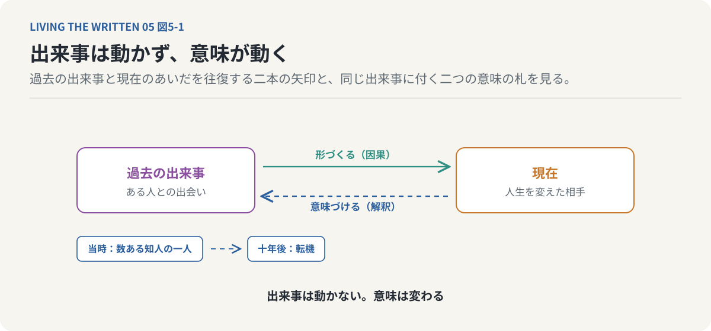
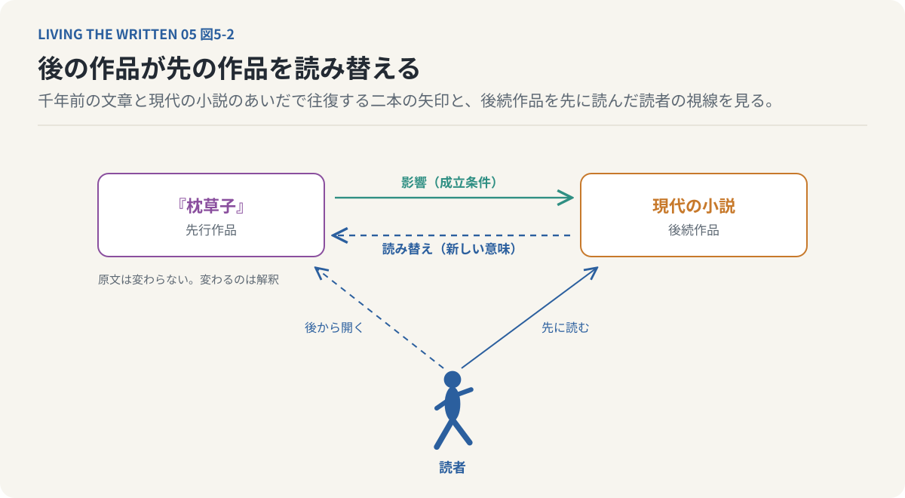
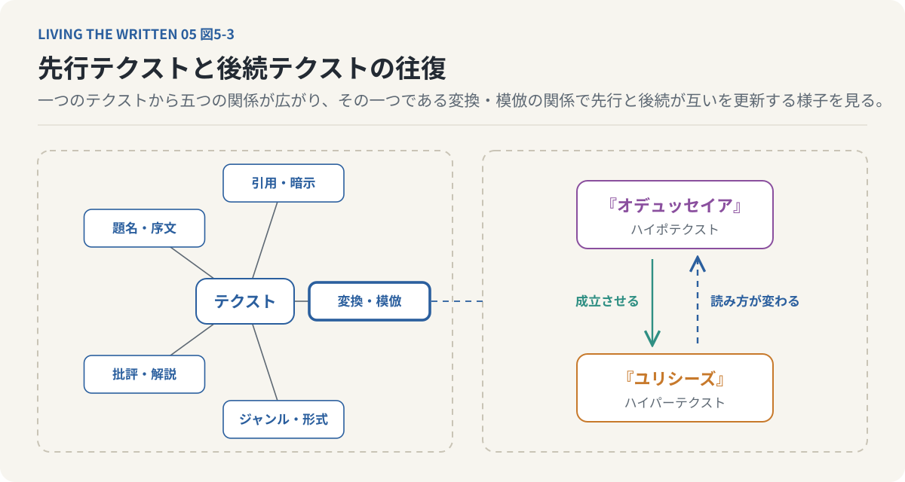
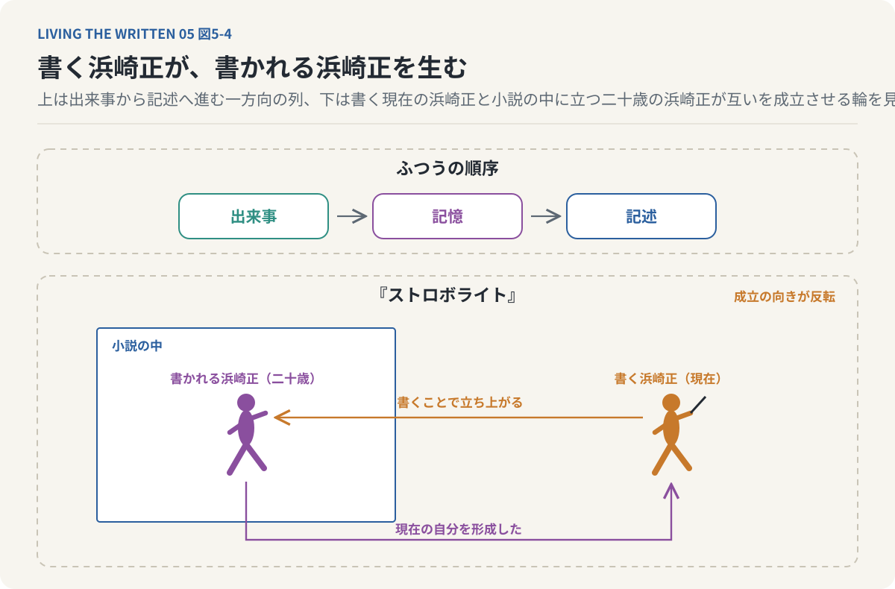
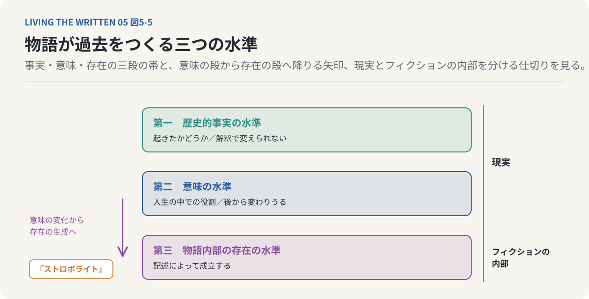
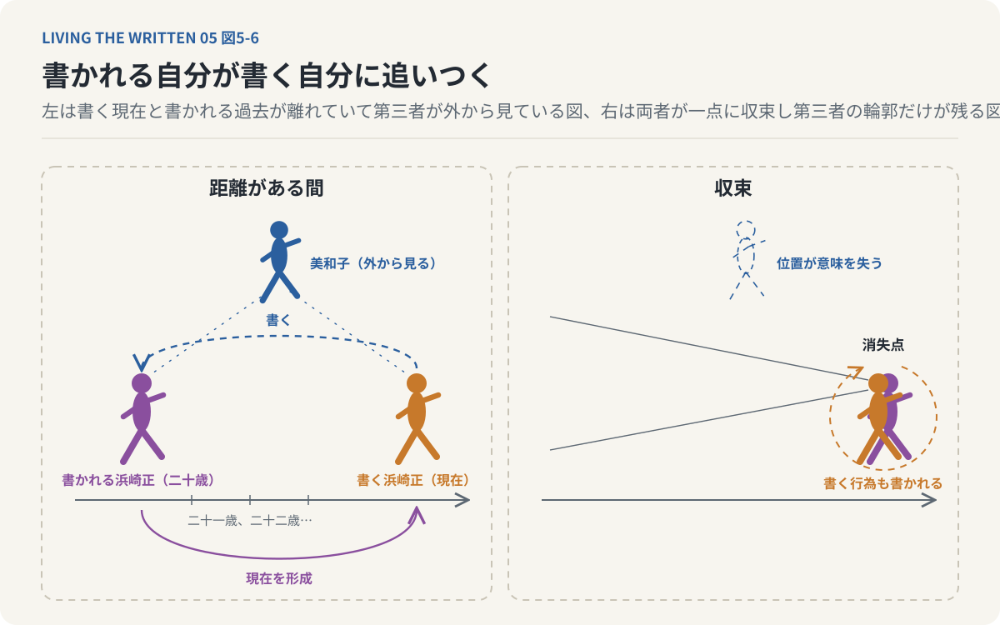

# 第5回　過去は終わったのに、なぜ書き換わるのか

## 『ストロボライト』と、物語が過去を生む逆説

<!-- NAV:TOP -->
[← 第4回](04-memory-and-relationships.md) | [連載目次](../README.md) | [第6回 →](06-ontology-of-fiction.md)
<!-- /NAV -->

勤め先の冊子に載せる略歴を頼まれた。生まれた年から今の仕事までを二百字の欄に一息に書く。入力欄の前で指が止まったのは、二十歳のときに大学を辞めた一年をどう書くかが決まらないからである。長いあいだ私はその一年を人に話さずにきた。辞めたと言えば聞こえはよいが、実際にはある朝から講義に行かなくなり、そのまま一度も戻らずに次の年の春を迎えたというほうが近い。

書き直すうちにその一年は「大学を中退し、独学で設計の仕事に就く」という一行になった。中退が転機になり仕事がその続きとして並ぶ。あの朝に布団の中で天井を見ていた二十歳の私はそんなことを何も知らない。知らないまま二百字の中では道を選んだ人として立っている。欄の外にいる私が書いたから、そこに立っている。

出来事は何も変わっていない。辞めた年もその後の年月も動かしようがない。

**過去の出来事が変わらないことと、過去の意味が変わらないことは同じなのだろうか。**

略歴の一行はこの二つを分けている。出来事は確定していても、その出来事の意味は確定していない。二百字はさらに先まで行く。書かれる前の二十歳の私と書かれた後の二十歳の私は同じ存在のしかたをしていないように見える。過去を語ることで過去の自分が成立するというこの逆説を、まず記憶と物語の関係から、次に作品どうしの関係から考える。

### 出来事は変わらず、意味は変わる

過去について二つのものを分けておく。一つは過去に起きた出来事で、もう一つはその出来事に現在の私たちが与えている意味である。二十歳で大学を中退した人がいるとして、中退したという出来事は動かないが、その意味はその後の人生で違ってくる。別の分野で成功したなら中退は自分の道を選んだ転機として語られ、進路に苦しみ続けたなら後悔すべき決断として語られる。同じ人でも三十歳のときと五十歳のときで評価が変わる。変わったのは事実ではなくその出来事が人生全体の中で持つ意味である。

時間の向きがここで二つになる。過去から現在への向きでは、かつての選択がその後の人生を形づくる。現在から過去への向きでは、後から得た経験が過去の選択を解釈し直す。前者を私たちは因果関係として理解している。大学を中退したから別の進路へ進んだという向きである。後者もまた人生を理解するときに働いていて、別の進路へ進んだからこそ中退が転機として理解される。

後からの解釈が過去の出来事そのものを変えるわけではない。現在の成功が過去の中退を引き起こしたのではなく、現在の成功は過去の中退をどのような出来事として理解するかに影響する。過去は現在を形成する。現在もまた過去の意味を形成する。この相互の関係が今回の出発点になる。

*図5-1：十年前の出会いそのものは変わらない。その相手が人生を変える存在になったとき、出会いは数ある知人の一人との出来事から転機へと意味を変える。過去は現在を形づくり、現在は過去を意味づける。*

私たちは自分の過去を記憶している。けれど記憶は過去の完全な記録ではない。人生のすべての瞬間を映像のように保存しているわけではなく、ある出来事は鮮明に覚え、別の出来事はほとんど覚えていない。同じ出来事でも思い出す時期や状況によって注目する部分が変わる。記憶は保存された情報の再生であるだけでなく、想起するたびに組み直される側面を持っている。

子どもの頃に親から叱られた経験を思い浮かべるとよい。当時は理不尽な出来事として覚えていたものが、大人になって親の置かれていた状況を理解することで別の意味を持つことがある。理解したからといって当時の苦痛が消えるわけではないし、後から与えた解釈が必ず正しいわけでもない。それでも現在の理解が過去の記憶に影響することは確かである。

記憶を他人に伝えるとき私たちは情報を列挙しない。出来事を選び順序を与え、因果を整理して一つの物語として語る。「こういう経験をしてこういう人間になった」という説明は過去の出来事をすべて再現したものではなく、現在の自分から見て重要な出来事を選んで結びつけたものである。記憶は過去についての認識であり物語はその認識に構造と意味を与える。私たちは過去を持っているだけではなく、過去を語ることによって自分が何者であるかを理解している。この理解を記憶の問題から物語そのものの構造へ広げるために作品どうしの関係に目を移す。

### 後の作品が先の作品を読み替える

一つの作品には一人の作者が込めた意味があると私たちは考えがちである。作者が何かを考えて文章にし、読者が文章を読んで作者の意味を受け取る。この理解では意味は作者から作品へ、作品から読者へと一方向に伝わる。実際の作品はそれほど独立していない。言葉の使い方や物語の形式や登場人物の類型は、それ以前の作品との関係の中で意味を持つ。読者もまたそれまでに読んだ作品や得た知識を通して新しい作品を理解する。

現代の小説をいくつも読んだ後で『枕草子』を開くと、清少納言の文章に以前は気づかなかった意味が見えてくることがある。読者はすでに現代文学の表現や価値観を知っていてその視点から千年前の文章を読んでいる。同じ作品でも読者の持つ文学的な経験によって読み取られる意味は違う。一つのテクストの意味はそのテクストだけで完結せず他のテクストとの関係の中で成立する。批評家のジュリア・クリステヴァ[^kristeva-semeiotike]はこの考えを間テクスト性と呼んで理論化し、文学作品を孤立した対象として読む見方を問い直した。

間テクスト性は引用や影響関係だけを指す語ではない。ある作品が別の作品を明示的に引用していなくても、読者は二つを関連づけて読める。後から書かれた作品によってそれ以前の作品の意味が変わることもある。作品の意味は書かれた時点ですべて確定するわけではなく、読まれ比較され解釈されることで新しい意味が生まれる。ここから時間について一つの逆説が立ち上がる。

文学の影響関係はふつう過去から未来へ向かう。古典が近代文学に影響し、先行作品を読んだ作家が新しい作品を書く。『枕草子』の例では向きが逆で、後世の作家が清少納言に影響を与えるとさえ言える。もちろん後世の作家が過去の清少納言本人に物理的な影響を与えたわけではなく、原文が後世の読者によって書き換わるわけでもない。変わるのは解釈と意味である。その限りで後続する作品が先行する作品に影響すると言える。

この二つの向きは矛盾しない。先行作品が後続作品の成立条件となる一方で、後続作品が先行作品の新しい意味を成立させる。後から来るものは先に来たものによって生まれる。同時に先に来たものの意味も変える。原因が結果を生み、結果を知ることで原因の意味が明らかになるという区別がここにも現れる。漫画家の青山景は『ストロボライト』[^aoyama-strobolight]でこの関係をさらに特殊な形で展開する。

*図5-2：古典は後の作品を生む。後の作品を知った読者は古典に以前はなかった意味を見る。原文は変わらず解釈と意味だけが変わる。*

### 先に来たものと、後から来たもの

テクストどうしの関係をもう少し細かく見ておく。文学理論家のジェラール・ジュネット[^genette-palimpsestes]は、テクストが他のテクストと結ぶ関係を広く捉えて五つに分けた。引用や暗示によって一つのテクストの内部に別のテクストが現れる関係がある。題名や序文のように作品の周辺に置かれた要素との関係や、別のテクストを批評し解説する関係もある。作品が属するジャンルや形式との関係も一つに数えられる。五つ目は、先行するテクストを変換したり模倣したりすることで後続のテクストが成立する関係である。

ホメロスの『オデュッセイア』とジェイムズ・ジョイスの『ユリシーズ』の関係がその例になる。『オデュッセイア』との関係によって『ユリシーズ』の構造の一部を理解できる。このとき先行するテクストはハイポテクスト、後続するテクストはハイパーテクストと呼ばれ、読者が『ユリシーズ』を知った後では『オデュッセイア』の読み方も変わりうる。先行テクストが後続テクストを成立させると同時に、後続テクストが先行テクストの意味を更新する。影響は往復する。

*図5-3：テクストは五つの関係で他のテクストと結ばれる。『オデュッセイア』は『ユリシーズ』を成立させ『ユリシーズ』を知った読者は『オデュッセイア』の読み方を変える。影響は往復する。*

この相互の関係を同一人物の過去と現在に当てはめたらどうなるか。現在の自分を後続テクスト、過去の自分を先行テクストとして捉えてみる。過去の自分が現在の自分を成立させ、現在の自分が過去の自分の意味を更新する。ここまでは記憶と物語の話の言い換えにすぎない。『ストロボライト』はその先へ踏み込む。

### 書く浜崎正と、書かれる浜崎正

『ストロボライト』では書く行為によって小説家の浜崎正の現在と過去が結びつけられる。現在の浜崎正が書く小説の中で二十歳の浜崎正が語られる。記憶をもとにした執筆に見える。過去の出来事が記憶として残り、現在の浜崎正がその記憶を小説として書く。順序は出来事から記憶へ、記憶から記述へと進む。

この順序が作品の中で裏返る。現在の浜崎正が書くことで、二十歳の浜崎正が物語の中に立ち上がる。二十歳の浜崎正を先行テクスト、現在の小説家である浜崎正を後続テクストと考えると、ふつうなら過去の浜崎正が現在の浜崎正を形成したと説明できる。ところが作品では現在の浜崎正による記述が過去の浜崎正を成立させる。成立の向きが反転している。過去の自分が現在の自分を生むだけでなく、現在の自分が過去の自分を生む。

*図5-4：記憶をもとに書くなら順序は出来事から記述へ進む。『ストロボライト』では現在の浜崎正が書くことで二十歳の浜崎正が物語の中に立ち上がる。過去が現在を生み現在が過去を生む。*

現実の過去が物理的に創造されると考える必要はない。現実の人間が過去について文章を書いたからといって、過去の歴史的事実が新たに発生するわけではない。物語の中では書かれる前の過去と書かれた後の過去が同じ存在論的な地位を持つとは限らない。二十歳の浜崎正は思い出される対象であるだけではなく、現在の浜崎正によって書かれることで物語の内部に存在を獲得する対象になる。

自分の過去を書く行為を考えてみるとよい。十年前の自分について文章を書くとき、書いている人と書かれている人は同じ人物であり、同時に別の位置にいる。書く側は十年前には知らなかった出来事を知っていて、当時は理解できなかった感情を今なら説明できる。当時は何でもなかった出来事を人生の転機として置くこともある。書く側は過去の自分には持ちえなかった視点から過去の自分を記述している。

二つの主体がここにいる。書く主体は現在の自分で、過去の出来事を選んで意味づけ、物語全体の構造を知っている。書かれる主体は過去の自分で、その時点では未来の出来事を知らず、現在の書き手によって語られる。同じ人物であっても物語の中では役割が違う。現在の書き手は過去の自分を対象として扱い、過去の自分はその書き手に記述される。現在の自分が過去の自分を生み出す作者になる。

ふつう作者と登場人物は区別される。作者は物語を書く存在であり登場人物は物語の中に書かれる存在である。自分自身を物語る場合には作者と登場人物が同一人物の異なる時間的な姿になる。現在の浜崎正は過去の浜崎正を書き、その過去の浜崎正こそが現在の浜崎正を成立させた人物でもある。作者が登場人物を生み、登場人物が作者を生む。書く者と書かれる者は互いの成立条件となり、単純な先後関係では捉えきれない構造がここに生まれる。

### 物語の内部で存在が生まれる

この構造は『進撃の巨人』[^isayama-aot]の因果の輪と比べられる。そこでは父グリシャの過去の行動が未来の息子エレンを成立させると同時に、未来のエレンの働きかけが過去のグリシャの行動を成立させていた。過去と未来が因果の循環を作っている。『ストロボライト』では書く行為と書かれる過去の間に似た構造が現れる。過去の浜崎正が現在の浜崎正を形成し、現在の浜崎正が過去の浜崎正を記述し、記述された過去の浜崎正が物語の内部で存在を獲得する。

二つの作品には違いもある。未来のエレンから過去のグリシャへの働きかけは物語内部の因果関係として描かれる。現在の浜崎正の記述が過去の浜崎正の存在を成立させることは、物語そのものの構造にかかわる。前者は出来事の因果をめぐる問題で、後者は記述することと存在することの関係をめぐる問題である。両者を同一視はできない。それでも共通する構造はあって、時間的に後から現れるものが先に存在していたものの成立条件となる。

通常の因果関係を反転させたように見える。より正確には過去と未来を独立した二点として扱うことが難しくなっている。過去は現在を形成し、現在は過去を物語る。その物語が過去の意味や存在を成立させる。過去と現在は一方向に結ばれているのではなく、互いを参照し互いを基礎づける関係として描かれている。

物語が過去をつくるという言い方は少なくとも三つの水準に分けられる。第一は歴史的事実の水準で、ある出来事が実際に起きたかどうかが問われ、過去の事実は現在の解釈によって自由に変更できるわけではない。第二は意味の水準で、ある出来事が現在の人生や物語の中でどのような役割を持つかが問われ、この意味は後からの経験や解釈によって変わりうる。第三は物語内部の存在の水準である。ある人物や出来事が物語の中でどのように存在するかが問われる。

『ストロボライト』はこの第三の水準に踏み込む。現在の浜崎正が過去の自分を書くとき、過去の自分は既存の事実として再現されるのではなく、記述によって成立する存在として描かれる。意味の変化という第二の水準から存在の生成という第三の水準へ広がっている。現実の世界で過去の事実が記述によって創造されると主張することと、フィクションの内部で記述によって人物が成立すると描くことは別の話である。

*図5-5：過去の事実は記述で変えられない。出来事の意味は後から変わる。『ストロボライト』はさらに下の段へ降り記述によって人物が物語の中に存在する水準を描く。*

浜崎正の書く行為は物語の内部に置かれている。書くという行為そのものが書かれる対象の存在に関わる。このために作者と登場人物の境界が揺らぎ、現在と過去や記述と対象の境界も揺らぐ。物語が自分自身の成立条件や物語であること自体を問題にするこの形はメタフィクションと呼ばれる。物語はすでに存在するものを説明するだけではなく物語の内部に存在するものを生み出す。このことはフィクションに限らず現実の自己理解についても示唆を持つが、歴史的事実と物語的な自己理解はここでも区別される。

### 書かれる自分が書く自分に追いつく

書く現在と書かれる過去は作品の中で近づいていく。過去について書く行為にはふつう時間の距離があり、書き手は過去の出来事を振り返り、書かれる対象は書き手よりも前の時点にいる。二十歳の自分について書いていた書き手が、二十一歳の自分、二十二歳の自分について書き進める。書き続けるうちに物語の時間は書いている現在へ近づく。

書かれる自分が書いている自分と同じ時点に到達したら何が起こるか。二つの主体の区別がここで揺らぐ。書く者は現在の自分で、書かれる者も現在の自分になる。それまで成立していた作者と登場人物の時間的な距離が失われる。この瞬間は物語の結末であるだけではなく、物語を書くという行為が自分自身を対象にして閉じるときでもある。書く主体が自分自身を書き、その書く行為もまた書かれる対象に含まれ、その記述をさらに書こうとすれば書く行為は再び対象となる。

「今この文章を書いている」と書く場合がその小さな例になる。その文は現在の執筆について述べているが、文を書いている間にも執筆は続いている。書かれた現在と実際に書いている現在は一致しない。記述しようとした瞬間は、記述されたときにはすでに過去になっている。完全に捉えようとするたびに現在は記述の先へ進んでしまう。

『ストロボライト』における書き手と書かれる者の収束は、この問題を物語の構造として表している。自分自身を完全に物語ろうとする行為は物語る自分自身を新たに生み出してしまう。自己を記述する行為は簡単には完結しない。

書く者と書かれる者が重なれば二人を外側から見ている第三者の位置も変わる。その位置に美和子がいる。現在の書き手と過去の書かれる者が分かれている間は第三者が両者の関係を見守ることができる。書き手が過去を語り、語られた過去が現在の書き手を形成し、第三者はその関係を外から捉える。二人が同じ地点に収束すると、現在と過去を二つの独立した対象として扱えなくなり、第三者が立っていた位置も従来の意味を失う。

この構造は消失点の比喩で捉えられる。遠近法では平行する線が画面上の一点へ収束するように描かれるが、その一点は線が物理的に交わる場所とは限らず、見る位置と表現の構造によって成立する点である。書く現在と書かれる過去が収束する点も通常の時間軸上の一地点として捉えられるとは限らない。それは書く者と書かれる者の区別が失われる境界であり、その境界を外側から完全に捉えることは難しい。外側から捉えようとする行為もまた新たな記述になるからである。書き手が物語の外にいるのか、書く行為ごと物語の内にいるのかが決まらなくなり、この揺らぎが『ストロボライト』を回想の物語ではなく物語そのものを問う作品にしている。

*図5-6：書き進めるほど書かれる自分は書いている現在に近づく。重なった点では書く行為そのものが書かれる対象になり記述は閉じない。外から見ていた位置も意味を失う。*

### 過去は終わっても、意味は終わらない

過去が存在するからそれを物語ると私たちは考えている。過去に経験したことを思い出して文章に記録する。この理解では物語は過去の後に成立する。『ストロボライト』はその順序を反転させ、現在の浜崎正が物語ることによって過去の浜崎正が存在し始める。物語は過去の単純な結果ではなく、過去の存在を成立させる条件になっている。過去があるから物語が生まれるだけではなく、物語ることによって過去が存在として成立する。

この逆説には二つの解釈がある。一つは物語内部の存在論で、書く行為によって書かれる人物が成立する。もう一つは現実の自己理解における意味の生成で、現在の自分が過去を語ることによって過去の出来事が人生の中で新しい意味を持つ。この二つを分けておくと作品の射程がはっきりする。物語の中では記述が存在を生み出し現実の人生では記述が自己の意味を形成する。後者の解釈でなら私たちは誰もが現在から過去をつくり続けていて、過去の事実を変更するのではなく、過去がどのような経験であったかを現在の自分から構成し直している。

自己同一性の問題がここにつながる。十年前の自分と現在の自分は年齢も考え方も違うのに、同じ人生を生きる同一人物だと私たちは考える。その同一性は何によって成立するのか。身体の連続性も記憶の連続性も要る。それだけでは自分自身を理解するのに足りず、過去の出来事を現在の自分と結びつけて一つの人生として理解する必要がある。

昔の自分が現在とは正反対の考えを持っていたとする。その変化は成長として語ることも、妥協として語ることも、環境への適応として語ることもできる。同じ変化でもどのような物語として理解するかによって現在の自分にとっての意味が違う。自己同一性には過去と現在の連続性を物語として構成する側面があり、自分の過去をどう語るかが現在の自己理解に影響する。

危険もここにある。現在の自分に都合のよい物語だけを選べば過去の事実を歪めることになり、自分が受けた苦痛の過小評価や他人に与えた苦痛の正当化にもつながる。物語によって過去の意味を構成できることは過去を自由に捏造してよいことを意味しない。事実に対する責任と、意味を再解釈する自由は両立しなければならない。

この区別を保ったうえで言える。私たちは過去によって形成されると同時に、現在の物語によって過去の自分を理解し直している。自己とは過去の記録を保持する存在であるだけでなく、過去を解釈し続ける存在でもある。自分が何者であるかという問いには一度で完成する答えがない。新しい経験をするたびに過去の意味が変わりうる。

**過去は終わっている。それでも過去の意味は終わっていない。**私たちは過去に生きた自分を保存しているのではなく、現在の自分から過去の自分を何度も理解し直していて、その理解は現在の自分が何者であるかという問いにも影響する。過去が現在をつくり、現在が過去を物語り、物語られた過去が再び現在の自分の意味を変える。この循環の中で自己は固定された記録ではなく解釈され続ける存在になる。

物語ることによって存在の意味が生まれるのなら、物語の中にしか存在しない人物は現実の人物より劣った存在なのかという問題が残る。登場人物が自分自身を虚構だと知ったときにその経験や苦痛が無意味になるのかという問題も同じ場所から出てくる。物語が存在を構成するなら虚構と現実を隔てる境界そのものを問い直すことになる。

二百字の略歴はまだ送っていない。欄の中の二十歳の私は道を選んだ人のまま立っていて、欄の外の私がそれを書き直すたびに別の人になる。浜崎正は二十歳の自分を書き続けている。書かれる浜崎正が、書く浜崎正に近づいていく。

---

次回：第6回「虚構だと知れば、その世界から自由になれるのか」

## 参考文献・注記

例として触れた清少納言『枕草子』、ホメロス『オデュッセイア』、ジェイムズ・ジョイス『ユリシーズ』は、いずれも本文で述べた範囲でのみ参照している。後から書かれた作品が先の作品の読み方を変えるという時間の向きの議論は、この連載の展開である。本文で五つの関係として述べたものはジュネットによる超テクスト性の分類で、順に間テクスト性、パラテクスト性、メタテクスト性、アルシテクスト性、ハイパーテクスト性と呼ばれる。メタフィクションと消失点の比喩は概説の範囲で述べており、特定の文献からの引用はない。原因と結果の区別と『進撃の巨人』の因果の循環は第2回、同じ出来事が人ごとに異なる意味を持つという議論は第4回『たゆたいエマノン』、自己を記述する行為が完結しないという問題は第7回の未完了相の議論で扱う。

[^isayama-aot]: 諫山創（2009）. [進撃の巨人](https://shingeki.net/)。『別冊少年マガジン』（講談社）2009〜2021年連載。進撃の巨人の継承者が未来の継承者の記憶を見るという設定によって、未来と過去が互いに関与する因果の循環が描かれる。リンク先は公式サイト。
[^aoyama-strobolight]: 青山景（2009）. [ストロボライト](https://ja.wikipedia.org/wiki/%E3%82%B9%E3%83%88%E3%83%AD%E3%83%9C%E3%83%A9%E3%82%A4%E3%83%88)。太田出版、2009年。小説家の浜崎正が二十歳の自分を小説として書くことで、書く者と書かれる者の関係が物語の中心になる。リンク先は日本語版Wikipediaの項目。
[^kristeva-semeiotike]: ジュリア・クリステヴァ（Julia Kristeva）（1969）. [Sēmeiōtikè（『セメイオチケ』）](https://ja.wikipedia.org/wiki/%E3%82%B8%E3%83%A5%E3%83%AA%E3%82%A2%E3%83%BB%E3%82%AF%E3%83%AA%E3%82%B9%E3%83%86%E3%83%B4%E3%82%A1)。あるテクストの意味が他のテクストとの関係によって形成されるという間テクスト性を理論化した。後から書かれた作品が先の作品の読み方を変えるという時間の向きの議論は、本連載の展開である。リンク先は日本語版Wikipediaの項目。
[^genette-palimpsestes]: ジェラール・ジュネット（Gérard Genette）（1982）. [Palimpsestes（『パランプセスト』）](https://ja.wikipedia.org/wiki/%E3%82%B8%E3%82%A7%E3%83%A9%E3%83%BC%E3%83%AB%E3%83%BB%E3%82%B8%E3%83%A5%E3%83%8D%E3%83%83%E3%83%88)。テクスト間の関係を間テクスト性、パラテクスト性、メタテクスト性、アルシテクスト性、ハイパーテクスト性の五つに分けた。本連載は五つの名称を出さず内容だけを本文で述べている。リンク先は日本語版Wikipediaの項目。

<!-- NAV:BOTTOM -->
---

[← 第4回](04-memory-and-relationships.md) | [連載目次](../README.md) | [第6回 →](06-ontology-of-fiction.md)
<!-- /NAV -->
