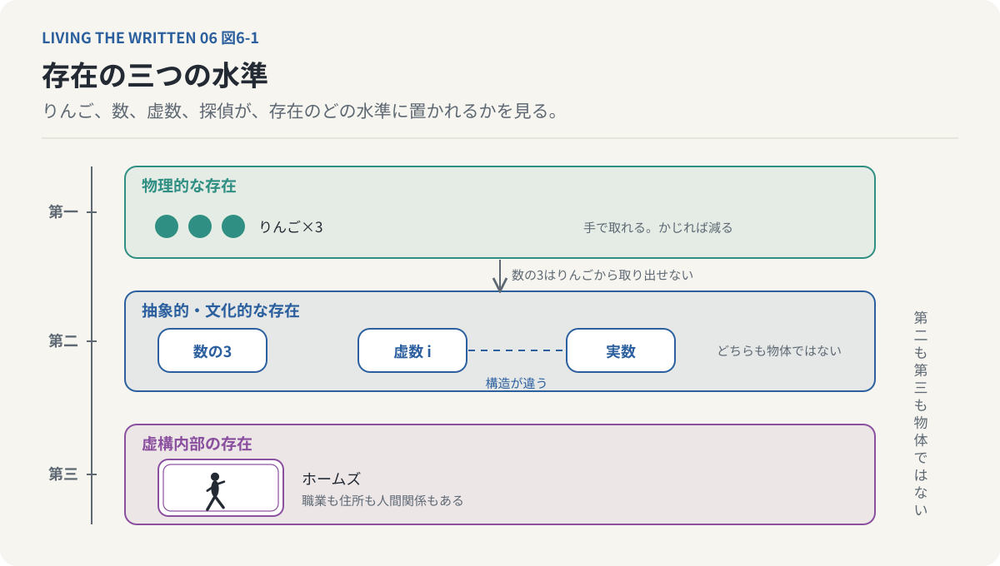
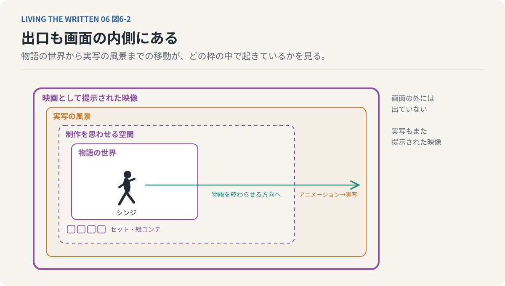
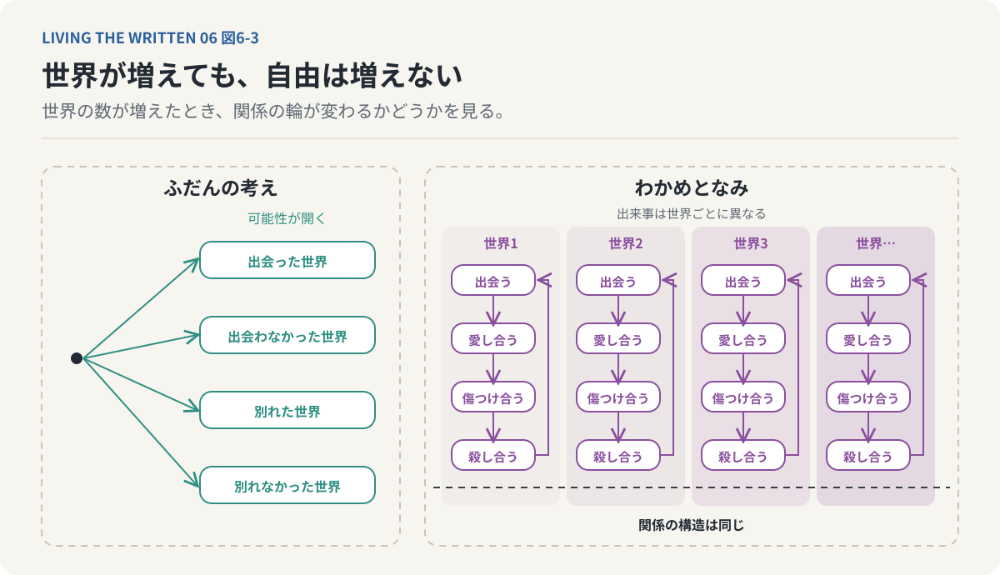
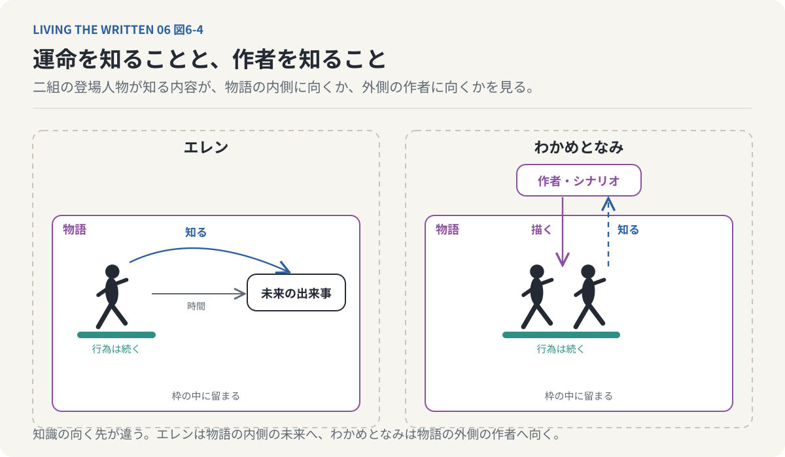
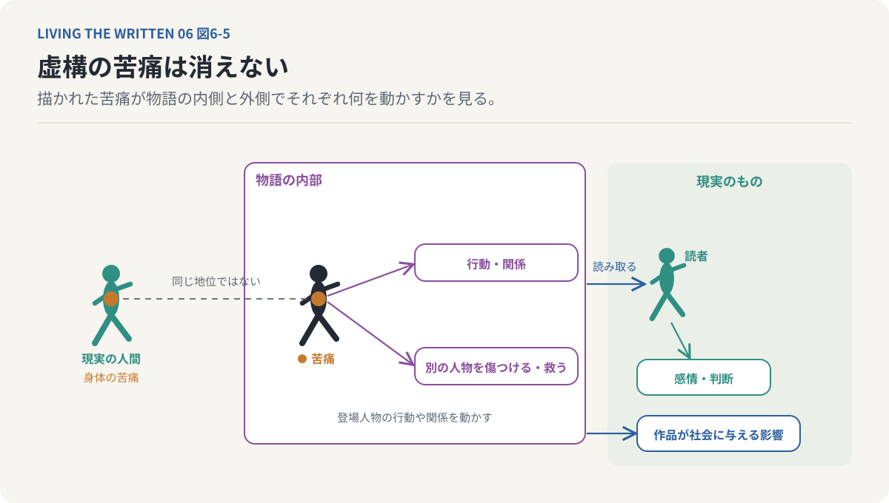
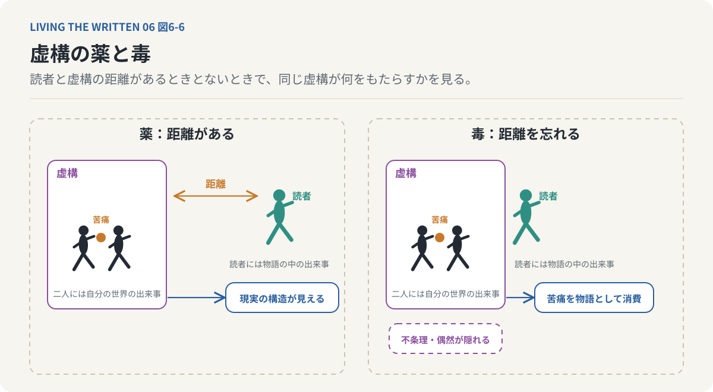
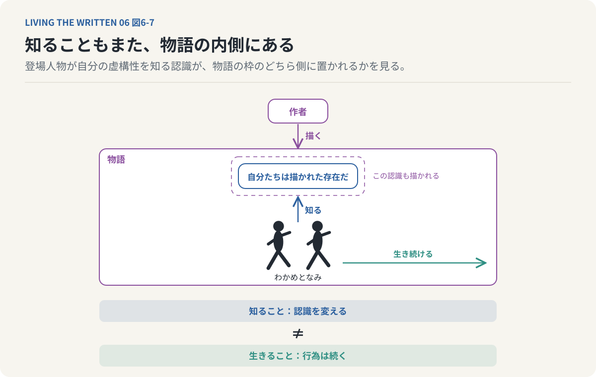

# 第6回　虚構だと知れば、その世界から自由になれるのか

## 『シン・エヴァンゲリオン』と『わかめとなみとむげんのものがたり』の存在論

<!-- NAV:TOP -->
[← 第5回](05-narrative-and-the-past.md) | [連載目次](../README.md) | [第7回 →](07-duration-and-incompletion.md)
<!-- /NAV -->

職場の避難訓練で負傷者の役が回ってきた。胸に貼られた紙には右足骨折と歩行不可の文字が印刷してある。書いたのは総務の誰かで、私の足はどこも痛くない。それでも合図が出ると私は廊下の床に横になり、担架が来るまで動かないことになっている。

床は冷たい。天井の蛍光灯が一本だけ消えた廊下で、通りかかった同僚が紙を読み上げてから担架を呼びに行く。私は自分が紙に書かれた負傷者であることを知っている。知っていることは床から起き上がる理由にはならない。笛が鳴るまでこの役は続く。

紙に書かれた役を知りながら、その役を続けている。物語の登場人物が自分の作者を知ったらどうなるかという古い問いと、この落ち着かなさは地続きに見える。ふだん私たちは現実と虚構をはっきり分けている。自分の意志で動く現実の人間に対して、登場人物は作者に動かされる。現実の苦痛は本物でも登場人物の苦痛は描かれた表現にすぎない。この区別を疑う人は少ない。

**自分が虚構の登場人物であると知ったとき、その人物は自分の世界から自由になれるのだろうか。**

もう一段先には、虚構だと知ってもなおその世界の中で苦しみ選択し行動し続ける存在をどう理解すればよいのか、という問いが控えている。ふつう私たちは存在するものについて物語が書かれると考える。虚構の登場人物では順序が逆になり、描かれることによって存在する。描かれた存在が自分の描かれ方を知ったとき何が起きるのかを今回は二つの作品で考える。

一方の作品では登場人物が自分の物語を終わらせる。もう一方では登場人物が自分の物語から逃れられないことを知る。二つの作品が揺さぶるのは自由意志だけではない。虚構であるという認識が存在の意味を変えるのかという問題まで、この二つは届いている。

### 三つのりんごと、数の3

目の前に三つのりんごがあるとする。りんごは手で取れるし、かじれば減る。けれど「3」という数そのものを、りんごとは別の物体として取り出すことはできない。三人の人間にも三冊の本にも三つの惑星にも同じ3という構造がある。数はどこにも転がっていない。

虚数と呼ばれる数がある。英語での名は imaginary number といい、文字どおりには想像上の数を意味する。二乗すると負になる、実数にはない性質を持つ。実数の範囲を広げる形で導入されたので存在しない数という響きがつきまとう。それでも電気回路や波動や量子力学の計算に使われて現実の現象を記述している。

りんごの例に戻れば物理的な実体ではない点で実数も虚数も同じである。両者の違いは一方が存在して他方が存在しないことにはなく、異なる数学的な構造の中で定義され、それぞれ固有の役割を持つことにある。数学的対象がどのように存在するかについては哲学の中でも立場が分かれており、虚数と実数が同じ資格で存在すると直ちには言えない。物理的な実体を持たないことが概念としての有効性を奪うわけではない。この一点だけを手がかりにする。

虚構と現実の違いも、存在するものと存在しないものの違いとして片づけてよいのか。数学の抽象物と文学の虚構を同一視はできない。物語の世界が物理世界と同じ仕方で存在すると証明できるわけでもない。それでも存在には物理的な実在のほかにも形式があるという発想は、虚構にも持ち込める。

探偵シャーロック・ホームズは現実のロンドンで事件を捜査した人物ではない。それでも彼には職業も住所も人間関係もある。物語の中で出来事に出会い、判断して動く。彼の推理に穴はなかったのか、別の選択はできなかったのかと読者は議論もする。現実には存在しない対象について私たちは意味のある言明をしている。

このねじれをほどくには存在の水準を少なくとも三つに分けるとよい。第一は身体や物体としての物理的な存在である。第二は言語や数学的対象や制度や作品のように、物理的な対象とは別の形式で成り立つ抽象的で文化的な存在を指す。第三が虚構世界の内部における存在で、登場人物は作品の設定と出来事の中にいる。小説の登場人物が虚構の内部に存在するといっても現実の身体を持つわけではないが、身体を持たないからといってその人物について何も語れないわけでもない。存在という言葉は一つの意味では使われていない。

*図6-1：三つのりんごは手で取れるが、数の3は取り出せない。虚数も実数も物体ではなく、違いは構造にある。虚構の登場人物も第三の水準で存在し、その人物について語ることはできる*

虚構の登場人物は現実の人間としては存在しない。それでいて物語の中では存在するものとして理解される。この二つは矛盾しない。虚構の存在論とは、存在のこの二重の使われ方を考える問題にほかならない。物語の内部に存在する人物が自分の存在形式を知ったら何が起きるかが、ここから先の主題になる。

### 虚構の外へ出ることも描かれる

庵野秀明の映画『シン・エヴァンゲリオン劇場版』[^anno-shin-eva]は長く続いたエヴァンゲリオンの物語を終わらせる作品である。終盤でスタジオのセットや撮影を思わせる空間が現れ、絵コンテや制作過程を連想させる表現が画面に入り込む。それまで物語の世界として提示されていたものが制作された映像であることを作品自身が示す。主人公のシンジはその中で物語を終わらせる方向へ進み、画面はアニメーションの世界から実写の風景へ移っていく。

映画を観ている間の私たちは登場人物の世界を一つの現実として受け入れる。その世界が制作されたものだと知っていても、観ている間は設定に従って出来事を理解する。ここではその前提が崩れる。作品の外部にあるはずの制作の仕組みが内部へ入り込む。物語が自分自身の虚構性や、物語として成立する仕組みを問題にする表現をメタフィクションと呼ぶ。登場人物の世界とそれを制作する側との境界が揺らぐ。

この変化は映像上の演出にとどまらず、虚構の物語が虚構であることを自ら示しながら終結する構造として読める。ただしシンジが現実世界へ物理的に移動したと断定する必要はない。実写の風景もまた映画として提示された映像であり、実写になったからといって作品が現実の外部へ文字どおり脱出したわけではない。虚構性を露出させた上で虚構を終わらせる、という表現上の構造がここにある。虚構の外部へ出ることさえ虚構の内部で描かれる。出口もまた画面の内側にある。

*図6-2：物語の世界の外側に制作の空間が現れ、画面は実写の風景へ移る。その実写もまた映画として提示された映像である。虚構を終わらせる出来事は、画面の内側で描かれる*

登場人物は自分の意志で作品の外へ移動できるわけではない。シンジが物語を終わらせるという出来事も制作者によって描かれたものである。虚構を終わらせたという結末も物語内部の出来事である。物語の内部から見れば、シンジはそれまでの世界の構造から解放され、自分の人生を引き受ける存在として描かれる。作品の外部から見れば、その解放もまた虚構の表現として成立しており、虚構を終わらせる物語を描き切ったところで幕が下りる。二つの視点は同時に成り立つ。

虚構の中で自由になることと虚構であることから自由になることは異なる。前者は物語内部の状態の変化で、後者はその存在が物語によって成立しているという条件そのものの変化である。シンジが成し遂げたのは後者の文字どおりの実現ではなく、その不可能性を含んだ上での虚構の終結だと読める。青山景の『ストロボライト』[^aoyama-strobolight]では書き手が書く行為によって過去の人物を物語の中に存在させた。一方は記述による存在の生成で、もう一方は記述された存在の物語的な終結にあたる。この対比は後に作品を完成させることと作り続けることの問題へつながる。

### 世界が増えても、自由は増えない

リトルサンダーの漫画『わかめとなみとむげんのものがたり』[^little-thunder-wakame]は、虚構の存在論を『シン・エヴァンゲリオン』とは別の方向から描く。主人公のわかめとなみは多数の並行世界を通じて関係を繰り返す。二人は異なる世界で出会って愛し合い傷つけ合って殺し合う。それぞれの世界で出来事は異なるのに関係の構造は反復する。単一の人生を始まりから終わりへ描く代わりに、複数の世界にわたって二人の関係がさまざまな形に変奏されていく。

別の世界があれば別の未来が開けるとふだん私たちは考える。ある選択をした世界と別の選択をした世界、出会わなかった世界と別れなかった世界が並ぶなら、可能性はいくらでもあるように見える。ところが二人の場合は世界が増えても自由は増えない。世界を変えても、浮かび上がるのは反復される関係である。可能性が無数に存在することは自由が無数に存在することを意味しない。選択肢が増えても同じ構造が繰り返されることがあり、異なる世界を経験してもそこから脱出できるとは限らない。

*図6-3：別の世界があれば別の未来が開くとふだん私たちは考える。二人の場合は世界が増えても同じ関係の輪が繰り返される。可能性の数は自由の数ではない*

終章「UNIVERSE 1」でわかめとなみは自分たちが漫画の登場人物であることを知る。経験してきた出来事にはあらかじめシナリオがあり、愛し合うことも傷つけ合うことも殺し合うことも描かれたものにすぎなかった。物語の内部に物語の外部についての知識が現れる。ふつう登場人物は自分が作者に描かれていることを知らず、自分の世界を唯一の現実として生きている。二人はその世界が制作されたものであることを知ってしまう。

これは未来を知ることよりも根本的な認識である。未来についての知識は出来事の内容にとどまるが、自分が虚構の登場人物だという知識はその出来事が成立する仕組みまで及ぶ。この出来事がなぜ起き、なぜ同じ関係を繰り返し、別の選択をしてもなぜ苦痛から逃れられないのか。その答えは物語の内部にはない。作者がそのように描いたからである。

自分が描かれた存在であることを知っても、描かれた存在であることから逃れられない。自己認識は世界の構造の理解をもたらす。その理解が世界の構造を変えるわけではない。二人は自分たちが虚構であることを知りながらその虚構を生き続ける。シンジは物語の内部で虚構の終結へ向かい、わかめとなみは自分たちが虚構であると知った上でそこに囚われ続ける。一方は虚構を終わらせる物語で、もう一方は虚構を終わらせられない物語である。

### 運命を知ることと、作者を知ること

未来の記憶を得る少年を思い出したい。『進撃の巨人』[^isayama-aot]のエレンは自分が何をすることになるのかを知りながら、自由を求め続ける。彼の行動は未来の既知性と主体的な欲望の関係を問い直した。わかめとなみの認識はこれと水準が違う。エレンが知るのは物語内部における未来の出来事で、わかめとなみが知るのは自分たちの世界そのものが作者に描かれた虚構だという事実である。

エレンは未来の出来事を知っていても自分の欲望や判断を経験し続ける。彼の知識は物語内部の因果構造に属する。なぜ自分がその行動をするのかを完全に理解しているわけではない。わかめとなみには出来事の成立理由を説明する別の水準があり、行為の背後に作者とシナリオがあることまで認識している。知識が向けられているのは物語そのものの成立条件である。作者の存在を知ることは、行動の具体的な動機を説明することとは同じではなく、知ったところで行為の苦痛が消えるわけでもない。

自由意志の問題がここで形を変えて戻ってくる。未来が確定していても行為する主体の経験は消えない。同じように、行為が描かれたものだと知っても登場人物の主観的な経験は物語の内部から消えない。ただし両者は完全には重ならない。

エレンでは自由意志と決定論の関係が問題になり、わかめとなみでは自由意志に加えて、登場人物の存在を成立させる作者と物語の関係が問題になる。運命を知ることと自分が運命を描かれた存在だと知ることは異なる。後者は自由意志の問題を虚構の存在論へ広げる。

*図6-4：エレンが知るのは物語内部の未来の出来事で、わかめとなみが知るのは自分たちを描く作者の存在である。知識の向く先は違うが、どちらも物語の枠の中で行為を続ける*

何かに囚われているとき、その構造を理解すれば自由になれると私たちは考えることがある。自分を縛る制度を知り、判断に影響する慣習や信じている物語を知る。こうした認識は状況を変える契機になる。それでも認識と解放は同じではない。ある社会制度が自分の行動を制約していると知り、その仕組みを完全に理解しても、制度が消えるわけではない。自分の置かれた状況を説明できることと変更できることは別である。

同じことは人間の認識にも当てはまる。判断に偏りがあると理解していても、その偏りから完全に自由になれるとは限らず、同じ失敗を繰り返していると知っていても次に同じ状況で違う行動を取れるとは限らない。知識は行為を変える可能性を持つが、それだけで行為が変わるわけではない。この構造をわかめとなみは極端な形で示している。二人は自分たちが虚構の登場人物だと知り、それでも作者に描かれた世界の内部から出られない。構造を知ることは構造を超えることではない。

知識が無意味だという主張ではない。知識は世界の理解を変える。世界を理解する能力と世界を変更する能力は区別して考えるほかない。囚われていると知ることは解放の出発点になりうるが、それだけで解放が成立するわけではない。

### 虚構の苦痛は消えない

虚構の登場人物が苦しんでいるとする。読者はその人物が現実には存在しないことを知っている。身体も経験も苦痛も作者によって描かれたものである。その苦痛は存在しないのか。

現実の人間が経験する苦痛と虚構の登場人物に描かれた苦痛が同じ存在論的な地位を持つわけではない。現実の人間には身体の感覚と意識があるが、虚構の登場人物が実際に主観的な経験を持っているという証明はない。登場人物が現実の人間と同じ仕方で苦しんでいると断定はできない。

それでも物語の内部では登場人物の苦痛は出来事として成立している。その苦痛は登場人物の行動や関係に影響し、別の人物を傷つけたり救おうとしたりする動機になる。読者はその苦痛を読み取って感情や判断を形づくる。現実の人物が苦しんでいるわけではないが、虚構の苦痛が無意味なわけでもない。読者が経験する感情も作品が社会に与える影響も現実のものである。虚構の苦痛は現実の身体的苦痛ではないが、虚構であることによって苦痛の表現が持つ意味まで消えるわけではない。

*図6-5：描かれた苦痛は現実の身体の苦痛と同じ地位を持たない。それでも物語の内部では行動と関係を動かし、読者の感情と作品の影響は現実のものとして残る*

わかめとなみはこの問題を登場人物自身の認識へ折り返す。二人は自分たちが虚構であると知り、自分たちの苦痛が描かれたものだと知る。その知識によって物語内部の苦痛が止まるわけではない。虚構性の認識は苦痛からの救済を保証しない。

作品の「UNIVERSE 4A」と「UNIVERSE 4B」には2019年夏という時間設定が置かれている。2019年の香港では逃亡犯条例改正案への抗議運動が広がり、政治的自由や民主的な権利をめぐる大きな対立へ発展した。この対応を踏まえるとわかめとなみの物語は自由をめぐる政治的な寓話として読める。二人は自分たちの世界が決められたものであることを知った上で行動し、抵抗する。異なる世界へ移っても苦痛や対立は繰り返される。その反復は行為が消えることを意味しない。

未来が決まっていたとしても行為は省略できない。抵抗が成功するかどうかを知っていることと抵抗を実際に行うことは異なる。ただし現実の政治運動と虚構の登場人物を同一視はできない。現実の人々の未来は作者が書いたシナリオとして確定しているわけではなく、現実の抵抗には制度や権力関係を実際に変える可能性がある。この対応が示すのは現実の政治運動の無意味さではなく、結果の不確実性や構造的な制約の中でそれでも行為することの意味である。

自由が保証されていないことは自由を求める行為が無意味であることを意味しない。行為の意味は成功した結果だけで決まるわけではなく、抵抗すること自体が何を受け入れず何を求めるのかを表す場合がある。一方で、その行為を美しい物語として読む読者は現実の苦痛を経験している当事者とは別の位置にいる。この距離が消えることはない。

### 虚構の薬と毒

小説や映画に描かれた出来事が現実に起こったとは限らない。それでも虚構によって現実の問題が深く理解されることがある。架空の人物の孤独を描くことで現実の人間の孤独が見え、架空の社会を描くことで現実の制度が抱える問題が明らかになり、架空の未来を描くことで現在の選択の含意が浮かび上がる。虚構は現実をそのまま写す必要がない。現実から一定の距離を取ることで、現実では見えにくい構造を強調できる。

この連載で扱ってきた作品はどれも現実にない設定から出発している。異星人の言語を通じて人間の時間認識を問い直す物語も、未来の記憶を通じて自由意志と運命の関係を問い直す物語も、設定そのものは現実に存在しない。わかめとなみの物語は、二人が自分の虚構性を知るという設定から存在と自由の関係を問い直す。虚構は事実ではないのに事実だけでは見えにくい真実を示すことがある。ただし虚構が示す真実は物理的な事実と同じ意味で検証されるものではなく、人間の経験や価値や関係や社会構造についての理解として成立する。虚構の価値は現実の出来事を正確に再現することだけでは測れない。

虚構には危険もあり、物語を通じて他者の苦痛を理解する一方で苦痛を美しい物語として消費してしまうこともある。戦争を描いた映画を観て登場人物の勇気や犠牲に心を動かされたとする。そこで描かれた苦痛を感動的な物語として受け取ることと、現実の戦争で苦しむ人々の経験を理解することは同じではない。虚構の中では苦痛に構造や結末が与えられる。現実の苦痛が常に意味のある結末へ向かうわけではない。物語は出来事を理解可能な構造へ組み立てることで現実を理解しやすくし、同時に現実にある不条理や偶然を覆い隠すこともある。

虚構は現実を理解する薬になる。虚構と現実の違いを忘れたとき、同じものが現実を歪める毒にもなる。この漫画を読むとき二面性はとりわけ鋭くなる。読者は二人が虚構の登場人物であることを知っており、一定の安全な距離からその苦痛を読むことができる。作品の内部では二人は自分たちの苦痛を経験する存在として描かれている。読者には物語の中の出来事が、登場人物には自分たちの世界で起こる出来事である。

*図6-6：虚構は現実から距離を取ることで見えにくい構造を見せる。距離を忘れると苦痛は感動的な物語として消費され、現実の不条理は隠れる。同じ虚構が薬にも毒にもなる*

現実の人間と虚構の登場人物の存在論的な違いは残る。それでもこの漫画は読者に一つの問いを向ける。自分が安全な場所から苦痛を読んでいるという事実を、どこまで自覚しているのか。虚構の存在論はここで倫理の問題へ接続する。他者の苦痛を理解したつもりになることと、他者の苦痛に向き合うことは異なる。この区別は虚構の登場人物に対してだけでなく、現実の他者に対しても働く。

### 知ることと、生きることは違う

私たちは現実に生きている。それでも現実を理解するときには言語や物語を使っている。自分が何者であり社会の中でどんな役割を持つのか、何を成功と呼んで何を自由と呼ぶのかといった理解は、個人の内部だけでは成立しない。それらは社会の制度や文化や言語や歴史的な物語の影響を受けている。ある社会では特定の職業に就くことが成功の象徴とされ、別の社会では家族を持つことや共同体に貢献することが人生の重要な価値とされる。私たちはこうした物語を通じて自分の人生を理解している。

社会的な物語が虚偽だという話ではない。それらは現実の制度や関係を理解し、行為を方向づける枠組みとして働いている。枠組みを認識したからといって直ちに自由になれるわけではない。社会的な期待に影響されていると理解しても、その期待から完全に逃れられるとは限らない。判断を支える価値観も知っただけでは変えられない。

わかめとなみの問題はここで現実の自己理解へ接続する。二人は自分たちが作者によって描かれた存在であることを知り、私たちは自分たちが制度や文化的な物語によって形づくられていることを知る場合がある。両者は同じではない。現実の人間は一人の作者にすべての行動を記述されているわけではない。それでも比べられる点は一つ残る。自分を形成する構造を認識しても、そこから直ちに自由になれるわけではない。

自由についての別の理解がここから生まれる。自由とはあらゆる構造から完全に独立した状態ではないのかもしれない。自分が置かれた構造を理解し、その中で何を引き受け何を変えようとするかという行為に関わる問題だと考えることもできる。自由が常に成立するという意味ではない。現実には行為を制約する制度や権力がある。制約を理解することと、その中でどう行為するかは別の問題として考えられる。

シンジは制作の仕組みが露出した画面の中で物語の終結へ向かい、わかめとなみは自分の虚構性を知りながらその物語から逃れられない。一方は虚構を終わらせることで新しい世界への移行を描く。もう一方は虚構を知ってもなおその内部で生き続けることを描く。**虚構であることを知っても、虚構であることから自由になるわけではない。**

未来を知っていても未来を生きなければならないという、未来の記憶を得たエレンの問題と対応している。未来を知ることと未来を経験することが異なるように、自分が虚構だと知ることと虚構の構造から脱出することは異なる。知識はその対象についての認識を変える。知識だけで対象の存在条件が変わるわけではない。

虚構であると知った後にも物語は続く。わかめとなみは自分たちが描かれた存在だと知り、その認識もまた物語の一部として描かれる。虚構についての知識さえ虚構の内部に取り込まれ、自分が登場人物であると知る登場人物も依然として登場人物である。この自己言及の構造は外部への完全な脱出の難しさを示している。

*図6-7：二人は自分たちが描かれた存在だと知る。その認識も作者に描かれた物語の一部であり、知った後も二人はその世界で生き続ける。知ることは認識を変えるが、生きることを置き換えない*

虚構と現実は同じ存在形式を持たない。現実の人間は身体を持って他者と関わり、物理的な世界の中で生きている。虚構の登場人物は物語によって構成された存在である。この違いを消す必要はない。

それでも虚構であることによって作品の意味や読者への影響が消えるわけではない。登場人物が自分の虚構性を知るとき、当然視していた自由や存在の概念まで問い直される。シンジが虚構を終わらせることも、わかめとなみが物語の中で生き続けることも行為として描かれている。二つの作品に共通するのは虚構であるという認識が行為の問題を消去しないことである。

この連載は時間を知覚することと時間そのものの構造、出来事の因果と出来事全体の意味を区別してきた。未来を知ることと未来を生きること、同じ時間を共有することと共に生きること、過去の事実と現在の物語が生む過去の意味も同じように分けてきた。今回加わったのは虚構であることを知ることとその虚構の内部で行為することの区別である。何かを知っていることとそれを経験し行為し存在させることは同じではない。未来を知っていても未来を生きなければならず、過去を記憶していても過去の意味は解釈され続け、虚構であると知っていても物語の内部では行為が続く。知識は存在を完全には代替しない。

存在が行為や関係によって成立するなら、その行為や関係はいつまで続くのかという問いが残る。物語が完成したとき何が残り何が失われるのか、絵が完成したとき描く者と描かれるものの関係はどう変わるのかという問題が、その先に待っている。完成した作品が残る。制作が終われば対象との関係の一つも終わる。

廊下の床で私は担架を待っている。胸の紙には右足骨折と印刷されたままで、笛はまだ鳴らない。わかめとなみは自分たちが描かれた存在だと知った。知ったあとも、二人はその世界にいる。

---

次回：第7回「なぜ完成させることが、失うことになるのか」

## 参考文献・注記

探偵シャーロック・ホームズはコナン・ドイルの一連の作品の登場人物。本文で触れた虚数と実数、数学的対象の存在をめぐる哲学の立場（実在論、形式主義、構成主義）、メタフィクション、2019年の香港の抗議運動は、いずれも概説の範囲で述べており、特定の文献からの引用はない。「虚構の存在論」は哲学で一般に使われる呼び名で、存在の三つの水準の区別は筆者の整理である。書く行為によって書かれる人物が存在を得る構造は第5回（青山景『ストロボライト』）、未来の記憶を得たエレン（諫山創『進撃の巨人』）と自由意志の問題は第3回で扱った。異星人の言語を通じて時間認識を問い直す物語はテッド・チャン『あなたの人生の物語』（第1回）を指し、連載ではほかに『たゆたいエマノン』（第4回）を扱った。作品の完成と喪失の問題は第7回で扱う。

[^isayama-aot]: 諫山創（2009）. [進撃の巨人](https://shingeki.net/)。『別冊少年マガジン』（講談社）2009〜2021年連載。進撃の巨人の継承者が未来の継承者の記憶を見るという設定によって、未来と過去が互いに関与する因果の循環が描かれる。リンク先は公式サイト。
[^aoyama-strobolight]: 青山景（2009）. [ストロボライト](https://ja.wikipedia.org/wiki/%E3%82%B9%E3%83%88%E3%83%AD%E3%83%9C%E3%83%A9%E3%82%A4%E3%83%88)。太田出版、2009年。小説家の浜崎正が二十歳の自分を小説として書くことで、書く者と書かれる者の関係が物語の中心になる。リンク先は日本語版Wikipediaの項目。
[^anno-shin-eva]: 庵野秀明（総監督）（2021）. [シン・エヴァンゲリオン劇場版](https://www.evangelion.co.jp/final.html)。2021年公開。物語が自らの虚構性を露わにしながら終わる構造を、本連載は「虚構の外へ出る物語」として扱う。リンク先は公式サイト。
[^little-thunder-wakame]: リトルサンダー（Little Thunder／門小雷）（2020）. [わかめとなみとむげんのものがたり](https://www.goodreads.com/book/show/87730299)。2019年の香港を舞台に、因縁で結ばれた二人が何度生まれ変わっても傷つけ合う物語。終章で二人は自分たちが漫画の登場人物であることを知る。リンク先は邦訳版の書誌ページ。

<!-- NAV:BOTTOM -->
---

[← 第5回](05-narrative-and-the-past.md) | [連載目次](../README.md) | [第7回 →](07-duration-and-incompletion.md)
<!-- /NAV -->
