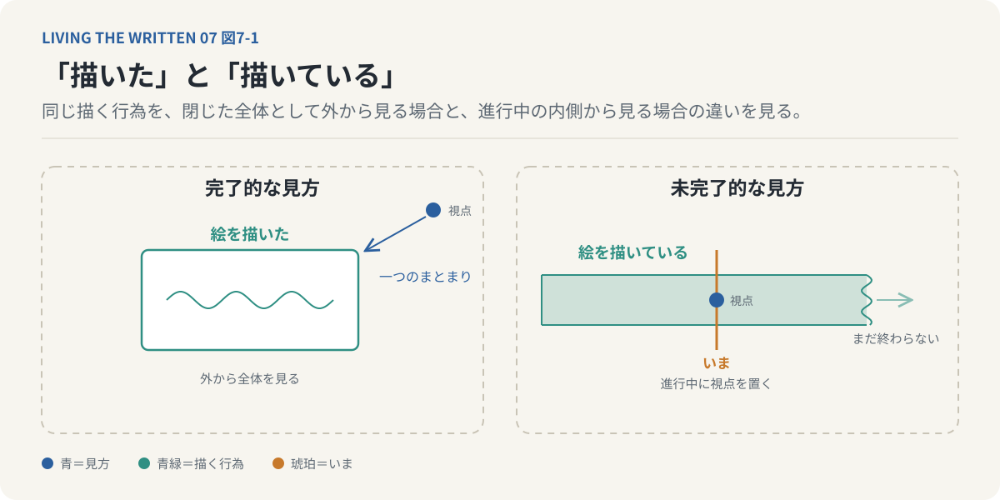
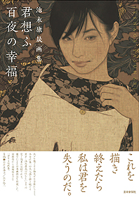
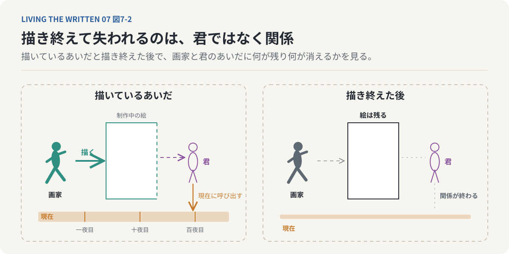
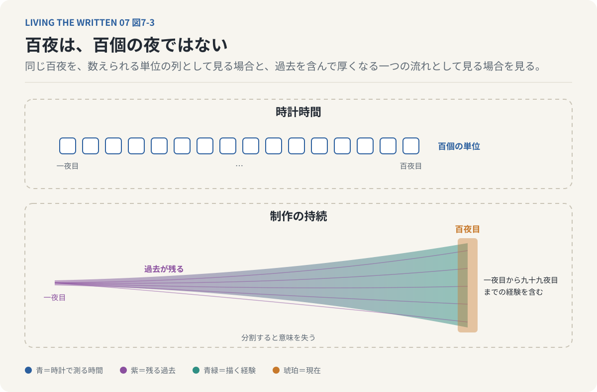
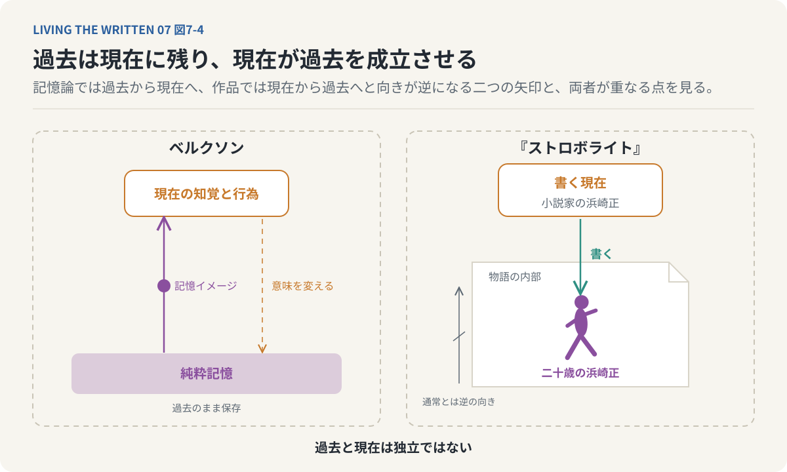
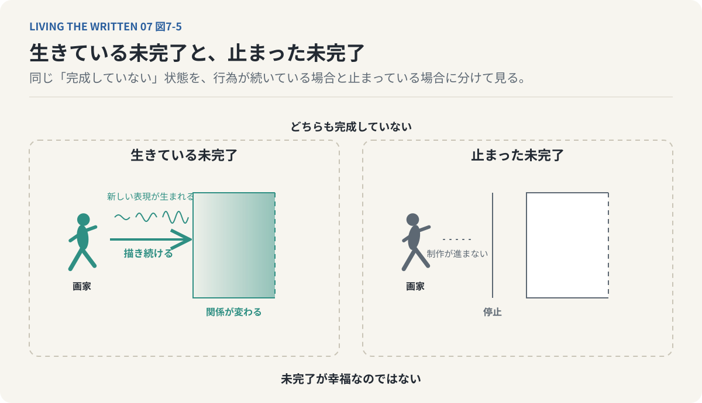
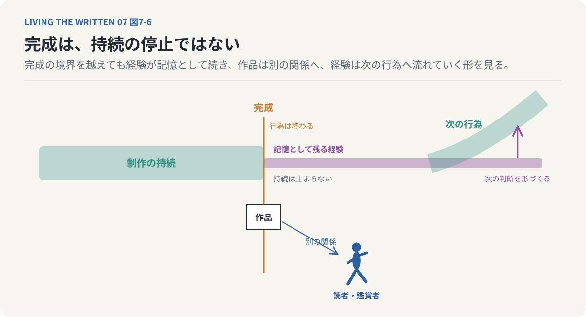
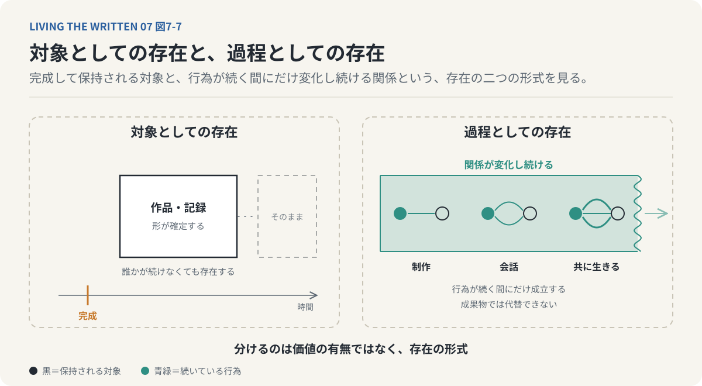

# 第7回　なぜ完成させることが、失うことになるのか

## ベルクソンの持続と、描き終えないことの存在論

<!-- NAV:TOP -->
[← 第6回](06-ontology-of-fiction.md) | [連載目次](../README.md) | [第8回 →](08-living-the-written.md)
<!-- /NAV -->

画家が百夜をかけて一人の「君」を描く。描き終えれば絵は残る。それでも描き終えた瞬間に、画家は君を失う。

**完成することで初めて得られるものがあるなら、完成することで失われるものもあるのではないか。**

絵を描くなら完成させたいし小説を書くなら最後まで書きたい。未完成とは目標にまだ届いていない状態で、完成はその不足が解消された状態だと私たちは考える。この見方では未完成は克服の対象でしかない。何かを描き続けることや書き続けることや誰かを思い続けることを完成へ至る途中経過としてだけ見てよいのかを考えたい。言語学のアスペクトと、時間を分割できない流れとして捉えた哲学を手がかりにする。

### 描いている絵と、描き終えた絵

画家はキャンバスに向かって一日目に輪郭を描く。二日目に色を重ねて三日目に細部を描き込む。描く行為が続くにつれて画面は変わっていく。ある時点で画家は完成を宣言する。制作の途中にあった絵と完成した絵の違いを、完成度の差としてだけ説明することはできない。制作中の絵はまだ変化する可能性を持っていて、次の一筆で構図や色彩が変わるかもしれないし、画家自身がそれまで描こうとしていたものとは別の対象を発見するかもしれない。

制作中の絵は物理的な画面であり変化し続ける過程でもあって、完成した絵ではその制作過程がいったん閉じられる。完成を宣言した時点で、画家はその絵についてこれ以上描き続けないという判断を下している。もちろん完成後に手を入れることはある。それでも完成で変わるのは画面の状態だけではない。制作中の絵は次の行為を求める対象であり、完成した絵は行為の結果として残された対象になる。完成とは絵の状態の変化であると同時に描く者と絵との関係の変化でもある。

この違いは言葉の形にも現れている。「絵を描いた」と「絵を描いている」を比べると、前者は描くという出来事を一つのまとまりとして捉え、後者は行為の進行中に視点を置いている。出来事の時間的な展開をどの観点から捉えるかを表すこの文法の区分を言語学ではアスペクトと呼ぶ。ここでは前者を完了的な見方、後者を未完了的な見方と呼んでおく。日本語の「た」や「ている」が常にこの二つに一対一で対応するわけではなく、「ている」には進行中だけでなく結果状態を表す用法もある。それでも未完了的な見方のもとでは行為はまだ終結していない過程として経験される。

*図7-1：「描いた」は行為を一つのまとまりとして捉え「描いている」は進行中に視点を置く。未完了は行為が存在しない状態ではなく開かれている状態である。この見方の違いが成果物の完成と行為の成立を分ける出発点になる。*

取り出したいのは、行為を完結した全体として捉えることと、その内部で進行している過程として捉えることの違いである。「小説を書いている」という状態を考える。その小説はまだ完成していない。けれど書くという行為が存在していないわけではなく、むしろ現在進行形で成立している。未完成だからといって書く行為が不完全な存在になるのではない。

成果物の完成と行為の成立は別のものとして分けられる。作品が最終の状態に到達して制作の結果が確定することと、制作が実際に行われて作品と制作者の関係が続いていることは、一方が欠けていても他方は成り立つ。行為の価値も完成した成果物だけで決まるわけではない。未完了とは行為が存在していない状態ではない。行為がまだ開かれている状態である。この区別が一人の画家の言葉を読むための出発点になる。

### 百夜のあいだ、君は現在に呼び出される

池永康晟の画集『君想ふ百夜の幸福』には描き終えることを喪失として捉える言葉がある。表紙に画家は「これを描き終えたら私は君を失うのだ。」と記す[^ikenaga-hyakuya]。画家は百夜のあいだ対象を見つめて思い、描く。一夜目にも十夜目にも百夜目にも描く。百夜という時間は制作に費やした時間の長さではない。対象に向かい続けた時間である。

*書影：『君想ふ百夜の幸福 池永康晟画集』（芸術新聞社、2014年）[^ikenaga-hyakuya]*

画家は絵を完成させようとしている。完成させてしまえば描き続けるという関係は終わる。描かれる「君」はそれまで制作中の絵を通じて繰り返し現在へ呼び出されていた。完成した後も絵は残る。けれど描くという行為によって対象を現在に呼び出し続ける関係は、同じ形では続かない。

失われるのは描かれる人物そのものではない。制作という行為の中で成立していた、対象との特定の関係である。描き続けている間の画家は対象に向かっている。描き終えるとその行為は過去のものになり、完成した絵は描いていた時間の痕跡として残される。完成によって作品が失われるのではない。作品を生み出していた時間が終わる。

描き終えることは描かれた対象を失うことではなく、百夜にわたって描き続けることで成立していた対象との関係を失うことである。こう捉えると完成への欲望と完成への恐怖が同時に成立する理由が見えてくる。画家は作品を完成させたい。それでも作品が完成すれば描き続ける時間は終わってしまう。完成は望ましい到達点であり、同時に現在進行形の関係を失う境界でもある。

*図7-2：画家は百夜のあいだ描く行為を通じて君を現在に呼び出し続ける。完成しても絵も君も失われず、描くことで成立していた関係だけが終わる。完成への欲望と完成への恐怖はここで同時に成り立つ。*

### 百夜は、百個の夜ではない

私たちは時間を時計で測る。一分は六十秒で一時間は六十分であり、百夜も百個の夜として数えられる。一日目も二日目も同じ二十四時間で測れる。ところが経験される時間は均質な単位の集まりではない。楽しい時間は短く、苦痛を伴う時間は長く感じられる。ある瞬間が人生全体を変えるほどの意味を持つこともあれば、振り返ると何年もの時間が一つの経験としてまとまっていることもある。

旋律を聴くときのことを考えるとよい。旋律は一つ一つの音が順番に鳴ることで成立するが、私たちはそれぞれの音を独立したものとして聴いているわけではない。前の音の響きや記憶が残っているからこそ次の音を旋律の一部として理解できる。ある音の意味は前の音との関係から生まれ、後の音によってそれまでの旋律の印象が変わることもある。独立した瞬間を足し合わせるだけではこの経験を説明しきれない。

ベルクソン[^bergson-essai]はこのように経験される時間を、時計によって空間的に区切られた時間から区別して持続と呼んだ。

> 純粋持続とはまさに、互いに溶け合い、浸透し合い、明確な輪郭もなく、相互に外在化していく何の傾向性もなく、数とは何の類縁性もないような質的諸変化の継起以外のものではありえないだろう。それはつまり、純粋な異質性であろう。[^bergson-essai]

持続とは意識の状態が互いに浸透し合いながら変化していく質的な連続性のことで、長い時間を意味する語ではない。一秒であってもその経験は持続として捉えられるし、百年であっても百個の一年を足し合わせるだけでは経験の質を説明できない。持続において過去は現在から切り離されず意識の中に残って現在の経験のあり方を変える。新しい経験が加わるたびにそれまでの経験全体の意味も変わる。現在は孤立した点ではなく過去を含みながら変化し続ける過程になる。

この見方を百夜に当てはめる。時計時間としての百夜は一夜目から数えて百個の単位になる。描く行為の持続として捉えると事情は異なる。一夜目に描いたことは二夜目の描画に影響し、二夜目までの経験は三夜目の画家の視線や判断を変える。九十九夜を描き続けた画家は、一夜目と同じ状態で百夜目を迎えるわけではない。それまでの制作経験が画家自身と作品の双方に蓄積されている。

百夜の制作は百個の独立した作業ではない。一夜目から百夜目までの経験は互いに関係しながら一つの制作過程を形づくっている。百夜目の幸福は百夜目だけから生まれたものではなく、そこには一夜目から九十九夜目までの経験が含まれている。

*図7-3：時計時間では百夜を百個の単位に分割できる。持続として見ると一夜目の経験は二夜目以降に残り、百夜目の幸福には九十九夜分の経験が含まれる。絵には百夜の痕跡が残るが過程そのものは絵から復元できない。*

時計時間では百夜を百個の単位に分割できるが、制作経験としての百夜は各時点を切り離すとその時間が持っていた意味を失う。完成した絵にはその百夜の痕跡が残る。けれど絵から百夜の経験そのものを復元できるわけではない。作品は過程の結果であって過程そのものではない。

百夜の幸福は時間の長さではなく、百夜を一つの持続として生きたことにある。描き終えることで失われるのは次の日も描くという予定ではない。それまで過去を含みながら続いていた一つの制作の持続である。

### 書き続けることが、過去を存在させる

昔よく聴いた曲を何年も経ってから聴いたとする。その瞬間にかつての場所や人物や感情が思い出されることがある。そのとき経験しているのは過去をそのまま再生したものではなく、現在の自分による過去の想起である。十年前の自分と現在の自分は違うから、同じ曲であっても現在における意味は異なりうる。過去の経験は現在の自分の中に残っている。ただしその過去は現在の経験から独立して現れるわけではない。

ベルクソンは記憶を二つに分けた。過去が過去のまま保存されている記憶を純粋記憶[^bergson-mm]と呼び、現在の知覚や行為に関係して意識に現れる記憶を記憶イメージと呼ぶ。この区別では過去は消滅したものではない。現在の経験に結びつき、それに働きかける。

青山景の漫画『ストロボライト』[^aoyama-strobolight]では現在の小説家である浜崎正が二十歳の浜崎正を書く。その行為によって過去の浜崎正が物語の内部に立ち上がる。通常は過去があったから現在の記憶が存在すると私たちは考えるが、この作品では逆に現在の書く行為によって過去の自分が存在を獲得する。

ベルクソンの記憶論では過去が現在の中に持続する。『ストロボライト』では現在の記述が過去を物語として成立させる。両者は同じ理論ではないが、過去と現在を独立したものとして扱えない点で重なる。過去は現在の中に残り、現在は過去の意味を変え続ける。

*図7-4：ベルクソンでは過去は純粋記憶として残り記憶イメージとして現在に現れる。『ストロボライト』では現在の書く行為が二十歳の浜崎正を物語の内部に立ち上げる。向きは逆でも過去と現在を切り離せない点で重なる。*

書くという行為は続いている。小説を書き続ける限り書かれる過去も展開し続ける。一文を書けばそれまでの文章との関係が変わり、次の場面を書けば以前の出来事の意味が変わり、登場人物の行動を描けばその人物がどのような存在であったかという理解も変わる。変更されるのは現実の歴史的な過去ではない。作品の内部で書く行為が過去の存在を成立させている。

池永康晟の描く行為との対応がここにある。描き続けているあいだ対象との制作上の関係が維持され、描画が進むことで対象の表現が変わり、完成によってその関係が終わる。書き続けているあいだ過去の自己が物語として展開し、記述が進むことで過去の意味や存在のあり方が変わり、書く現在と書かれる過去が接近してやがて収束する。池永の場合は描く行為が終わる。浜崎正の場合は書く現在と書かれる過去の区別が失われる。いずれも完了が成果物の成立ではなく関係の変化として描かれている。

書く者は書かれる者よりも未来にいる。だから書く者は書かれる者が知らない出来事を知っている。この非対称によって書く行為が成立している。書かれる時間が進むにつれて物語の中の浜崎正は書いている浜崎正に近づき、過去と現在のあいだにあった距離が縮まる。書かれる自分が現在の自分に追いついたらどうなるか。

書く者と書かれる者が同じ時点に並ぶと現在の書き手が過去の自分を語るという構造は変わる。現在の自分が書いているという行為そのものを記述しようとすればその記述もまた新しい出来事になる。書く行為を記述すればその記述を書く行為が生じ、さらにその行為を記述しようとする。自分自身を完全に物語ろうとするとき物語るという行為自体が新たに物語られるべき対象になる。書き続ける限り書くという行為は現在進行形で存在するが、その行為を完全に記述し終えようとすれば記述そのものが新しい現在を生み出してしまう。

ベルクソンにおいて現在は孤立した瞬間ではなく、過去を含みながら変化する過程であった。『ストロボライト』では現在の執筆行為が過去を物語として生成し、その過去が現在へ追いつこうとする。構造は異なる。それでも現在を固定された一点として捉えられない点で両者は共通している。

### 未完了は、欠けていることなのか

未完成という言葉には否定的な響きがある。まだ完成していない、まだ終わっていないという言い方は、完成した状態を基準にして現在の状態を不足として評価している。描いているという行為は描き終わっていないから存在しないのではない。書いているという行為も書き終わっていないから成立していないのではない。むしろその行為は現在進行形で成立している。

誰かと会話している状態を考える。会話が終わっていないからといってその会話が成立していないわけではない。会話しているという関係はまさに進行しているあいだに存在し、会話が終わればその行為は過去のものになる。誰かと旅をしているときも旅の価値は目的地への到着だけにあるわけではない。移動している時間や途中で見た風景や交わした言葉にも価値がある。旅が終わったからこそ全体を振り返れる一方で、旅の途中にしか存在しない経験もある。

完成によって成立する価値は、結果が確定して成果物を他者へ渡せるようになり全体を振り返って評価できることにある。未完了の過程に成立する価値は、行為を現在進行形で経験しながら対象との関係を保ち新しい可能性に向かって変化し続けることにある。二つは対立するものではない。完成した成果物の価値が制作過程のすべてを代替しないというだけである。未完了とは完成の不足であるだけではない。完成によって失われる固有の価値が存在する状態でもある。

終わらせたくないという気持ちはここから説明できる。好きな小説を読み終えたくない、長く続いた旅を終えたくない、親しい人との会話を終えたくない。これらは結末を恐れているからではない。終わることでそれまで成立していた関係が変わるからである。

読んでいる間の読者は物語の続きを経験している。読み終えるとその関係は読書中の経験から読後の記憶や解釈へと変わる。旅をしている間の旅人は新しい景色や出来事を経験し、旅が終わるとその経験は記憶になる。会話している間の二人は互いの言葉に応答し続けている。会話が終わるとその相互作用は一度閉じられる。

完成そのものを拒んでいるのではなく、現在進行形で成立している関係を失いたくないのである。その関係は完成した成果物だけでは保存できない。旅の写真は残る。それでも旅をしている時間そのものは戻らない。会話の記録が残っても会話している現在を保存することはできない。描き続けていた百夜を完成した絵へ移し替えることはできず、絵だけが残る。

記録と経験の違いがここにある。未来を知っていることと未来を生きることが違うように、完成した作品を持っていても制作していた時間を再び生きられるわけではない。結果を手に入れることはその結果へ至る時間を所有することではない。人生の価値を成果や到達点だけで測ることには限界がある。

### 生きている未完了と、止まった未完了

百夜のあいだ描き続ける時間には描くという行為を通じた対象との関係がある。完成を遅らせるほど幸福は増えるのか。単に完成を先延ばしにするだけでは持続の価値が生まれるとは限らない。描くことが苦痛になって対象との関係が失われているなら、未完了であることは幸福を意味しない。完成しないことへの恐怖で制作を止めてしまえば、描くという行為の持続も失われる。

二つの未完了を分けておきたい。一つは行為が生きている未完了で、描き続けることで対象との関係が変わり新しい表現が生まれる。もう一つは行為が停止したままの未完了で、完成していないが制作も進んでいない。価値を持つのは未完了という形式そのものではなく、その未完了の中で何が経験され何が生成されているかである。未完了が幸福なのではない。未完了の行為の中に幸福が成立する場合がある。

*図7-5：完成を先延ばしにするだけでは持続の価値は生まれない。行為が生きている未完了では描き続けることで関係が変わり表現が生まれるが、止まった未完了では何も生成されない。価値は形式ではなくその中で何が経験されるかにある。*

同じように完成が不幸なのでもない。作品を他者へ渡し、自分の行為を一つの成果として受け止め、新しい制作へ進む喜びがある。終わらせるべき行為もあるし続けることで苦痛が増す関係もある。未完了を無条件に肯定することもできない。未完了であることそれ自体が常に価値を持つわけではなく、その行為が続いていることでどのような関係や経験が成立しているかが問われる。完成と未完了のどちらか一方を絶対化することはできず、どのような関係を持続させどのような関係を終わらせるのかという判断が残る。

完成によって成立するのは成果物としての存在である。未完成の絵はまだ作品として十分に成立しておらず、完成した絵は一つの作品として確定する。制作中に存在していたのは画家と対象との現在進行形の関係であって成果物としての存在と同じではない。

完成した絵は残るが描き続ける行為は終わる。完成した小説も残るが書き続ける行為は終わる。完成は単純な獲得ではない。何かを得ることで別の何かを失い、成果物が確定することでそれまで開かれていた制作の可能性が閉じられる。

もちろん完成後に新しい解釈や関係が生まれることはある。完成した作品が読者や鑑賞者に渡り、作者自身も予測しなかった意味を持つことがある。完成はすべての関係の終わりではなく、終わるのは制作中の作品と制作者との間に成立していた特定の関係であり、そこから別の関係が始まる。完成は存在を終わらせるのではない。存在のあり方を変える。作品は残るが描いている時間は戻らず、完成とはその両方を引き受けることである。

### 終わることを選ぶ物語

『シン・エヴァンゲリオン劇場版』[^anno-shin-eva]を対照に置く。長い時間をかけて描かれ、繰り返し解釈されて新しい作品として展開されてきたエヴァンゲリオンという作品世界を、この映画はエヴァンゲリオンのない世界へ向かうという形で終結させる。作品が自分自身の虚構性を露わにして物語を終わらせるこの構造を今回は完成の側から見る。

池永康晟の描く行為との対比がここに現れる。池永の言葉では描き終えることは描く対象との関係を失うこととして表現される。この映画では物語を終わらせることが新しい世界へ進むための条件になる。一方では未完了を維持することに価値があり、もう一方では未完了を終わらせることに価値がある。矛盾のように見えるこの二つは、完成によって関係が変わるという同じ構造の異なる側面を描いている。

描き続けることで維持される関係がある。描き終えることで初めて成立する関係も存在する。終わらせないことによって守られるものがあり、終わらせないことによって失われる可能性もある。終わることを受け入れるという選択がそこにある。作品を終わらせることはそれまで作品を成立させていた関係を終わらせるが、その喪失によって新しい関係が可能になる。失うことを引き受けなければ次に進めない場合もある。

持続とは何かを終わらせないことではない。意識の状態が過去を含みながら質的に変化していくことであって、完成を拒み続けることと同じではない。持続は終わりを含む。出来事が終わることもあるし、ある関係が終わって別の関係が始まることもあるが、その変化はそれまでの経験から切り離されていない。

一冊の小説を書き終えれば書く行為は完了する。それでも書いた経験は作者の人生から消えず、次の作品を書くときの判断や感覚に影響する。絵を描き終えたとしても描いた時間が画家の経験から消えるわけではない。完成によって制作行為は終わる。その経験は現在の意識の中に残ってその後の行為に影響する。

未完了という見方は行為の進行を示す。持続はその行為を含む経験が過去を保持しながら変化していくことを示す。進行中の行為を孤立した瞬間の集合として捉えられない点で、二つの概念はつながる。完成は行為の終わりであって持続の停止ではない。

終わった行為は記憶として現在に残り、その記憶が次の行為を形づくる。完成は持続の否定ではなく持続の中で生じる関係の変化である。この区別によって描き終えないことの価値と描き終えることの価値を同じ時間の哲学の中で理解できる。

*図7-6：『シン・エヴァンゲリオン劇場版』は物語を終わらせることを新しい世界へ進む条件にする。完成で制作の行為は終わるが、その経験は記憶として残り次の行為を形づくる。持続は終わりを含み、完成は持続の中で生じる関係の変化である。*

### 存在は、結果にだけ宿るのではない

私たちは完成を存在の成立として捉える。絵や小説が完成し、物語が完結することで対象は一つのまとまりとして確定する。けれど完成した対象はそれを生み出した行為と同一ではない。描く者と描かれる対象、書く者と書かれる人物や語る者と語られる過去のあいだには、行為が続いている間にだけ現在進行形で成立する関係がある。完成によってその形式の関係は終わる。

完成は存在を確定させる。同時に存在を成立させていた時間を終わらせる。ただし終わることは消滅することと同じではない。作品も記憶も残り、その経験は次の行為に影響する。完成した作品は作者の手を離れて読者に読まれ、鑑賞者に見られて他者に解釈されるようになる。そこで作品の存在の形式は制作中とは別のものに変わる。

完成とはある関係を終わらせ、別の関係を可能にする境界である。未完了には未完了であることによって成立する価値があり、完成には完成することによって成立する価値がある。両者を分けるのは価値の有無ではなく存在の形式である。描き続けることや書き続けることや誰かと共に生き続けること。これらは完成した結果を得るための手段ではない。行為が続いている間にしか成立しない関係や経験があって、それは成果物によって代替できない。

*図7-7：完成した作品や記録は誰かが続けなくても保持される対象として存在する。制作や会話や共に生きることは行為が続く間にだけ変化し続ける過程として存在する。両者を分けるのは価値の有無ではなく存在の形式である。*

ベルクソンの持続は時間を均質な瞬間の集合としてではなく、過去を含みながら質的に変化する経験として捉える。池永康晟の画家は描く行為が続いている間、対象との関係を持続させる。浜崎正は書き続けることで過去の自分を物語として生成し続ける。『シン・エヴァンゲリオン劇場版』は長く続いてきた物語を終わらせることで新しい関係への移行を描く。この三つは完成と未完了の異なる側面を示している。

存在は完成した結果にだけ宿るのではなく、何かを成立させ続ける行為の中にも宿る。物理的な対象は誰かが制作を続けていなくても存在しうるし、完成した作品も描き終えた後に存在し続ける。存在するものすべてが未完了の行為によってのみ成立するという意味ではない。ここで問題にしているのは存在の一つの形式にすぎない。

描いている間にしか存在しない描く者と対象の関係、書いている間にしか存在しない書く現在と書かれる過去の関係、共に過ごしている間にしか存在しない二人の現在進行形の関係。完成によってその関係が終わるとしてもそこで経験した時間が無意味になるわけではない。その時間には終わるからこそ取り戻せない固有性がある。

**完成させることで失われるものがあるのは、未完成の間にも、すでに何かが存在していたからである。**未完了は欠損ではなく行為が生きているという状態でもある。それでも私たちはいつまでも同じ行為を続けられない。物語は終わって制作は完了し、関係も変わる。

人生にも終わりがある。完成を拒むことだけが答えではない。何を続けて何を終わらせ、何を次の関係へ引き継ぐのかという選択もまた持続する人生の一部になる。知ることと生きることは違い、記録することと経験することも違う。完成することと完成へ向かう時間を生きることも違う。どれほど結末が明確であっても、その結末に至る行為を知識だけで代替することはできない。

画家は百夜のあいだ君を見つめ続ける。百夜目の夜にも画家は描いている。

---

次回：第8回「すべてが決まっていても、なぜ私たちは生き続けるのか」

## 参考文献・注記

池永の言葉は画集の表紙の一文を引き、ベルクソンの持続の定義は訳書の二文を解説記事から引いた。いずれも原文（画集、訳書）では未照合であり、文言を確認したURLと取得日は各脚注に記す。本文で触れた言語学のアスペクトと日本語の「た」「ている」の用法は概説の範囲で述べており、特定の文献からの引用はない。持続を制作に当てはめた箇所と、完成を関係の変化として捉える議論は筆者の展開である。『ストロボライト』の書く者と書かれる者の関係は第5回で、『シン・エヴァンゲリオン劇場版』が虚構性を露わにして終わる構造は第6回で扱った。未来を知ることと未来を生きることの区別は第3回による。

[^aoyama-strobolight]: 青山景（2009）. [ストロボライト](https://ja.wikipedia.org/wiki/%E3%82%B9%E3%83%88%E3%83%AD%E3%83%9C%E3%83%A9%E3%82%A4%E3%83%88)。太田出版、2009年。小説家の浜崎正が二十歳の自分を小説として書くことで、書く者と書かれる者の関係が物語の中心になる。リンク先は日本語版Wikipediaの項目。
[^anno-shin-eva]: 庵野秀明（総監督）（2021）. [シン・エヴァンゲリオン劇場版](https://www.evangelion.co.jp/final.html)。2021年公開。物語が自らの虚構性を露わにしながら終わる構造を、本連載は「虚構の外へ出る物語」として扱う。リンク先は公式サイト。
[^ikenaga-hyakuya]: 池永康晟（2014）. [君想ふ百夜の幸福 池永康晟画集](https://ja.wikipedia.org/wiki/%E6%B1%A0%E6%B0%B8%E5%BA%B7%E6%99%9F)。芸術新聞社、2014年。第一画集。リンク先は日本語版Wikipediaの項目。本回の引用：画集の表紙に記された一文「これを描き終えたら私は君を失うのだ。」。文言は芸術新聞社の書誌ページ https://www.gei-shin.co.jp/books/isbn978-4-87586-387-8/ の書影（2026年10月29日取得）と、読者レビュー https://booklog.jp/item/1/487586387X （2026年10月29日取得）で確認。原文（画集）未照合。書影は同書誌ページの画像（https://www.gei-shin.co.jp/media/2022/04/387-8.jpg 、2026年10月29日取得）を縮小せずに収録した。
[^bergson-essai]: アンリ・ベルクソン（Henri Bergson）（1889）. [Essai sur les données immédiates de la conscience（『意識に直接与えられたものについての試論』『時間と自由』）](https://plato.stanford.edu/entries/bergson/)。分割できず質的に変化し続ける内的な時間を「持続」として、時計で測る均質な時間から区別した。本連載の持続の説明はこの区別に基づく。リンク先はスタンフォード哲学百科事典の項目。本回の引用：第2章の、純粋持続を定義する二文。文言は解説記事 https://www.philosophyguides.org/decoding/decoding-of-bergson-donnees-immediates/ （2026年10月29日取得）に引かれた訳文による孫引き。同記事は岩波文庫版『時間と自由』（中村文郎訳、2001年）と白水社版（竹内信夫訳）を挙げるが、訳文の帰属とページを明記していないため、訳者とページは未確認。原文（訳書）未照合。
[^bergson-mm]: アンリ・ベルクソン（Henri Bergson）（1896）. [Matière et mémoire（『物質と記憶』）](https://plato.stanford.edu/entries/bergson/)。過去がそのまま保存される純粋記憶と、現在の経験に結びつく記憶イメージを区別した。リンク先はスタンフォード哲学百科事典の項目。

<!-- NAV:BOTTOM -->
---

[← 第6回](06-ontology-of-fiction.md) | [連載目次](../README.md) | [第8回 →](08-living-the-written.md)
<!-- /NAV -->
