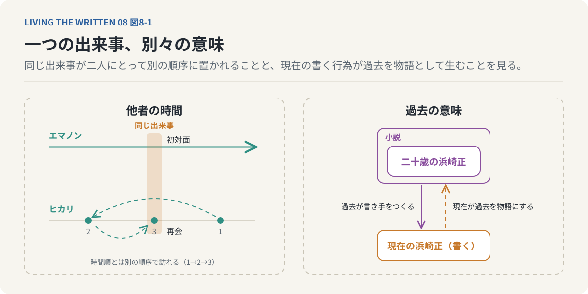
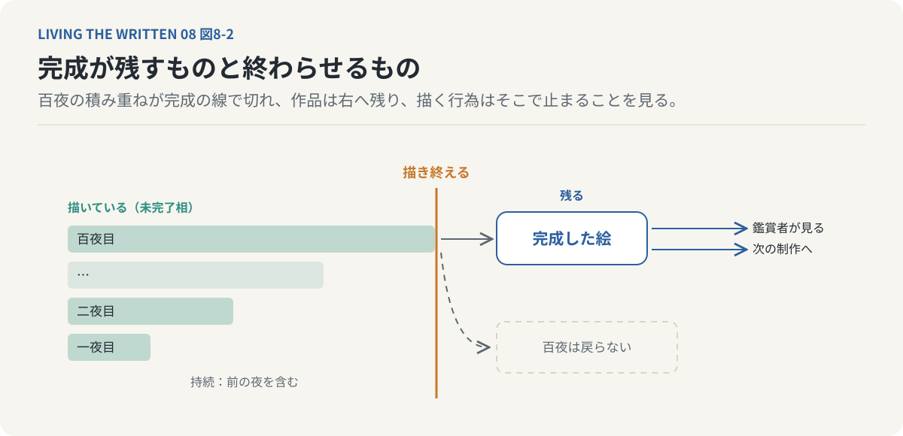
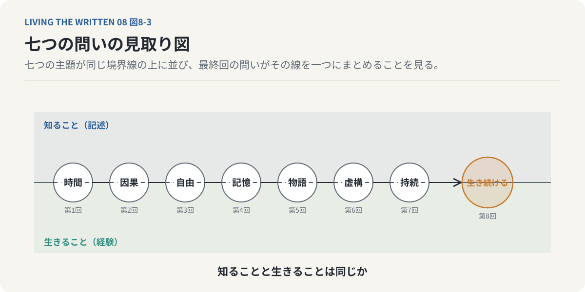
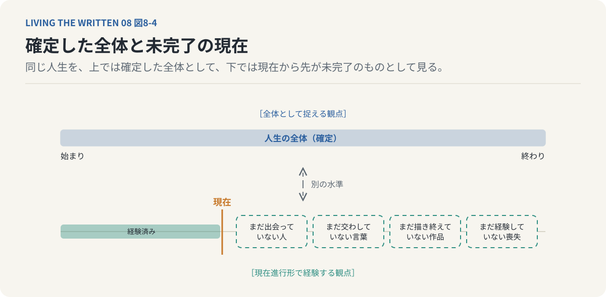
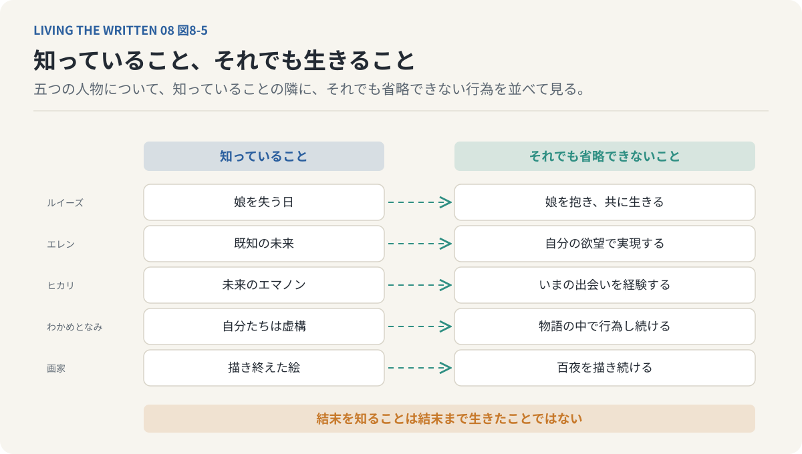

# 第8回　すべてが決まっていても、なぜ私たちは生き続けるのか

## 時間・因果・自由・記憶・物語・虚構・持続の哲学

<!-- NAV:TOP -->
[← 第7回](07-duration-and-incompletion.md) | [連載目次](../README.md)
<!-- /NAV -->

背表紙の割れた文庫本を今年も棚から抜いた。最後の一行まで覚えているし、途中で誰が去るのかも知っている。それでも最初のページを開くと手が止まらなくなる。結末を知っている本を読むのは、読んでいる間に起こることのためである。

私たちは未来が決まっていないから生きる意味があると考えている。けれど未来がすべて決まっているとしたら、誰と出会い誰を失うかも、自分が何を選ぶかさえ最初から確定している。そのとき現在を生きることの意味は宙に浮く。結末が決まっている物語を最後まで生きる理由が見当たらなくなる。

**何かについて知っていることと、それを実際に生きることは同じなのだろうか。**

この連載が七つの回で扱ってきた問題は、時間の認識に始まり完成の喪失に終わる。作品も論点も回ごとに違う。それでも底にあったのはこの一つの問いである。七つの議論をこの問いの周りに並べ直すところから始める。

### 順番に知ることと、全体を知ること

私たちは過去を記憶し現在を経験し未来を予測する。出来事はこの順序で現れ、世界は過去から未来へ一方向に展開しているように見える。出来事を一つずつ順番に知っていく認識の形をこの連載では逐次的認識と呼んできた。

異星人ヘプタポッドは違う。『あなたの人生の物語』[^chiang-story]で彼らが使う書き言葉ヘプタポッドBでは文字の各部分が全体の構造によって決まる。書き手は内容の全体を把握してから書き始める。この言語の構造は過去と未来を一つの全体として認識する時間経験と対応している。言語学者ルイーズはその言語を習得し、未来を記憶のように経験するようになる。全体を先に知るこの形を逐次的認識と対にして同時的認識と呼ぶ。

出来事の順序と認識の順序は別のものとして扱える。私たちはある出来事の後に別の出来事を経験するが、その順序が世界全体の唯一の構造だとは限らない。時間が一方向に流れるという感覚と物理的な時間の非対称性も同じ問題ではない。熱力学的な時間の方向と現在が移動していくという主観的な感覚は分けて考える。ここから出てくるのは時間の流れが存在しないという結論ではない。時間がどのように存在するかと、私たちが時間をどのように経験するかは別の問題だという区別である。

原因が先にあり結果が後から生じると私たちは考えている。物理学には出来事を全体の条件から記述する方法がある。光がある点から別の点へ進むとき、その経路は始点から終点までの伝播時間が停留値を取るという条件で特徴づけられる。フェルマーの原理と呼ばれるこの記述は運動を経路全体の作用から導く変分原理の一例である。局所的な運動方程式と経路全体の変分条件は適切な条件の下で対応するが、だからといって未来の終点が過去に命令を送っているわけではない。

経路全体を用いた数学的な記述と、未来から過去への因果的作用は別のものである。『進撃の巨人』[^isayama-aot]で未来を知る少年エレンは父グリシャの過去の行動に関与する。グリシャの過去の行動がエレンを成立させ、同時に未来のエレンの働きかけがグリシャの行動を成立させる。原因と結果を一方向の連鎖として見るだけではこの構造は捉えきれない。

物理学の変分原理と物語の中の因果ループを同一視することはできない。共通するのは出来事の全体を理解するのに時間的な先後関係だけでは足りないという一点にある。同じことは人生にも言える。ある出来事が起きたとき、私たちはその意味を十分に理解していないことがある。かつての失敗が振り返ると転機になり、何気ない出会いが人生を決めた出来事として読み直される。変わるのは過去の物理的な事実ではなく、出来事全体の中でその過去が占める意味である。

原因が結果を生む。けれど結果を知って初めて原因の意味が見える。私たちは人生を過去から未来へ生きながら、理解するときには現在から過去を振り返っている。経験の方向と解釈の方向は一致しない。

この区別は連載全体に関わっている。行為の意味を理解するとき、私たちは経験した順序だけでなく出来事全体の関係を参照している。人生は過去から未来へと経験される。それでも人生の意味が過去から未来へと順番に確定するわけではない。

### 未来を知っていても、行為は省けない

自分の人生がすべて記された書物があるとする。これから起こる出来事がすべて正確に書かれていて、その未来は変更できない。この本を読んでしまったら自由意志は残らないように思える。

自由をどう考えるかで答えは変わる。別の行動を選べることとしての自由と、自分の欲求や判断に基づいて行為することとしての自由は同じではない。未来が一つに確定していてもその未来を実現する行為が主体自身の欲求や判断から生じている場合がある。

エレンは自由を求める。自由への欲望が既知の未来を実現する力にもなる。その意志は運命から脱出するのではなく、運命を成立させる。

ルイーズは娘が生まれることも娘を失うことも知っている。それでも娘を産み、共に生きる。未来を知っていることと未来を経験したことは異なる。娘との会話を知っていてもその会話は自分で交わさなければならない。娘を抱くことを知っていても、実際に抱くことは別の出来事になる。未来の記憶は現在の経験を代替しない。

「約束する」と口にするとき私たちは約束について説明しているのではない。言うことそのものが約束という行為になる。言語行為論はこれを遂行的な発話と呼ぶ。言葉は既存の事実を説明するだけではなく、適切な条件の下では行為そのものとして働く。同じように未来について知ることと、その未来を実際に成立させることは異なる。

未来が確定しているなら行為は不要になる、とは言えない。その未来には現在の行為そのものが含まれているのだから、行為を取り除けばもはや同じ未来ではない。未来の知識は未来の経験を代替しない。人生の価値は未知の未来が残されていることだけで成立しているわけではない。ここに連載全体の中心へつながる命題の芽がある。

### 他者の時間と、過去の意味

『たゆたいエマノン』[^kajio-emanon]のエマノンはおよそ30億年に及ぶ生命の記憶を受け継いでいる。それほど長い記憶を持ちながら時間は一方向に進む。一方のヒカリは歴史上の異なる時点へ、時間の順序とは別の順序で移動する。それでもヒカリ自身の経験には順序があり、彼女は自分が経験した順に記憶を蓄積していく。二人は異なる時間の系列を生きている。

エマノンにとって初対面の出来事がヒカリにとっては再会かもしれない。ヒカリがすでに記憶している出来事を、エマノンはまだ経験していないかもしれない。同じ出来事を共有していても同じ順序で経験しているわけではない。それでも関係は成立する。共に生きることは同じ時計時間を共有することだけでは説明できない。

現実の人間関係でも私たちは同じ出来事を同じ意味で記憶してはいない。一方にとって忘れられない出来事が他方には何気ない一日だったりする。短い出会いが人生全体に影響することもあれば、長い年月を共に過ごしても互いの人生に深く関わらないこともある。共に生きるとは同じ時間にいることではなく、互いの時間に残ることである。

もちろん時間の共有が不要なのではない。同じ時間を過ごすことは関係をつくる重要な条件だが、関係の意味は共有した時間の長さだけには還元できない。他者は自分と異なる記憶と経験を持つ。その時間を完全に共有することはできない。それでも互いの人生に影響を与えることはできる。存在は孤立した個体の問題ではなくなり、他者との関係の中で自分の人生の意味が形づくられる。

過去が現在を形づくると私たちは考える。過去に何を経験したかで現在の自分が決まる。けれど現在の自分もまた過去の意味をつくっている。ある出来事をどう記憶しどんな物語として理解するかで、その出来事が人生で持つ意味は変わる。

後から読んだ小説が先に読んだ小説の見え方を変えることがある。先行する作品が後続の作品に影響を与えるだけではなく、後続の作品によって先行する作品の読み方が変わる。テクストの意味が他のテクストとの関係で成立するこの性質を間テクスト性と呼ぶ。過去の作品が未来の作品を生み、未来の作品が過去の作品の意味を変える。

『ストロボライト』[^aoyama-strobolight]で現在の浜崎正は小説の中に二十歳の浜崎正を書く。ふつうは過去の経験が書き手をつくる。ところが現在の書く行為によって、二十歳の浜崎正が物語の内部に存在を獲得する。過去が現在を生むだけではなく、現在が過去を物語として生み出す。

物語内部の存在の生成と現実の歴史的事実の変更は別のことであり、過去について文章を書いても過去の出来事が物理的に変わるわけではない。それでも過去の意味は現在の解釈によって変わりうるし、その変化は現在の自分が何者であるかという理解にも及ぶ。私たちは過去の記録を保持しているだけではなく出来事を結びつけて一つの人生として理解している。新しい経験が入るたびにその理解は変わり続ける。

過去は終わっている。けれど過去の意味は終わっていない。過去の事実が確定していても自己の意味が完全に確定しているわけではない。自己は過去の記録の集合ではなく、過去を解釈し続ける存在でもある。

*図8-1：同じ出来事でも経験する順序は人ごとに違う。過去の事実は変わらない。だがその意味は現在の解釈によって生まれ続ける。*

### 構造を知ることと、そこから出ること

虚構の登場人物は現実の人間として存在しない。それでも物語の内部では一定の性質や関係を持つ存在として描かれ、その物語は現実の読者に影響を与える。知ることと存在することの違いがここで形を変えて現れる。

『シン・エヴァンゲリオン劇場版』[^anno-shin-eva]の少年シンジはエヴァンゲリオンのない世界へ向かう。作品は自分自身の虚構性を露出させながら終結へ進んでいく。シンジの解放もまた作品の内部で描かれた出来事であり、虚構の外部へ向かうことさえ虚構の表現として成立している。

『わかめとなみとむげんのものがたり』[^little-thunder-wakame]の二人は自分たちが漫画の登場人物だと知っている。自分たちの行動にはシナリオがある。それでも物語から逃れることはできず、わかめとなみは物語の中で行為し続ける。

自分がどんな構造によって成立しているかを知っても、その構造から直ちに自由になれるわけではない。私たちも社会制度や文化や言語や価値観によって形づくられている。それを認識しても影響から完全には逃れられない。何に囚われているかを知ることと、そこから脱出できることは異なる。構造を知ることは構造を超えることではない。

もう一つの含みがある。登場人物が自分の虚構性を知るという出来事もまた物語として描かれている。物語の外部を知るという認識もこうして物語の内部に取り込まれる。自分が登場人物だと知る登場人物も、依然として一人の登場人物である。人間は自分自身を完全に外側から理解できるのか。

私たちは自分の人生について語れる。語る行為自体も人生の一部になる。自分自身を完全に説明しようとすると、説明している現在の自分が新しい対象として現れる。自己理解が簡単には完結しない理由がここにある。

### 描き終えると、何が終わるのか

絵を完成させ小説を書き終え仕事を成し遂げる。完成によって成果物は一つのまとまりとして確定し、私たちはそれを価値あるものと捉える。完成した成果物とそれを制作していた時間は同じではない。

画家の池永康晟は『君想ふ百夜の幸福』[^ikenaga-hyakuya]を百夜にわたって描く。その間ずっと対象を見つめて思い、描き続ける。描き終えれば描くという行為は終わる。完成した絵は残る。描いていた百夜そのものは戻らない。

「描いている」という言い方は絵がまだないことを言っているのではない。描くという行為がいま進行していることを言っている。文法で未完了相と呼ばれるこの形は、行為がまだ成立していない状態ではなく現在進行形で成立している状態を指す。描き続けることも書き続けることも誰かと会話し続けることも、完了する前から存在している。行為が続いている間にしか成立しない関係がある。

一夜目の経験が二夜目に影響し、二夜目までの経験が三夜目へ引き継がれ、百夜目にはそれまでの経験全体が含まれている。百夜の制作は百個の独立した夜ではない。ベルクソン[^bergson-essai]は時間を均質な瞬間の集合としてではなく、過去を含みながら変化する経験として捉え、これを持続と呼ぶ。この過程の結果が完成した作品であり、制作していた経験そのものではない。完成は作品を確定させる。同時に作品を成立させていた行為を終わらせる。

ただし完成は単なる喪失ではない。作品が完成することで新しい関係が可能になる。読者が読み鑑賞者が見る。作者も次の制作へ進む。完成と未完了は価値の有無で区別されるものではなく、異なる存在の形式である。

*図8-2：百夜は前の夜を含みながら続く。描き終えれば絵は残り新しい関係が始まる。描いていた時間は戻らない。*

作品は完成した対象として存在し、同時にその作品が制作される過程にも固有の経験や関係がある。存在は結果として残るものだけではない。行為が続いている間に成立する関係もまた一つの存在のあり方になる。

### 記述は、経験を代替しない

七つの議論を並べると共通する形が見えてくる。時間の構造を記述することと時間を経験することは違う。人生の結末を知ることと人生を生きることは同じではない。他者について知ることと他者と関係を結ぶことも、過去の出来事を記録することとその意味を現在において理解することも重ならない。自分を成立させる構造を知ることとその構造から自由になることは別である。完成した作品を所有することと制作していた時間を経験することは違う。

どれも記述と経験を分けている。世界についての完全な記述が存在したとしてもその記述は世界の中で行われる経験を代替しない。記述と経験が完全に独立だと言っているのではないし、経験が記述できない神秘的な実体だと断定しているのでもない。出来事についての情報を持つことと、その出来事の当事者として行為することは出来事への関わり方が異なる。

*図8-3：時間から持続まで七つの問いは、知ることと生きることの境界に沿って並ぶ。最終回はその境界を一つの問いとして引き受ける。*

ある会話の内容を知っていてもその会話に参加したことにはならない。誰かの人生を完全に記録できても、その人物として人生を生きたわけではない。完成した絵画のすべての特徴を知っていてもその絵を描いていた百夜を経験したことにはならない。ここに知識と経験の差がある。この差が生きることの意味を考える出発点になる。

勉強するのは知識を得るため、働くのは成果を出すため、旅をするのは目的地へ行くためである。何かを制作するのは作品を完成させるためである。こう考えると行為は結果へ至る手段になり、結果が得られれば行為の目的は達成される。すべての行為がこの形に収まるわけではない。

親しい相手との会話は情報交換だけを目的としていない。すでに知っている話を繰り返し、特に重要な情報がなくても共に時間を過ごすこと自体に価値がある。何度も聴いた音楽を再び聴き、結末を知っている小説を読み返す。その行為には結果を知ることとは別の価値がある。

行為には少なくとも二つの側面がある。ある結果を得るために行われる手段としての側面が一つ。もう一つは、行為すること自体が経験になり結果だけでは価値を説明しきれない経験としての側面である。多くの行為には両方がある。絵を描くことには作品を完成させる目的があり、同時に描いている時間そのものにも価値がある。誰かと共に生きることにはさまざまな目的や期待があり、それでも関係の意味は最終的な結果だけでは決まらない。

人生は最後に何かを完成させるためだけの行為ではない。到達すべき目標はあるが人生の価値のすべてがその達成で決まるわけではなく、生きている間に経験される行為や関係にも固有の価値がある。

自分の人生がすべて記された書物を最後まで読んでしまったとする。これから出会う人物も経験する出来事も最後に迎える死も正確に書かれていて、人生について知らないことは何もない。それでもその人生は終わっていない。明日出会う人を知っていても出会いはまだ先にある。十年後に完成する作品を知っていても制作はまだ始まっていない。その死を知っていても、まだ死んではいない。

ルイーズが娘との人生を知っていることは娘と共に生きる時間を消去しない。エレンが未来を知っていることは彼自身の欲望や判断を歴史から取り除かない。ヒカリが未来のエマノンを知っていても現在のエマノンとの出会いはその時点に固有の経験になる。描き終えた絵画を知っていても描いていた百夜を省略できるわけではない。

未来がすべて決まっているなら人生は無意味だという考えはこの区別を見落としている。未来が確定していることは未来の行為が不要であることを意味しない。むしろ現在の行為を含むからこそ、その未来になる。結末を知っていることは結末まで生きたことではない。この命題は未来が現実にあらかじめ決まっていることを証明するものではなく、決定された未来という仮定の下でも現在の経験が消えないことを示している。未来が確定しているかどうかという問題と経験することの意味は区別して考えられる。

未来がすべて確定していると仮定すると、人生の始まりから終わりまでの出来事の全体が一つの歴史として成立している。その意味では人生の全体が確定していると言える。だがその人生を生きる主体にとって現在の経験はまだ続いている。まだ出会っていない人がいる。まだ交わしていない言葉があり、まだ描き終えていない作品があり、まだ経験していない喪失がある。人生を全体として捉える観点と、現在進行形で経験する観点は別の水準に属する。

描いている最中の絵と同じように、人生が全体として確定していると仮定しても経験としては未完了でありうる。決定論から未完了性が論理的に導かれるのではなく未完了であることだけで人生の価値が証明されるのでもない。示せるのは、全体の確定性と主体が経験する現在進行形の行為を区別できるという一点である。未来が確定しているなら現在は無意味だという推論はこの区別で退けられる。

*図8-4：全体として見れば人生は始まりから終わりまで確定している。現在から見ればまだ会っていない人も交わしていない言葉もある。二つの観点は別の水準にある。*

人間が存在し作品が存在し記録が存在すると言うとき、私たちは存在するものを一つの対象として考えている。会話は一つの物体として存在するわけではない。二人が言葉を交わす行為によって成立し、終われば過去のものになる。記録が残っても記録は会話そのものではない。他者との関係も互いに行為し記憶し影響を与え合うことで成立する。作品の制作でも完成した対象が残る一方で、制作中の関係はつくるという行為によって成立していた。

あるものが一定の状態で存在し記録や成果物として保持される対象としての存在がある。行為や関係が継続することで成立し、時間の中で変化し続ける過程としての存在もある。二つは排他的ではない。人間は身体を持つ存在であり同時に他者と関係を結び行為し経験する存在でもある。すでに完成したものの中にだけ存在があるのではなく、何かを成立させ続ける行為の中にも存在はある。未完了は不足ではなくなり、完成はその存在を否定するものではなく、ある関係を終わらせ別の関係を可能にする変化になる。

### 決まった物語を、なお生き続ける

最初の問いへ戻る。私たちは未来が未知であることに価値を見いだす。何が起こるか分からないから期待し、何を達成できるか分からないから努力し、どんな人生になるか分からないから選択する。これらは人間の時間経験にとって重要な要素である。ただ未来の未知性だけを人生の価値の条件にするなら、未来を知っている存在の人生は無意味になってしまう。

ルイーズはその反例として描かれている。娘との人生を知っていてもその人生を生きる。この行為の価値は未来が分からないことで成立しているのではなく、娘と出会い共に過ごし関係を結ぶことで成立している。人生の意味は未来の不確実性だけに依存せず、最後に何を達成したかだけで決まるのでもない。何を経験し誰と関係を結び何を引き受けて行為したかにも意味がある。

苦痛や喪失を無条件に肯定するのではない。未来が決まっているから不正や苦痛を受け入れるべきだという結論にもならない。現実の私たちは未来について完全な知識を持たず、現在の行為によって状況を変えられる可能性がある。だから結果を予測し、よりよい未来を求めることには重要な意味がある。仮に未来が確定しているとしても、行為することの意味がすべて失われるわけではない。人生の価値は未来が未確定であることだけではなく現在の経験と関係の中にも成立する。

どんな物語にも始まりと展開と結末がある。冒頭では分からなかった出来事が結末で理解でき、何気ない会話が伏線だったと分かる。結末は物語全体の意味を変える。だが結末が分かったからといって読む経験が不要になるわけではなく、結末だけを知っていることと最初から最後まで読んだことは異なる。読み返せば新しい意味が生まれ、結末を知った上で冒頭を読むと以前とは違うものが見えてくる。文章そのものは変わっていない。

変わったのは読者の理解である。間テクスト性と持続はここで重なる。テクストは完成していても読解は完成していない。物語が終わることと物語の意味が終わることは同じではない。

完成した作品はそれ以上書き足されないかもしれないが、読まれ記憶され別の作品と結びつくことで新しい意味が生まれる。物語は完成しても物語をめぐる関係は持続する。完成は一つの行為を終わらせて別の行為を始める条件にもなる。

人生の結末が決まっているなら生きることは無意味になる、という考えには隠れた前提がある。人生の意味は結末がまだ決まっていないことによって成立するという前提である。これまで見てきた作品はその前提を揺さぶる。

未来を知りながらルイーズは娘と生きる。未来を知りながらも自由を求めたエレンは、自分自身の欲望によってその未来を実現する。エマノンとヒカリは異なる時間の順序を生きながら互いの人生に痕跡を残し、浜崎正は過去を書くことで過去の自分を物語として存在させる。わかめとなみは自分たちが虚構だと知りながらその物語を生きる。描き続けることで画家は描かれる対象との関係を持続させる。

どの人物にも共通しているのは知識と経験の違いである。結末を知っていることは結末まで経験したことではなく、未来を知っていることは未来を実現する行為を不要にしない。そうした行為や関係は人生を構成する付随的な要素ではなく人生そのものの一部になる。

*図8-5：どの人物も結末や構造を知っている。それでも娘を抱き、未来を実現し、出会い、行為し、描き続ける。知ることは生きることを代替しない。*

私たちはいつまでも生き続けられるわけではない。どれほど多くの経験を重ね、どれほど多くの人と関係を結んでも現在進行形の人生はいつか終わる。描き終えた絵画は残るが描いていた時間は戻らない。同じように人が生き終えたとき、その人物の現在進行形の行為は終わる。だがその人物が生きたことで生じた関係や影響がすべて消えるわけではない。他者の記憶に残り、つくった作品や制度が残り、交わした言葉が別の人物の行動に影響し続ける。

何かを残した人生だけが価値ある人生なのではない。他者に記憶されず成果や記録も残らない経験にも生きられていたときの価値がある。ある行為が終わることはその行為が存在しなかったことを意味せず、ある関係が失われることはその関係が無意味だったことを意味しない。終わるからこそ、そこで経験された時間には取り戻せない固有性がある。

終わること自体が価値を保証するのでもない。価値を決めるのは終わりの有無ではなく、終わりがあるという条件の下でどんな行為や関係が実際に成立したかである。人生が終わることと人生を生きたことの意味が消えることは同じではない。

時間はどう認識されるのかという問いから出発して、原因と結果の関係と未来を知る者の自由を考え、異なる時間を生きる者同士の関係を見た。さらに現在の物語が過去の意味をどう形づくるかと、虚構だと知ることが存在の意味を変えるかを問うた。完成がなぜ喪失を伴うのかという最後の問いがこれに続く。これらの問いは一つの問題へ収束する。人生はすでに決まった出来事の集合として理解できるとしてもそれを実際に生きる行為と同じではない。

私たちは人生についての物語を持っている。過去を記憶し現在の自分を理解し未来を予測し、自分が何者でどこから来てどこへ向かうのかを物語として捉える。その物語は人生そのものを代替しない。語ることと生きることは違い、記憶することと経験することは違い、結末を知ることと結末に至ることは違う。

未来を知っていても現在の行為は省略できず、過去が確定していても過去の意味は解釈され続け、物語が完成していても物語を読む経験は終わらない場合がある。存在は完成した結果としてだけではなく過程としても捉えられる。何かを経験し誰かと関係を結び行為し続ける過程である。存在とは決まった物語をなお生き続けることである。

存在と言っても、時間の中で自分の経験を持ち他者との関係を形成し行為し続ける主体を指している。物理的な対象や抽象的な存在のすべてが物語を生きるわけではない。決まった物語という言い方も現実の未来があらかじめ確定していると断定しているのではない。仮に人生の全体が確定していても、そこに含まれる経験は主体にとって現在進行形で生きられるという意味である。私たちは人生の結末を知らない。たとえ結末を知っていたとしても、その人生を生きることは省略できない。

結末が決まっているから人生が無意味なのではない。結末を知っていても、生きなければ経験できないことが人生の意味を形づくる。人生は何が起こるかという情報の集合ではなく、実際に起こる出来事の中で主体が経験し行為し関係を結ぶ過程でもある。その過程を知識だけで省略することはできない。結末は物語の一部であって物語は結末だけで成立するわけではない。始まりがあり途中があり行為があり関係があり、それらが経験されることで一つの人生が成立する。

知っている音楽を再び聴く。結末を知っている物語を読み返し、何度も交わした会話をもう一度交わす。すでに大切だと知っている人と今日も共に過ごす。そこには未知の情報を獲得することとは別の価値がある。経験することと行為することと関係を持続させること、そしていつかそれらを終えることは、人生についての知識だけでは代替できない。

物語は結末によって閉じられるが物語を生きることは結末を知るだけでは完了しない。**すべてが決まっていたとしても、すべてはまだ生きられていない。**だから私たちは生き続ける。

文庫本はまだ半分も進んでいない。この先で誰が去るのかを私は知っている。知っているページを今夜もめくる。ルイーズは娘を失う日を知っている。その娘を、いま抱いている。

---

全8回を終えて。時間の認識から始まった問いは、因果、自由意志、記憶、物語、虚構、持続を経て、存在することの意味へ届いた。この結論も最後の答えとして固定される必要はない。書き終えた文章は読まれることで新しい意味を持ち、読者が別の作品を読み、別の経験を積んで再びこの文章を読めば、以前とは違う意味が生まれるかもしれない。連載はここで終わる。この連載が何を意味するのかは、ここで終わるとは限らない。（全8回・完）

## 参考文献・注記

本文で触れたフェルマーの原理と変分原理、言語行為論の遂行的発話、間テクスト性、ベルクソンの持続、文法の未完了相は、いずれも概説の範囲で述べており、特定の文献からの引用はない。「逐次的認識」「同時的認識」はこの連載の用語である。本文の各章は順に、第1回と第2回、第3回、第4回と第5回、第6回、第7回の議論を振り返っている。

[^chiang-story]: テッド・チャン（Ted Chiang）（1998）. [あなたの人生の物語（Story of Your Life）](https://ja.wikipedia.org/wiki/%E3%81%82%E3%81%AA%E3%81%9F%E3%81%AE%E4%BA%BA%E7%94%9F%E3%81%AE%E7%89%A9%E8%AA%9E)。1998年発表の中編。邦訳はハヤカワ文庫SF『あなたの人生の物語』（早川書房）所収の表題作。言語学者ルイーズがヘプタポッドの文字言語を習得し、未来を記憶として経験するようになる。リンク先は日本語版Wikipediaの項目。
[^isayama-aot]: 諫山創（2009）. [進撃の巨人](https://shingeki.net/)。『別冊少年マガジン』（講談社）2009〜2021年連載。進撃の巨人の継承者が未来の継承者の記憶を見るという設定によって、未来と過去が互いに関与する因果の循環が描かれる。リンク先は公式サイト。
[^kajio-emanon]: 梶尾真治（2020）. [たゆたいエマノン（徳間文庫）](https://www.tokuma.jp/book/b494659.html)。地球に生命が生まれてからの記憶を受け継ぐエマノンと、時代を跳びながら彼女と出会う少女ヒカリの短編集。徳間書店。リンク先は版元の書誌ページ。
[^aoyama-strobolight]: 青山景（2009）. [ストロボライト](https://ja.wikipedia.org/wiki/%E3%82%B9%E3%83%88%E3%83%AD%E3%83%9C%E3%83%A9%E3%82%A4%E3%83%88)。太田出版、2009年。小説家の浜崎正が二十歳の自分を小説として書くことで、書く者と書かれる者の関係が物語の中心になる。リンク先は日本語版Wikipediaの項目。
[^anno-shin-eva]: 庵野秀明（総監督）（2021）. [シン・エヴァンゲリオン劇場版](https://www.evangelion.co.jp/final.html)。2021年公開。物語が自らの虚構性を露わにしながら終わる構造を、本連載は「虚構の外へ出る物語」として扱う。リンク先は公式サイト。
[^little-thunder-wakame]: リトルサンダー（Little Thunder／門小雷）（2020）. [わかめとなみとむげんのものがたり](https://www.goodreads.com/book/show/87730299)。2019年の香港を舞台に、因縁で結ばれた二人が何度生まれ変わっても傷つけ合う物語。終章で二人は自分たちが漫画の登場人物であることを知る。リンク先は邦訳版の書誌ページ。
[^ikenaga-hyakuya]: 池永康晟（2014）. [君想ふ百夜の幸福 池永康晟画集](https://ja.wikipedia.org/wiki/%E6%B1%A0%E6%B0%B8%E5%BA%B7%E6%99%9F)。芸術新聞社、2014年。第一画集。本連載は、描き終えることを喪失として捉える画家の言葉を要旨として扱い、文言は引用していない。リンク先は日本語版Wikipediaの項目。
[^bergson-essai]: アンリ・ベルクソン（Henri Bergson）（1889）. [Essai sur les données immédiates de la conscience（『意識に直接与えられたものについての試論』『時間と自由』）](https://plato.stanford.edu/entries/bergson/)。分割できず質的に変化し続ける内的な時間を「持続」として、時計で測る均質な時間から区別した。本連載の持続の説明はこの区別に基づく。リンク先はスタンフォード哲学百科事典の項目。

<!-- NAV:BOTTOM -->
---

[← 第7回](07-duration-and-incompletion.md) | [連載目次](../README.md)
<!-- /NAV -->
